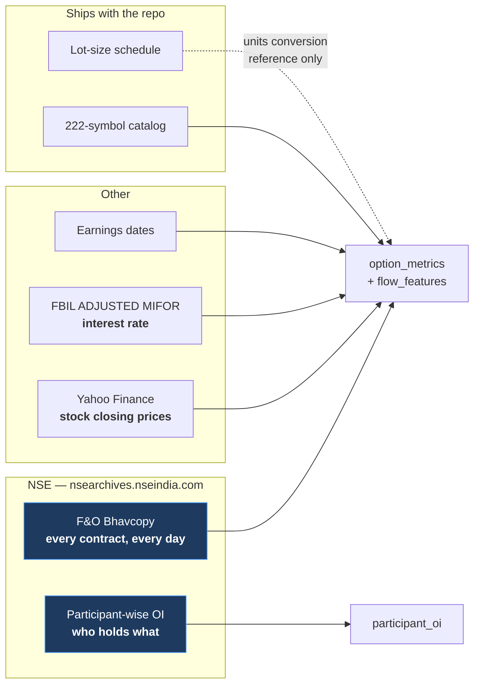

# 2. Data Sources — What We Download and What It Means

[← Market primer](01-market-primer.md) · [Index](README.md) · Next: [Pipeline →](03-pipeline.md)

Five external sources, plus two reference files that ship with the repository. Everything is
**free, public, end-of-day data**. No paid feed, no intraday tick data, no broker API.

---

## 2.1 NSE F&O Bhavcopy — the backbone

> **What it is:** NSE's official end-of-day report of **every single derivatives contract
> that existed that day** — every strike, every expiry, calls and puts, plus all futures.
> "Bhavcopy" comes from *bhav*, Hindi for price/rate.

| | |
|---|---|
| **Command** | `uv run mktmtm fetch-bhavcopy` |
| **Module** | `src/mktmtm/data/bhavcopy.py` |
| **Lands in** | `data/raw/bhavcopy/extracted/` (11 GB) → `filtered/` (9.1 GB) |
| **Coverage** | 1,255 daily files |
| **Volume** | **60.6 million rows** once cached |

### Two file formats, split at 2024-07-08

NSE changed its file format mid-history. This is handled by
`UDIFF_CUTOFF_DATE = 2024-07-08`, and **everything downstream uses the legacy column names**.

| Era | URL pattern |
|---|---|
| Legacy (before 2024-07-08) | `nsearchives.nseindia.com/content/historical/DERIVATIVES/{year}/{month}/fo{DDMMMYYYY}bhav.csv.zip` |
| UDiFF (from 2024-07-08) | `nsearchives.nseindia.com/content/fo/BhavCopy_NSE_FO_0_0_0_{date}_F_0000.csv.zip` |

`normalize_bhavcopy_columns` maps UDiFF names back to legacy ones:

| UDiFF name | Legacy name | UDiFF code | Legacy code |
|---|---|---|---|
| `TckrSymb` | `SYMBOL` | `IDF` | `FUTIDX` |
| `FinInstrmTp` | `INSTRUMENT` | `STF` | `FUTSTK` |
| `XpryDt` | `EXPIRY_DT` | `IDO` | `OPTIDX` |
| `StrkPric` | `STRIKE_PR` | `STO` | `OPTSTK` |
| `OptnTp` | `OPTION_TYP` | | |
| `SttlmPric` | `SETTLE_PR` | | |
| `TtlTradgVol` | `CONTRACTS` | | |
| `OpnIntrst` | `OPEN_INT` | | |
| `ChngInOpnIntrst` | `CHG_IN_OI` | | |
| `UndrlygPric` | `UNDERLYING_PRICE` | | |

Note the last one: UDiFF-era files carry NSE's own underlying price. Legacy files do not, so
the ETL falls back to the near-month futures price there.

### Every field, and what it means in the market

| Field | Type | What it is | Why it matters |
|---|---|---|---|
| `INSTRUMENT` | text | Contract class: `OPTSTK`, `OPTIDX`, `FUTSTK`, `FUTIDX` | Separates stock/index and option/future |
| `SYMBOL` | text | The underlying, e.g. `RELIANCE` | Join key |
| `EXPIRY_DT` | text | Expiry date, `27-Jun-2024` format | Days-to-expiry; separates near from far month |
| `STRIKE_PR` | float | Strike price (0 for futures) | Where the position sits relative to spot |
| `OPTION_TYP` | text | `CE` call, `PE` put, `XX` for futures | Direction of the bet — partially |
| `OPEN` `HIGH` `LOW` `CLOSE` | float | The contract's own OHLC that day | Price action of the option itself |
| `SETTLE_PR` | float | **Official settlement price** | The correct mark. Exists even if the contract never traded, where `CLOSE` would be a stale last-traded price. Used for IV and for the futures basis. |
| `CONTRACTS` | int | Volume traded today | Activity — but includes intraday churn |
| `VAL_INLAKH` | float | Traded value in lakhs (₹100,000) | Not used |
| `OPEN_INT` | int | **Open interest, in shares** | Positions currently open and carrying risk |
| `CHG_IN_OI` | int | **Change in open interest, in shares** | ⭐ *New positioning* — the most important field in the project |
| `TIMESTAMP` | text | Trade date | Join key |

> ⚠️ **`OPEN_INT` and `CHG_IN_OI` are in shares, not contracts.** Divide by the lot size to
> get contracts. Verified against participant data to within 0.02%. See
> [the primer](01-market-primer.md#4-open-interest-vs-volume-the-key-distinction).

### Instrument mix across the 60.6M rows

| Instrument | Rows | Share |
|---|---|---|
| `OPTSTK` — stock options | 52,829,025 | 87.2% |
| `OPTIDX` — index options | 7,028,460 | 11.6% |
| `FUTSTK` — stock futures | 733,488 | 1.2% |
| `FUTIDX` — index futures | 18,911 | 0.03% |

Stock options dominate overwhelmingly, which is why the option chain is the primary signal
source and futures are a thin but high-quality secondary one.

---

## 2.2 Yahoo Finance — the underlying price

> **What it is:** The daily closing price of the actual stock. Bhavcopy tells you about the
> *contracts*; this tells you what the *stock* did.

| | |
|---|---|
| **Command** | `uv run mktmtm fetch-yahoo` |
| **Module** | `src/mktmtm/data/yahoo.py` |
| **Endpoint** | `query1.finance.yahoo.com/v8/finance/chart/{SYMBOL}.NS` |
| **Lands in** | `data/raw/yahoo_finance/` — `{SYMBOL}_raw.json` + `{SYMBOL}_processed.json`, 434 files |

### The two price series, and why mixing them corrupts data

Yahoo returns **two** price series, and they are for different purposes. Confusing them is
the single most damaging mistake possible in this pipeline.

| Series | Stored as | What it is | Correct use |
|---|---|---|---|
| **Raw / unadjusted** | `underlying_price` | The actual price printed that day | ⭐ Strike selection, IV, Greeks, futures basis, moneyness |
| **Adjusted** | `underlying_price_adj` | Back-adjusted for splits, bonuses, dividends | ⭐ Returns, momentum, training labels |

**Why raw for strikes.** If a stock splits 1:2, its price halves overnight. The *adjusted*
series rewrites all history so there is no jump. But NSE's strikes and settlement prices are
**unadjusted** — the bhavcopy for last year really does show a ₹2,000 strike. Matching an
adjusted ₹1,000 price against unadjusted ₹2,000 strikes picks entirely the wrong part of the
chain.

**Why adjusted for returns.** The reverse. A 1:2 split is not a −50% return. Using raw prices
for returns invents a catastrophic loss that never happened.

Getting this backwards corrupted roughly **10% of implied-volatility rows** before it was
caught. Full account: [`docs/data/iv-integrity-audit.md`](../data/iv-integrity-audit.md).

**Known gap.** FINNIFTY and MIDCPNIFTY have no working Yahoo ticker, so they have no spot
source and are legitimately absent from the dataset.

---

## 2.3 NSE Participant-wise Open Interest — the only named data

> **What it is:** Once per day, NSE publishes how many contracts each *category* of market
> participant holds. It is the only public source that attaches an identity to a position.

| | |
|---|---|
| **Command** | `uv run mktmtm fetch-participant-oi` |
| **Module** | `src/mktmtm/data/participant_oi.py` |
| **URL** | `nsearchives.nseindia.com/content/nsccl/fao_participant_oi_{DDMMYYYY}.csv` |
| **Lands in** | `data/raw/participant_oi/` — 1,258 CSVs |
| **Coverage** | 2021-08-02 → 2026-09-03, **1,258 days × 5 categories = 6,290 rows** |

### The five participant categories

See [the primer](01-market-primer.md#10-who-is-actually-trading) for who these are. `Pro` —
broker proprietary desks — is the dealer/market-maker proxy this project uses.

### The 14 measured columns

Each is a **contract count**. Every row is one participant category on one day.

| Column | Meaning |
|---|---|
| `future_index_long` / `_short` | Index futures held long / short |
| `future_stock_long` / `_short` | Stock futures held long / short |
| `option_index_call_long` / `_short` | Index call options bought / written |
| `option_index_put_long` / `_short` | Index put options bought / written |
| `option_stock_call_long` / `_short` | Stock call options bought / written |
| `option_stock_put_long` / `_short` | Stock put options bought / written |
| `total_long_contracts` / `total_short_contracts` | Row totals |

**Derived on read** (never stored, so the table stays a faithful copy of NSE's file):
`net_*` = long − short for each pair, and `d_net_*` = the day-over-day change, which is the
actual *flow*.

### Two integrity properties, and one that is only nearly true

1. Every open long is somebody's short, so the `TOTAL` row's long and short legs must match.
2. The five categories must sum to the `TOTAL` row.

Both hold — **to within 1 contract**. NSE rounds each leg independently, so a perfectly valid
file can be off by one. An exact equality check here silently rejected **14 legitimate
trading days** before this was measured and a tolerance of 2 added. That is why the
validator has tests pinning *both* sides: it must accept NSE's rounding and still catch real
corruption.

### The limitation that defines the project

**This data has no symbol breakdown.** It says institutions bought 50,000 stock calls today.
It cannot say in which stock. Joined to a per-symbol table on date alone, it takes the same
value for every symbol on that date and therefore contributes **exactly zero** to any
cross-sectional comparison.

Its legitimate uses are: validating what dealers actually do (which is how `DEALER_SIGN` was
measured), settling questions of units, market-level regime labelling, and checking whether a
per-symbol feature's *market aggregate* tracks real institutional flow.

---

## 2.4 FBIL ADJUSTED MIFOR — the interest rate

> **What it is:** The risk-free-ish rate used in option pricing. MIFOR (Mumbai Interbank
> Forward Offer Rate) is India's benchmark for this, published by Financial Benchmarks India.

| | |
|---|---|
| **File** | `data/reference/ADJUSTED_MIFOR.csv` (ships with the repo) |
| **Module** | `src/mktmtm/data/rates.py` |
| **Stored as** | `option_metrics.interest_rate`, **in percent** (6.5 means 6.5%) |

Every option-pricing formula needs an interest rate — it is the *r* in Black-Scholes, and it
is also the cost of carry that sets the fair futures basis.

Rates are not published every calendar day, so `get_rate_with_fallback` uses the nearest
prior observation. **Beyond 7 days** (`_MAX_RATE_STALENESS_DAYS`) that stops being an
interpolation and becomes a fabricated constant, so staleness is tracked rather than hidden.

---

## 2.5 Earnings dates

> **What it is:** When each company announces results. Implied volatility rises predictably
> into an earnings date and collapses after it, so "days until earnings" is a genuine
> confounder for any volatility feature.

| | |
|---|---|
| **File** | `data/reference/earning_dates.json` |
| **Module** | `src/mktmtm/data/earnings.py` |
| **Becomes** | `option_metrics.upcoming_earning_date` → `ml_dataset.days_to_earnings` |

Shape: a list of `{date, trading_symbol, event_type, description}` records.

---

## 2.6 The symbol catalog (ships with the package)

| | |
|---|---|
| **Location** | `mktmtm.data.catalog`, loaded via `importlib.resources` |
| **Table** | `symbol_data`, **222 rows** |
| **Columns** | `symbol_name`, `symbol_title`, `symbol_type`, `symbol_bse_code`, `isin_code`, `dhan_underlying_security_id`, `underlying_segment` |

222 catalogued symbols; **217 reach `ml_dataset`** (214 individual securities + 3 indices:
NIFTY, BANKNIFTY, NIFTYNXT50).

The five absentees:

| Symbol | Why |
|---|---|
| `FINNIFTY`, `MIDCPNIFTY` | No working Yahoo ticker → no spot price. Legitimate. |
| `LTIM`, `PEL`, `TATAMOTORS` | Zero rows — an open issue, not yet explained. |

> `data/symbols.py` is **load-only** and must never regenerate the catalog.

---

## 2.7 Lot sizes (ships with the repo)

| | |
|---|---|
| **File** | `data/reference/lot_sizes.csv`, 853 rows |
| **Module** | `src/mktmtm/data/lots.py` |
| **Shape** | `symbol, effective_from, lot_size, source` |

A sparse **change-point schedule**, not a constant. All 217 dataset symbols are covered, with
a median of 3 revisions each and a maximum of 8. `source` is `nse_circular`, `nse_bhavcopy`,
or `derived` (reconstructed and approximate — concentrated in the early years).

Its only role is converting between shares and contracts. Because `OPEN_INT` is already in
shares, notional values are computed as `oi × spot` with **no lot factor at all**.

---

## Summary

| Source | Grain | Rows | Names participants? | Per symbol? |
|---|---|---|---|---|
| Bhavcopy | contract × day | 60.6M | ❌ | ✅ |
| Yahoo | symbol × day | ~272K | ❌ | ✅ |
| Participant OI | category × day | 6,290 | ✅ | ❌ |
| MIFOR | day | — | — | ❌ |
| Earnings | event | — | — | ✅ |

The tension in the last two columns is the whole research problem: the data that names
participants has no symbols, and the data with symbols names nobody.

[← Market primer](01-market-primer.md) · [Index](README.md) · Next: [Pipeline →](03-pipeline.md)
