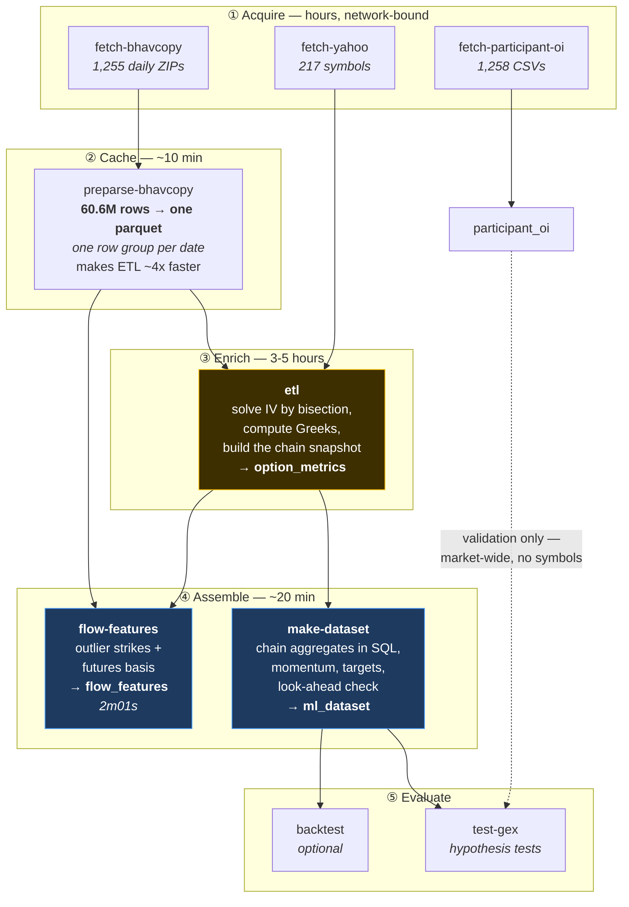
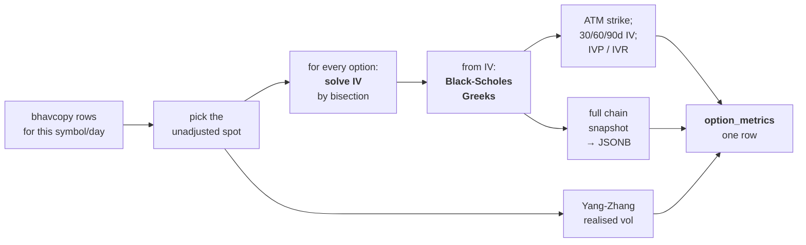

# 3. Pipeline — How Raw Files Become a Training Matrix

[← Data sources](02-data-sources.md) · [Index](README.md) · Next: [Database →](04-database.md)

The shape of the whole system is **raw files → PostgreSQL fact table → ML matrix**, with
pure-mathematics modules underneath that never touch input or output.

---

## 3.1 The full pipeline



### Commands, in order

```bash
uv run mktmtm fetch-bhavcopy        # NSE F&O bhavcopy      → data/raw/bhavcopy/
uv run mktmtm fetch-yahoo           # daily closes          → data/raw/yahoo_finance/
uv run mktmtm fetch-participant-oi  # participant-wise OI   → participant_oi
uv run mktmtm preparse-bhavcopy     # parquet cache  ← re-run after EVERY fetch
uv run mktmtm etl                   # threaded per-symbol ETL → option_metrics
uv run mktmtm make-dataset          # features + targets    → ml_dataset (+ parquet)
uv run mktmtm flow-features         # outlier strikes + basis → flow_features (+ parquet)
uv run mktmtm backtest              # optional
```

Smoke runs: `make-dataset --limit-symbols RELIANCE,TCS --limit-dates 30`,
`flow-features --limit-dates 5`, `backtest --symbols X --years 2024 --months 1`.

`MKTMTM_NO_PROGRESS=1` forces log lines instead of progress bars — also automatic when
stderr is not a terminal, so `mktmtm etl > run.log` stays readable.

---

## 3.2 Stage 2: the parquet cache

Re-parsing 1,255 CSVs once per symbol means reading the same files 217 times. Instead,
`preparse-bhavcopy` writes everything into **one parquet file**, and the ETL slices it.

Two earlier versions of this failed on a 14 GiB host, and how it works now is a direct
consequence:

| Approach | Outcome |
|---|---|
| A dict of per-symbol DataFrames | Duplicated every row — **OOM at 12.5 GB** |
| Boolean-masking the full frame per symbol | Memory-safe but re-scanned 60M rows 217 times — impractically slow |
| **One sorted frame + a `{symbol: (start, stop)}` offset map** | ✅ Peak ~9 GB, `df.iloc[start:stop]` per symbol |

> ⚠️ **A subtle trap.** The parquet stores text columns as `category` (dictionary-encoded, to
> keep the file small), and each row group carries its own dictionary. Read back, the
> categories follow *first-appearance* order across 1,254 row groups — **not alphabetical**.
> Sorting then orders by category *code*, leaving the column unsorted for `searchsorted`,
> which silently returns nonsense spans. In one five-year build this dropped 75 of 222 symbols
> and gave TATASTEEL/TATAPOWER/TATAMOTORS spans holding *other symbols'* rows. The fix is
> casting to `str` before sorting; an assertion now makes any regression loud.

The cache is also written **one row group per trade date**, which is what lets
`flow-features` stream a day at a time instead of loading 60M rows.

---

## 3.3 Stage 3: the ETL, where the real computation happens

This is the expensive stage (3–5 hours for five years) and the one that cannot be repaired
later. For each `(symbol, date)` it:



Concretely:

1. **Pick the spot** — unadjusted, from bhavcopy's own `UNDERLYING_PRICE` where present, else
   the near-month futures price.
2. **Solve implied volatility** for every option, by bisection on the settlement price.
3. **Compute the Greeks** from that IV — delta, gamma, theta, vega, rho, vanna, charm.
4. **Snapshot the whole chain** as JSONB — ~233 entries per row, ~49.5M in total.
5. **Realised volatility** via Yang-Zhang from the futures OHLC.
6. **Pick the at-the-money strike** and lift its CE/PE detail into dedicated columns.
7. **Gamma flip level** — the spot price at which net dealer gamma crosses zero, found by
   evaluating on a ±10% grid and interpolating the crossing.

> ⚠️ **Re-running `make-dataset` cannot repair IV, strike or Greek defects.** Those are baked
> into `option_metrics` at ETL time. Fixing them requires a full ETL re-run.

### The legacy twin

`pipeline/process.py` computes the same enrichment against JSON files instead of Postgres. It
feeds only the old UI, not the ML path. **Any change to enrichment logic must land in both**,
or they silently diverge — the constants `_IV_WINDOW = 252` and `_IV_MIN_PERIODS = 60` are
duplicated in each file precisely because they must match, and an anti-divergence test keeps
the two chain builders byte-identical.

---

## 3.4 Stage 4: assembling the training matrix

`make-dataset` reads `option_metrics` and produces `ml_dataset`:

1. **Base load** — scalar columns, `ORDER BY symbol, date`.
2. **Chain aggregates in SQL** — max pain, walls, GEX, DEX, HHI and friends, computed with
   lateral joins over `jsonb_array_elements`. This is in SQL because a Python pass over
   ~49.5M chain elements takes minutes.
3. **Lift CE/PE** — flatten the ATM option's JSONB into columns.
4. **Derived features** — momentum, spreads, ratios, day counts.
5. **Targets** — forward-shifted per symbol.
6. **Look-ahead validation** — raises rather than writing a corrupt table.
7. **Corporate-action screening** — blanks contaminated rows, with logging.

`flow-features` runs independently off the cache and `option_metrics`, and writes
`flow_features`. It does **not** touch `ml_dataset`, so a candidate feature can be built and
tested without disturbing a validated matrix.

---

## 3.5 The invariants — what breaks silently if you get it wrong

Each of these encodes a bug that actually happened.

### Two price series, two purposes
`underlying_price` (raw) for strikes, IV, Greeks and basis. `underlying_price_adj` for
returns, momentum and labels. Mixing them corrupted ~10% of IV rows.
[Details](02-data-sources.md#the-two-price-series-and-why-mixing-them-corrupts-data).

### `NULL` is never a number
`implied_volatility_bisection` returns `None`, never a sentinel. The old `0.0` / `500.0`
returns were "garbage wearing a number's clothes" and propagated into every derived
volatility feature. The same rule governs the newer tables: a symbol-day with no outlier
strikes has a count of 0 but **NULL** ratios, because with nothing flagged there is nothing to
average.

### Row order is load-bearing
Every momentum feature is a `groupby().pct_change()`. The SQL `ORDER BY symbol, date` and the
explicit re-sorts in `_add_derived`, `_add_targets` and `screen_corporate_actions` are not
cosmetic. A merge that quietly reorders rows produces features that look fine and are wrong.

### Column lists are a contract
`DATASET_COLUMNS` in `ml/dataset.py` is the single source of truth for column identity *and
order*; `sql/init_ml_dataset.sql` mirrors it. `FLOW_COLUMNS` has the same relationship with
`init_flow_features.sql`, enforced by a test that parses the DDL.

### Targets are NULL on the most recent day
There is no "tomorrow" for the last row of each symbol. Those are **inference** rows, never
training rows. `next_day_rv_5d` needs five trailing NULLs, not one, because its window spans
five forward days.

### Corporate actions are blanked, not dropped
`screen_corporate_actions` NULLs contaminated features and logs every one. Dropping rows
instead is how survivorship bias creeps in. An unscreened split poisons three things at once:
the momentum features spanning it, the *label* on the preceding row, and the scale of every
fitted model — a −65% observation is a 40-sigma event in a series with σ ≈ 1.6%.

---

## 3.6 How a feature is allowed to claim it works

Two rules, both learned the hard way.

**1. Control for implied volatility.** IV is the strongest predictor of near-term movement in
this data, so a new feature can score well by merely re-expressing it. Every feature is judged
on its **partial** correlation after residualising against `ce_iv_30`.

The cautionary example is `oi_outlier_moneyness`: raw rank IC **+0.0368**, partial IC
**+0.0004**. It dies completely.

**2. Normalise within symbol, not across symbols.** Most exposure measures scale with the
size of the stock — a large company has bigger everything. Pooling all symbols then ranks
them by size and calls it signal. This is exactly what invalidated the project's original
pooled result.

The correct form is a **causal within-symbol z-score**: expanding window, `shift(1)` so today
is never in its own baseline, minimum 60 prior observations.

**3. Split honestly.** Purged walk-forward cross-validation with an embargo equal to the
label horizon. Financial data is autocorrelated; an ordinary random split leaks the future.

---

## 3.7 Why there is no simple supervised model

The obvious approach — feed the 69 features to a neural network and predict institutional
activity — is not available, for a specific reason:

**There is no label.** Nobody publishes "an institution accumulated a position in RELIANCE on
2026-03-14." Every target in `ml_dataset` is a *price* or *volatility* outcome:

| Target | What it actually measures |
|---|---|
| `next_day_return` | Tomorrow's price change |
| `next_day_direction` | Up or down |
| `next_day_abs_return` | Size of tomorrow's move |
| `next_day_rv_5d` | Realised volatility over the next 5 days |
| `next_day_iv_chg` | Change in implied volatility |
| `next_day_vrp` | Realised minus implied |

All six are price-prediction proxies. Training on them answers a question the project
explicitly is not asking.

`participant_oi` is the only genuine flow label — and it has no symbol breakdown.

So the modelling direction follows from the data, not from preference:

| Level | Label? | Right tool |
|---|---|---|
| **Market-wide** (1,253 days) | ✅ real, from `participant_oi` | Gradient boosting / regularised linear. Far too few rows for a deep network. |
| **Per symbol** (212,441 rows) | ❌ none exists | Unsupervised latent-state models (HMM) |

An MLP is wrong in both places: at market level it would memorise 1,253 rows; per symbol
there is nothing to supervise it with.

---

## 3.8 Where each stage's code lives

```
data/          bhavcopy, yahoo, participant_oi, rates, earnings, lots, symbols
options/       pricing (Black-Scholes + bisection IV), volatility (Yang-Zhang),
               chain (ATM pick, time to expiry), dealer_exposure (GEX/DEX, gamma flip)
                 └── pure functions, no I/O, unit-tested standalone
storage/       db.DBWriter (pooled, batched UPSERT, NaN scrub) → option_metrics
               etl.py         threaded per-symbol ETL — THE path feeding the ML dataset
               etl_chunked.py single-pass sharded variant, no IVP/IVR
ml/            dataset.py (the matrix), gex_hypothesis.py, splits.py, metrics.py, baselines.py
features/      flow.py — outlier strikes + futures basis
gex_features.py    fast recompute of just the dealer columns
pipeline/      process.py — LEGACY JSON twin of etl.py; feeds only the old UI
backtest/      short-strangle + weekly delta hedge
ui/            Streamlit control panel; steps run as detached subprocesses
```

[← Data sources](02-data-sources.md) · [Index](README.md) · Next: [Database →](04-database.md)
