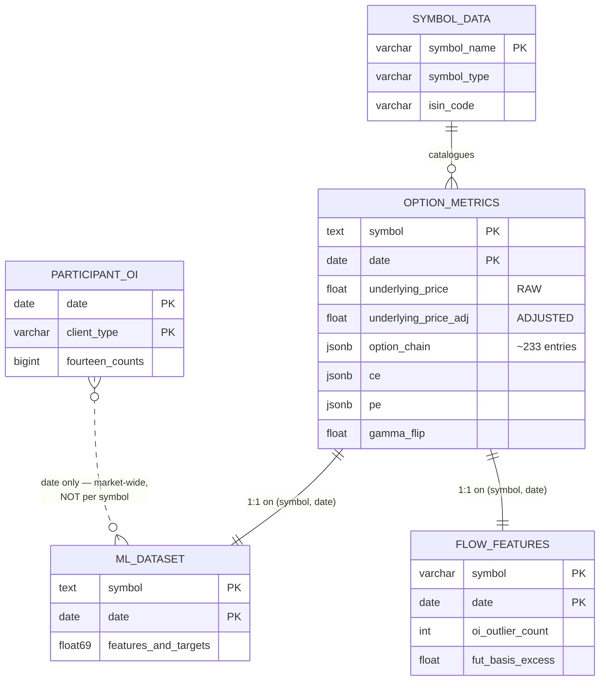

# 4. Database — Every Table, Every Column

[← Pipeline](03-pipeline.md) · [Index](README.md) · Next: [Derived features →](05-derived-features.md)

PostgreSQL, six tables, **25 GB** total. Bootstrap is idempotent and safe to re-run:

```bash
psql "$PG_DSN" -f src/mktmtm/storage/sql/init_db.sql   # runs all DDLs in dependency order
uv run python scripts/verify_db_health.py              # health gate; exits 1 on structural flaws
```

---

## 4.1 The tables at a glance



| Table | Rows | Size | Grain | Purpose |
|---|---|---|---|---|
| `option_metrics` | 212,441 | **24 GB** | symbol × day | The fact table — full enriched option chain |
| `ml_dataset` | 212,441 | 341 MB | symbol × day | Flat training matrix, 69 columns |
| `flow_features` | 212,441 | 45 MB | symbol × day | Candidate flow features, 20 columns |
| `participant_oi` | 6,290 | small | category × day | Named participant positions, market-wide |
| `symbol_data` | 222 | small | symbol | The F&O catalogue |
| `backtest_results` | 0 | — | trade | Strangle backtest output (unpopulated) |

**Coverage:** 2021-08-02 → 2026-08-28, 1,254 trading days, 217 symbols.
`participant_oi` runs four days further, to 2026-09-03 (1,258 days), because it does not
depend on the bhavcopy fetch.

The three big tables join **one-to-one** on `(symbol, date)` — verified: all 212,441 rows.

---

## 4.2 option_metrics: the fact table

The centre of the system. One row per symbol per trading day, holding both scalar summaries
and the entire option chain as JSON.

```sql
PRIMARY KEY (symbol, date)
```

| Column | Type | Meaning |
|---|---|---|
| `symbol` | text | Underlying symbol |
| `date` | date | Trading day |
| `underlying_price` | float | ⭐ **Raw / unadjusted** spot. The only correct basis for strikes, IV, Greeks, moneyness and basis. |
| `underlying_price_adj` | float | ⭐ **Adjusted** close. The only correct basis for returns and labels. |
| `interest_rate` | float | MIFOR rate, **in percent** (6.5 = 6.5%) |
| `strike_price` | float | The at-the-money strike chosen for this day |
| `expiry_30d` / `_60d` / `_90d` | date | The three nearest expiries |
| `upcoming_earning_date` | date | Next results date for this company |
| `rv_yz` | float | Yang-Zhang realised volatility, **decimal** (0.072 = 7.2%) |
| `gamma_flip` | float | Spot level where net dealer gamma crosses zero; NULL if no crossing in ±10% |
| `ce` | jsonb | The ATM **call**'s full detail |
| `pe` | jsonb | The ATM **put**'s full detail |
| `option_chain` | jsonb | ⭐ **The entire chain** — every strike, both types, all expiries |
| `extras` | jsonb | Spare; currently `{}` |

> ⚠️ Note the unit mismatch: `rv_yz` is a decimal fraction while the `iv_*` values are
> percent-scale. Anything comparing them must multiply by 100 — which
> [`iv_rv_spread`](05-derived-features.md#volatility-relationships) does.

### The `ce` / `pe` JSONB shape

The at-the-money option, lifted out for convenience:

```json
{
  "oi": 2237500,
  "volume": 40703,
  "open": 16.0, "high": 21.0, "low": 16.0, "close": 19.15,
  "last_price_30d": 19.15,
  "iv_30": 17.360967826001293,
  "iv_60": 18.009683781193225,
  "iv_90": 26.09332477023889,
  "ivp": 26.190476190476193,
  "ivr": 37.66120999940527,
  "greeks": {
    "delta": -0.39609541520698793,
    "gamma": 0.005824642952239037,
    "theta": -0.28592920116386283,
    "vega":  1.4683529233022545,
    "rho":  -0.46370100212608834,
    "vanna": -0.4706802755556141,
    "charm": -0.11533730375069283
  }
}
```

`_lift_ce_pe` flattens these into the `ce_*` / `pe_*` columns of `ml_dataset`.

### The `option_chain` JSONB shape

An array of one object per contract. **~233 entries per row on average; ~49.5 million in
total.** This is where the 24 GB lives.

```json
{
  "type": "PE",
  "strike": 1320.0,
  "expiry": "23-Nov-2026",
  "open": 0.0, "high": 0.0, "low": 0.0, "close": 58.2,
  "settle": 70.48,
  "volume": 0,
  "oi": 0,
  "chg_oi": 0,
  "iv": 26.239643608442755,
  "delta": -0.49581871813964845,
  "gamma": 0.0024196359943878106,
  "vanna": 0.178825442259777,
  "charm": -0.3399381888870251
}
```

| Field | Meaning |
|---|---|
| `type` | `CE` call or `PE` put |
| `strike` | Strike price |
| `expiry` | Expiry, `DD-Mon-YYYY` |
| `open/high/low/close` | The option's own price action |
| `settle` | ⭐ Official settlement — the mark used for IV |
| `volume` | Contracts traded today |
| `oi` | Open interest, **in shares** |
| `chg_oi` | ⭐ Change in open interest — *new positioning* |
| `iv` | Implied volatility, percent-scale; **`null` when it did not converge** |
| `delta` `gamma` `vanna` `charm` | Greeks. Fall back to `0.0` when IV did not converge — a documented exception, because `delta` is consumed by the backtester and an index. |

Chain aggregates are computed **in SQL** with lateral joins over `jsonb_array_elements`,
because a Python pass over 49.5M elements takes minutes.

---

## 4.3 `ml_dataset` — the training matrix

Flat, 69 columns, one row per symbol-day. `DATASET_COLUMNS` in `ml/dataset.py` defines
identity *and* order; `init_ml_dataset.sql` mirrors it.

Grouped as the code groups them:

| Group | Count | Columns |
|---|---|---|
| **Identity** | 2 | `symbol`, `date` |
| **Level** | 3 | `underlying_price`, `interest_rate`, `rv_yz` |
| **CE/PE** | 26 | `ce_iv_30`…`pe_oi` — the ATM option's IV, percentiles, Greeks, price, volume, OI |
| **Tier 2** | 9 | `ret_1d`…`days_to_earnings` — momentum, spreads, day counts |
| **Tier 3** | 9 | `atm_straddle`…`chain_breadth` — chain-wide summaries |
| **Dealer (GEX)** | 14 | `dex`…`dist_to_flip` — dealer exposure and structure |
| **Targets** | 6 | `next_day_return`…`next_day_vrp` |

Every one is explained in [derived features](05-derived-features.md).

> ⚠️ In `ml_dataset`, the column named `underlying_price` holds the **adjusted** price —
> `ml/dataset.py` aliases `underlying_price_adj` to that name on load, because everything in
> this table is returns and labels. The raw price stays in `option_metrics`.

**Targets are NULL on each symbol's most recent day** — inference rows, never training rows.

---

## 4.4 `flow_features` — candidate features under evaluation

Built 2026-09-04. Deliberately a **separate table** rather than new `ml_dataset` columns:
these are candidates, and promoting one means editing `DATASET_COLUMNS`, the DDL, and
re-running `make-dataset`. That should happen once a feature has earned it.

```sql
PRIMARY KEY (symbol, date)
```

### Outlier-strike family

| Column | Type | Meaning |
|---|---|---|
| `oi_outlier_count` | int | Contracts flagged as extreme that day (0 on a quiet day) |
| `oi_outlier_max_absz` | float | Strongest robust \|z\| among them |
| `oi_outlier_share` | float | Flagged \|chg_oi\| ÷ the day's whole chain \|chg_oi\| |
| `oi_outlier_call_frac` | float | Call share of flagged activity |
| `oi_outlier_moneyness` | float | Weighted mean `(K − S) / S` — how far OTM |
| `oi_outlier_dte` | float | Weighted mean days to expiry |
| `oi_outlier_build_notional` | float | Rupees of position **opened** |
| `oi_outlier_unwind_notional` | float | Rupees of position **closed** |

### Futures family

| Column | Type | Meaning |
|---|---|---|
| `fut_dte` | int | Near-month days to expiry |
| `fut_basis` | float | Near-month mark − spot, in rupees |
| `fut_basis_pct` | float | `mark / spot − 1` |
| `fut_basis_annual` | float | Annualised %, **NULL below 5 days to expiry** |
| `fut_basis_excess` | float | ⭐ Annualised basis **minus the carry rate** — the strongest feature in the project |
| `fut_oi` | bigint | Near-month open interest, **in shares** |
| `fut_oi_chg` | bigint | Change in it, in shares |
| `fut_volume` | bigint | Contracts traded |
| `fut_oi_notional` | float | `oi × spot` — no lot factor |
| `fut_oi_chg_notional` | float | `chg_oi × spot` |
| `fut_roll_ratio` | float | `next_oi / (near_oi + next_oi)` — how far the roll has progressed |
| `fut_roll_spread` | float | `(next − near) / near` |

**NULL means "not computable", never 0.** A day with no outlier strikes has `count = 0` and
`share = 0` — both real measurements — but NULL for the weighted means, because with nothing
flagged there is nothing to average. A 0 there would be indistinguishable from a genuine
at-the-money reading.

Coverage: 34,288 of 212,441 symbol-days (16.1%) carry an outlier; 176,067 (82.9%) have
`fut_basis_excess` (the rest are inside the 5-day annualisation cutoff).

---

## 4.5 `participant_oi` — the only named data

```sql
PRIMARY KEY (date, client_type)
```
plus `idx_participant_oi_client_date` for the common access pattern — one participant's
series through time.

`client_type` ∈ `{Client, DII, FII, Pro, TOTAL}`. All 14 measured columns are **contract
counts** (BIGINT); see [data sources](02-data-sources.md#the-14-measured-columns) for the
list and meaning.

Only NSE's raw columns are stored. Net positions and day-over-day flows are derived on read
by `add_net_positions`, so the table stays a faithful copy of the source file.

> ⚠️ **This is market-wide data.** Joined to `ml_dataset` on date alone it is constant within
> a date and contributes exactly zero to any cross-sectional comparison. Use it for
> dealer-sign validation, units checks, and market-level regime work — never as a per-symbol
> feature.

---

## 4.6 `symbol_data` and `backtest_results`

**`symbol_data`** — 222 rows, the shipped F&O catalogue.

| Column | Meaning |
|---|---|
| `symbol_name` | NSE trading symbol (join key) |
| `symbol_title` | Full name |
| `symbol_type` | `individual_securities` or `index_futures` |
| `symbol_bse_code`, `isin_code` | Cross-reference identifiers |
| `dhan_underlying_security_id`, `underlying_segment` | Broker-API identifiers |

**`backtest_results`** — 18 columns, one row per simulated short-strangle trade
(entry/exit dates, strikes, deltas, prices, P&L in points, hedge P&L, skip reason).
Currently **0 rows**; the backtester exists but has not been run over the rebuilt data.

---

## 4.7 Health gate

`scripts/verify_db_health.py` checks structural integrity and exits 1 on failure:
duplicate `(symbol, date)` pairs, empty option chains, NULL underlying prices, catalogue
symbols absent from the data, `ml_dataset` row-count parity with `option_metrics`, target
nullity confined to the last day, IV sanity bounds, extreme return outliers, symbols with
implausibly short histories, and parquet-vs-table row parity.

> It has **no `flow_features` checks yet** — a broken build of that table would currently pass
> the gate silently.

[← Pipeline](03-pipeline.md) · [Index](README.md) · Next: [Derived features →](05-derived-features.md)
