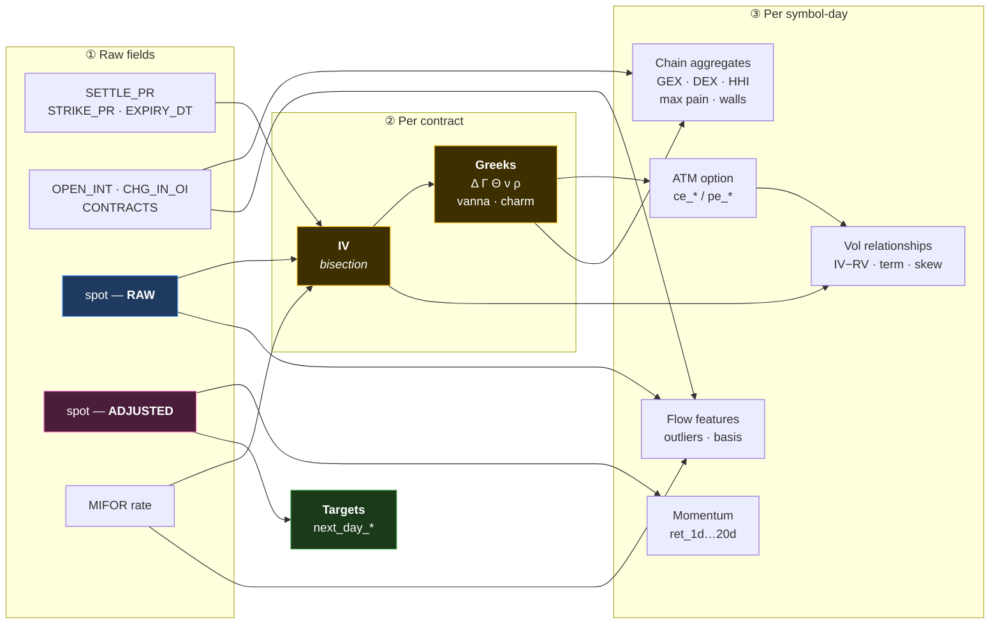

# 5. Derived Features — Every Computed Column Explained

[← Database](04-database.md) · [Index](README.md) · Next: [Storage and files →](06-storage-and-files.md)

Nothing here is downloaded. Every column below is **computed** from the raw sources. For each:
what the formula is, and what it is supposed to mean about the market.

Terms used throughout are defined in [the primer](01-market-primer.md).

---

## 5.1 Feature lineage



Note the split at the bottom: **raw spot feeds everything about option structure; adjusted
spot feeds only momentum and targets.** See
[the invariant](03-pipeline.md#two-price-series-two-purposes).

---

## 5.2 Level features (3)

| Column | Formula | Meaning |
|---|---|---|
| `underlying_price` | Yahoo adjusted close *(in this table)* | The stock's price. Note: `ml_dataset` aliases the adjusted series to this name. |
| `interest_rate` | MIFOR, nearest prior observation | The risk-free rate; the *r* in Black-Scholes and the fair cost of carry. |
| `rv_yz` | Yang-Zhang estimator over a trailing window | **Realised volatility** — how much the stock actually moved. Decimal scale (0.072 = 7.2%). |

**Why Yang-Zhang** rather than the standard deviation of closes: it uses each day's open,
high, low and close, so it captures overnight gaps and intraday range. It is several times
more statistically efficient, which matters on short windows.

---

## 5.3 The at-the-money option — `ce_*` / `pe_*` (26)

All 26 describe the single option closest to the money — the most liquid, most
information-dense contract on the chain. `ce_` = call, `pe_` = put.

| Column | Meaning |
|---|---|
| `ce_iv_30`, `ce_iv_60`, `ce_iv_90` | Implied volatility at ~30 / 60 / 90 days to expiry. **Percent scale.** |
| `pe_iv_30`, `pe_iv_60`, `pe_iv_90` | Same, for puts |
| `ce_ivp` / `pe_ivp` | **IV Percentile** — what fraction of the past year had lower IV. "Is today's IV high *for this stock*?" |
| `ce_ivr` / `pe_ivr` | **IV Rank** — where today sits between the year's min and max: `(IV − min) / (max − min) × 100` |
| `ce_delta` / `pe_delta` | Δ — shares of hedge per option |
| `ce_gamma` / `pe_gamma` | Γ — how fast that hedge must change |
| `ce_theta` / `pe_theta` | Θ — daily time decay |
| `ce_vega` / `pe_vega` | ν — sensitivity to volatility |
| `ce_rho` / `pe_rho` | ρ — sensitivity to interest rates |
| `ce_close` / `pe_close` | The option's own closing price |
| `ce_volume` / `pe_volume` | Contracts traded |
| `ce_oi` / `pe_oi` | Open interest |

**IVP vs IVR** — both answer "is IV high?", differently. IVP is a rank among all past
observations (robust). IVR is a position between the extremes (sensitive to a single spike).
Both are computed over a 252-day window with a 60-day minimum.

---

## 5.4 Tier 2 — momentum, spreads, calendars (9)

### Momentum
| Column | Formula |
|---|---|
| `ret_1d` `ret_5d` `ret_10d` `ret_20d` | `groupby(symbol).underlying_price.pct_change(N)` |

Price change over 1, 5, 10 and 20 trading days, computed on the **adjusted** series.

> ⚠️ These are the reason [row order is load-bearing](03-pipeline.md#row-order-is-load-bearing).
> `pct_change` reads adjacent rows directly; a reordering merge produces silently wrong values.

### Volatility relationships

| Column | Formula | Meaning |
|---|---|---|
| `iv_rv_spread` | `ce_iv_30 − rv_yz × 100` | **Expected minus actual volatility.** Positive means options are pricing in more movement than has been happening — the volatility risk premium. The ×100 converts `rv_yz` from decimal to percent. |
| `term_slope` | `ce_iv_90 − ce_iv_30` | **The volatility term structure.** Normally positive (further out = more uncertainty). Inverted (negative) signals near-term stress. |
| `put_call_iv_spread` | `pe_iv_30 − ce_iv_30` | **Demand for downside protection.** Puts usually cost more than calls; a widening gap means fear is being bid. |

### Calendars

| Column | Formula | Why it matters |
|---|---|---|
| `days_to_expiry_30d` | `expiry_30d − date` | Gamma and theta explode near expiry; almost every option feature has an expiry-cycle component. |
| `days_to_earnings` | `upcoming_earning_date − date` | IV rises predictably into earnings and collapses after. A genuine confounder for any volatility feature. |

---

## 5.5 Tier 3 — chain-wide structure (9)

These summarise the *whole* chain, not one option. All computed in SQL over
`jsonb_array_elements`.

| Column | Formula | Meaning |
|---|---|---|
| `atm_straddle` | Sum of the CE and PE settlement prices at the strike nearest spot, ~30d expiry | The market's price for "the stock will move, either way". A direct read on expected movement. |
| `skew_25d` | IV of the 25-delta put − IV of the 25-delta call, ~30d expiry | ⭐ **The shape of fear.** Positive means downside protection costs more than upside participation — the normal state in equities, widening under stress. Strikes are picked by nearest \|delta\| to 0.25. |
| `otm_put_iv_premium` | IV of the ~5%-OTM put − `pe_iv_30` | How much extra the market charges for further-out protection. Another cut at tail-risk pricing. |
| `put_call_vol_ratio` | chain put volume ÷ chain call volume | Today's trading skewed toward puts or calls |
| `put_call_oi_ratio` | chain put OI ÷ chain call OI | *Standing positions* skewed toward puts or calls — the more durable of the two |
| `chain_volume` | Σ volume over all contracts | Total activity |
| `chain_oi` | Σ open interest | Total open positions |
| `chain_oi_chg` | Σ change in open interest | ⭐ Net new positioning across the chain. **Note it is a net sum** — a day where longs build 10,000 and writers build 10,000 looks identical to a day where nothing happened. That blindness is exactly what the outlier detector exists to fix. |
| `chain_breadth` | Fraction of contracts with volume > 0 | How much of the chain is actually alive. Low breadth means activity is concentrated in a few strikes. |

---

## 5.6 Dealer exposure — the GEX family (14)

This group implements the project's central hypothesis. See
[the primer](01-market-primer.md#why-gamma-is-the-centre-of-the-theory) for the theory and
[the findings](../models/gex-dealer-positioning-findings.md) for how it turned out.

### The dealer sign

Aggregating dealer exposure requires knowing which side dealers are on:

```python
DEALER_SIGN = {"CE": -1.0, "PE": +1.0}    # dealers short calls, long puts
```

**This was measured, not assumed.** In the US convention it is the other way round. From this
project's own participant data, institutional desks (`Pro`) were net short calls on **99.9%**
and net long puts on **98.3%** of 1,258 days. The constant applies to **stocks only** —
index positioning is regime-dependent, drifting monotonically from 90.5% to 36.7% across
2021–2026, so indices are excluded rather than given a sign. They are 1.5% of rows.

### The exposure aggregates

| Column | Formula | Meaning |
|---|---|---|
| `gex` | `Σ sign · oi · Γ · S² · 0.01` | ⭐ **Gamma exposure.** Net gamma dealers hold across the chain. Negative (the usual state, 97.3% of rows) means their hedging *amplifies* moves. |
| `gex_chg` | `Σ sign · chg_oi · Γ · S² · 0.01` | Today's *change* in that exposure — new positioning only |
| `dex` | `Σ oi · Δ · S` | **Delta exposure** — OI-weighted net delta of the chain |
| `vanna_exp` | `Σ sign · oi · vanna` | Hedging pressure from *volatility* changes |
| `charm_exp` | `Σ sign · oi · charm` | Hedging pressure from *time passing* — trading that must happen even in a flat market |
| `dex_chg` | `groupby(symbol).dex.diff()` | Day-over-day change |
| `oi_hhi_chg` | `groupby(symbol).oi_hhi.diff()` | Day-over-day change |

> ⚠️ **Known inconsistency:** `dex` does **not** apply `DEALER_SIGN`, while `gex`, `gex_chg`,
> `vanna_exp` and `charm_exp` all do. It matches the original specification, but that
> specification describes it as "net delta dealers must hedge" — an interpretation that
> requires the sign. As computed it is the chain's OI-weighted net delta, not a dealer
> position. Recorded as an open design decision rather than silently changed.

### Chain structure

| Column | Formula | Meaning |
|---|---|---|
| `oi_hhi` | `Σ (strike's OI share)²` over strikes, CE+PE pooled | **Herfindahl concentration.** Near 0 = OI spread evenly across many strikes; near 1 = piled into one. Concentration is a positioning signature. |
| `max_pain` | The strike minimising total OI-weighted in-the-money value, near expiry | The price at which the *most* open options expire worthless — folklore says price gravitates here into expiry. |
| `call_wall` | Strike with the most call OI | A ceiling: heavy call writing above the price creates hedging resistance |
| `put_wall` | Strike with the most put OI | A floor, by the same logic |
| `dist_to_call_wall` | `(call_wall − S) / S` | How far the ceiling is, in percent |
| `otm_put_oi_build` | `Σ chg_oi` over out-of-the-money puts | New downside-protection buying |
| `dist_to_flip` | `(S_raw − gamma_flip) / S_raw` | ⭐ Distance to the **gamma flip level** — the spot price where net dealer gamma crosses zero, i.e. where their hedging switches from amplifying to damping. Computed on a ±10% grid with linear interpolation; NULL when there is no crossing in range, which is a real state, not a failure. |

**Sign invariance.** `gamma_flip` and `dist_to_flip` are unchanged by flipping `DEALER_SIGN`
— negating a function does not move its zeros. This was used to verify the sign correction
was a pure negation and nothing else moved.

---

## 5.7 Targets (6)

All are **forward** shifts within each symbol. Every one is NULL on the symbol's most recent
day: there is no tomorrow yet.

| Column | Formula | Question it asks |
|---|---|---|
| `next_day_return` | `S(t+1) / S(t) − 1` | How much did it move? |
| `next_day_direction` | `1 if return > 0 else 0` | Which way? |
| `next_day_abs_return` | `\|next_day_return\|` | ⭐ How *big* was the move, regardless of direction. The primary target for volatility work. |
| `next_day_rv_5d` | Realised volatility over the next 5 days | Sustained movement, not one day. Needs **5** trailing NULLs per symbol, not 1. |
| `next_day_iv_chg` | `ce_iv_30(t+1) − ce_iv_30(t)` | Did the market's *expectation* shift? |
| `next_day_vrp` | `next_day_abs_return − ce_iv_30 / (100 · √252)` | ⭐ **Volatility risk premium** — realised minus implied, in comparable daily units. Did the market over- or under-price movement? |

All six are computed on the **adjusted** price series.

> ⚠️ Every one of these is a *price or volatility* outcome. None of them measures institutional
> activity. That gap is the project's central methodological problem — see
> [why there is no simple supervised model](03-pipeline.md#37-why-there-is-no-simple-supervised-model).

---

## 5.8 Flow features (20)

Built 2026-09-04 into `flow_features`. Full report:
[`docs/implementation/flow-features.md`](../implementation/flow-features.md).

### The outlier-strike detector

**What it is for.** Every feature in §5.5 is a *sum or average* over ~300 strikes, and
averaging destroys a localised signal. Nobody accumulates 50,000 contracts of a 15%-OTM call
by accident — but that build vanishes once summed alongside the at-the-money churn. This
detector finds the individual strike instead.

A contract is flagged when it clears **both** gates:

1. **`|z| ≥ 25`** — a robust z-score of `chg_oi` computed **within `(symbol, date, expiry)`**
2. **`share ≥ 0.05`** — it holds at least 5% of the symbol-day's entire `|chg_oi|`

Three design points, each measured:

**The scale is estimated from contracts that actually traded.** A standard deviation would be
inflated by the very build being hunted. But a median-absolute-deviation over the *whole*
chain fails too, for the opposite reason: an option chain is heavily zero-inflated, so the
median and MAD both collapse toward zero and everything that moved scores an enormous z. That
version flagged **99.4% of symbol-days** — it was measuring the noise floor. Restricting the
estimate to non-zero changes drops it to ~13%.

**Comparison is within expiry.** Near-month contracts carry systematically larger OI changes,
so one pooled scale would flag the front month daily and never see a far-dated build.

**Both gates are required.** With the corrected scale the `|z|` distribution runs p50 0.7,
p90 3.1, p99 18.4, p99.9 53 — so a nominal-looking `z ≥ 4` sits near the 92nd percentile.

The resulting flag rate is **stable across all five years** (10.8%–16.6%, no trend), which is
the check that matters given F&O liquidity grew several-fold over the window.

| Column | Meaning |
|---|---|
| `oi_outlier_count` | How many contracts flagged |
| `oi_outlier_max_absz` | The strongest one |
| `oi_outlier_share` | How much of the day's activity was concentrated in them |
| `oi_outlier_call_frac` | Calls vs puts (descriptive only) |
| `oi_outlier_moneyness` | `(K − S) / S` — how far out of the money |
| `oi_outlier_dte` | Days to expiry of the flagged builds |
| `oi_outlier_build_notional` | Rupees opened — `chg_oi × spot` |
| `oi_outlier_unwind_notional` | Rupees closed |

> ⚠️ **No column here carries a direction.** An OI build cannot distinguish a buyer from a
> writer: an OTM call build is bullish if bought and bearish if written. Resolving that needs
> the price-change quadrant, which is a separate, not-yet-built feature.

### Futures basis and roll

| Column | Formula | Meaning |
|---|---|---|
| `fut_basis` | `mark − spot` | Rupee premium of the future over the stock |
| `fut_basis_pct` | `mark / spot − 1` | Same, proportional. Well-behaved at every horizon. |
| `fut_basis_annual` | `basis_pct × 365/dte × 100` | Annualised. **NULL below 5 days to expiry** — dividing a 0.5% basis by a 1-day horizon gives 182% "annualised", which would dominate every downstream z-score. |
| `fut_basis_excess` | `fut_basis_annual − interest_rate` | ⭐ **Basis minus the fair cost of carry.** The raw basis is mostly just interest; the *excess* is demand pressure. Positive = leveraged long demand paying up. Negative = crowded shorts or borrow scarcity. |
| `fut_roll_ratio` | `next_oi / (near_oi + next_oi)` | How far positions have migrated to the next month |
| `fut_roll_spread` | `(next_mark − near_mark) / near_mark` | The cost of carrying a position forward |
| `fut_oi`, `fut_oi_chg`, `fut_volume` | Raw counts (**OI in shares**) | Position size and turnover |
| `fut_oi_notional`, `fut_oi_chg_notional` | `× spot` | Rupee equivalents |
| `fut_dte` | `expiry − date` | Days to expiry — kept as an explicit calendar control |

**The mark is `SETTLE_PR` with a `CLOSE` fallback.** Settlement is the official daily price
and exists even on a day the contract did not trade, where `CLOSE` would be a stale
last-traded price showing a fictitious basis.

**Sanity check that it is measuring what it claims:** `fut_basis_excess` has a median of
+0.005% annualised — essentially exactly zero, which is what "excess over fair carry" should
be — with a fat left tail (p1 −28.9%). That tail is the dividend signature: futures trade at
a discount ahead of an expected dividend.

---

## 5.9 What actually works

Measured on `next_day_abs_return`, within-symbol causal z-score, partial correlation after
controlling for `ce_iv_30`:

| Feature | Partial IC | t | Verdict |
|---|---|---|---|
| `fut_basis_excess` | **−0.0516** | −20.7 | ⭐ Strongest in the project |
| `gex` | +0.0407 | 17.6 | The previous best |
| `fut_basis_pct` | −0.0236 | −10.2 | The un-adjusted version — half the signal |
| `oi_outlier_share` | +0.0078 | 3.4 | Marginal |
| `oi_outlier_call_frac` | +0.0101 | 1.4 | No |
| `oi_outlier_max_absz` | +0.0055 | 0.8 | No |
| `oi_outlier_moneyness` | +0.0036 | 0.5 | No — and raw IC was +0.0368 |

Two lessons worth carrying:

**The carry adjustment doubles the signal** (−0.052 vs −0.024). Subtracting the interest rate
is not cosmetic — it is what turns a price ratio into a measure of demand.

**`oi_outlier_moneyness` is the cautionary tale.** Raw rank IC +0.0368 collapsing to +0.0004
under the IV control is exactly the failure the standing evaluation rule exists to catch.

But note what "fails" means here. The outlier family fails at *predicting price movement* —
which is not the project's question. At market level, aggregated across symbols and compared
against `participant_oi`, `outlier_rate` tracks institutional option flow (FII +0.225,
Pro +0.205, **Client −0.281** — retail on the opposite side, as it must be). It measures
positioning; it just does not forecast volatility. Those are different claims and only the
second one failed.

[← Database](04-database.md) · [Index](README.md) · Next: [Storage and files →](06-storage-and-files.md)
