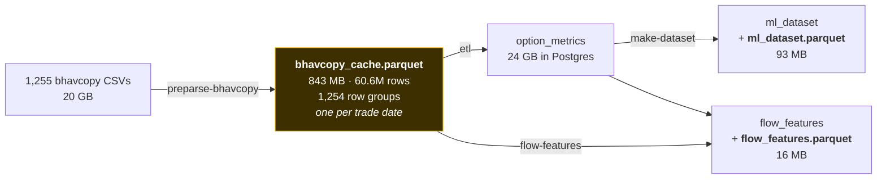

# 6. Storage and Files — What Lives Where, and Why

[← Derived features](05-derived-features.md) · [Index](README.md)

Three storage layers, each with a different job: **raw files** (the archive of truth),
**parquet** (fast columnar working copies), and **PostgreSQL** (the queryable fact store).

---

## 6.1 The layout

```
MktMtm/
├── data/                          ~21 GB total
│   ├── raw/                       20 GB   — downloaded, never modified
│   │   ├── bhavcopy/              20 GB
│   │   │   ├── extracted/         11 GB   1,255 unzipped NSE CSVs
│   │   │   ├── filtered/          9.1 GB  1,255 column-filtered copies
│   │   │   └── _partial_2021/     351 MB  a partial early-2021 fetch
│   │   ├── yahoo_finance/         122 MB  434 files (217 × raw + processed)
│   │   └── participant_oi/        5.2 MB  1,258 daily CSVs
│   │
│   ├── reference/                 1.1 MB  — ships with the repo, hand-curated
│   │   ├── ADJUSTED_MIFOR.csv             interest rates
│   │   ├── earning_dates.json             results calendar
│   │   └── lot_sizes.csv                  853 lot-size change points
│   │
│   ├── processed/                 952 MB  — generated, safe to delete
│   │   ├── bhavcopy_cache.parquet 843 MB  60.6M rows, the ETL's input
│   │   ├── ml_dataset.parquet      93 MB  212,441 × 69
│   │   └── flow_features.parquet   16 MB  212,441 × 20
│   │
│   ├── jobs/                      empty   UI job state
│   └── serving/                   empty   reserved
│
├── docs/                          architecture, data audits, model findings
├── scripts/                       verify_db_health.py and friends
├── src/mktmtm/                    the package
└── tests/                         unit + integration + fixtures
```

Plus **PostgreSQL at 25 GB**, of which `option_metrics` alone is 24 GB.

> The volume is `fuseblk` (NTFS via FUSE) at 86% capacity, ~134 GB free. Two consequences:
> file modification times are not reliable, and a full ETL re-run needs headroom.

---

## 6.2 The three parquet files



### `bhavcopy_cache.parquet` — 843 MB, 60.6M rows

**Why it exists.** Re-parsing 1,255 CSVs once per symbol would read the same files 217 times.
Consolidating into one columnar file makes the ETL roughly **4× faster**.

**15 columns:** `DATE, INSTRUMENT, SYMBOL, EXPIRY_DT, STRIKE_PR, OPTION_TYP, OPEN, HIGH, LOW,
CLOSE, SETTLE_PR, CONTRACTS, OPEN_INT, CHG_IN_OI, UNDERLYING_PRICE`

**Two structural properties that downstream code depends on:**

1. **One row group per trade date** — 1,254 groups, ~48,000 rows each. This is what lets
   `flow-features` stream a day at a time (peak memory: one day) rather than loading 60M
   rows. It also allows skipping whole days using row-group statistics without decoding
   them, which is what makes `--limit-dates` genuinely fast.
2. **Text columns are dictionary-encoded** (`category` dtype), which keeps the file at 843 MB
   instead of several GB — but carries the ordering trap described
   [in the pipeline doc](03-pipeline.md#32-stage-2-the-parquet-cache).

**Regenerate with:** `uv run mktmtm preparse-bhavcopy` — and **re-run it after every
bhavcopy fetch**, or the ETL silently works from stale data.

### `ml_dataset.parquet` — 93 MB

An exact mirror of the `ml_dataset` table: 212,441 rows × 69 columns, ordered by
`(symbol, date)`, columns in `DATASET_COLUMNS` order.

Its purpose is training. Reading a 341 MB table over a database connection for every
experiment is slow; the parquet loads in a second.

### `flow_features.parquet` — 16 MB

The same idea for `flow_features`. Written **from the same in-memory frame** that is written
to PostgreSQL, in the same call — so the two cannot drift.

---

## 6.3 The parquet/database sync hazard

This is the one genuinely dangerous property of having both.

**What happened.** `gex-features` recomputes the dealer columns and writes them to
PostgreSQL — and *only* PostgreSQL. After the `DEALER_SIGN` correction was applied, the
database held the corrected values while `ml_dataset.parquet` still held the old ones. For
all **212,441 rows**, `parquet.gex == −db.gex`. Anything training from the file would have
silently disagreed with the table, with no error anywhere.

**The fixes, layered:**

1. `export_ml_dataset_parquet()` re-exports the parquet from the database, and
   `gex-features` runs it **by default**.
2. `--no-parquet` prints an explicit warning that the file now disagrees with the table.
3. `verify_db_health.py` compares parquet row count against table row count.
4. `flow-features` sidesteps the problem entirely by exporting from the same frame it writes.

**The rule:** any command that writes to a table must either re-export the matching parquet
or say loudly that it did not.

Verified for this build: parquet and table agree on row count (212,441), column count (69),
and on the mean of both `gex` (−7.0248e+08) and `ce_iv_30` (30.70012).

---

## 6.4 What is safe to delete

| Path | Safe to delete? | Cost to rebuild |
|---|---|---|
| `data/processed/*.parquet` | ✅ Yes | 10 min (cache), ~20 min (ml_dataset), 2 min (flow) |
| `data/raw/bhavcopy/extracted/` | ⚠️ Only if `filtered/` is intact | Re-download, hours |
| `data/raw/bhavcopy/filtered/` | ❌ No | Re-download, hours |
| `data/raw/yahoo_finance/` | ⚠️ Re-fetchable | ~30 min, and Yahoo may rate-limit |
| `data/raw/participant_oi/` | ⚠️ Re-fetchable | ~20 min at 0.5 s/day |
| `data/reference/` | ❌ **Never** | Hand-curated, not reproducible |
| `option_metrics` table | ❌ No | **3–5 hours of ETL** |
| `ml_dataset` / `flow_features` tables | ✅ Yes | 20 min / 2 min |

The two irreplaceable things are **`data/reference/`** (hand-built and not regenerable) and
**`option_metrics`** (cheap to store, expensive to recompute).

---

## 6.5 Rebuild recipes

**Everything downstream of the fact table** (~25 min) — after a feature change:
```bash
uv run mktmtm make-dataset
uv run mktmtm flow-features
uv run python scripts/verify_db_health.py
```

**Just the dealer columns** (~10 min) — after a `DEALER_SIGN` or Greek-aggregate change:
```bash
uv run mktmtm gex-features          # re-exports the parquet by default
```

**Full rebuild from raw files** (~4–6 hours) — after an ETL or IV/Greek change:
```bash
uv run mktmtm preparse-bhavcopy
uv run mktmtm etl
uv run mktmtm make-dataset
uv run mktmtm flow-features
uv run python scripts/verify_db_health.py
```

> ⚠️ Re-running `make-dataset` **cannot** repair IV, strike or Greek defects — those are baked
> into `option_metrics` at ETL time. Any fix there needs the full rebuild.

---

## 6.6 Configuration

All configuration goes through the pydantic `Settings` singleton
(`src/mktmtm/config/settings.py`) — **never** bare environment reads.

| Setting | Default | Notes |
|---|---|---|
| `data_dir` / `raw_data_dir` / `processed_data_dir` / `reference_data_dir` | under `data/` | Every path above derives from these |
| `pg_dsn` | none | **Overrides** the individual `pg_*` fields when set |
| `pg_host` / `pg_port` / `pg_db` / `pg_user` / `pg_password` / `pg_sslmode` | localhost:5432, `mktmtm` | Read from `PG_*` env vars or `.env` |
| `batch_size` | 1000 | Rows per batched UPSERT |
| `max_workers` | 4 | ETL thread count |

Integration tests (`pytest.mark.integration`) need a live PostgreSQL and skip cleanly when no
credentials resolve; `MKTMTM_PG_ENV_FILE` points them at an env file.

> ⚠️ `mktmtm-ui` binds the tailnet IP by default and has **no authentication** — never bind
> it to `0.0.0.0`.

[← Derived features](05-derived-features.md) · [Index](README.md)
