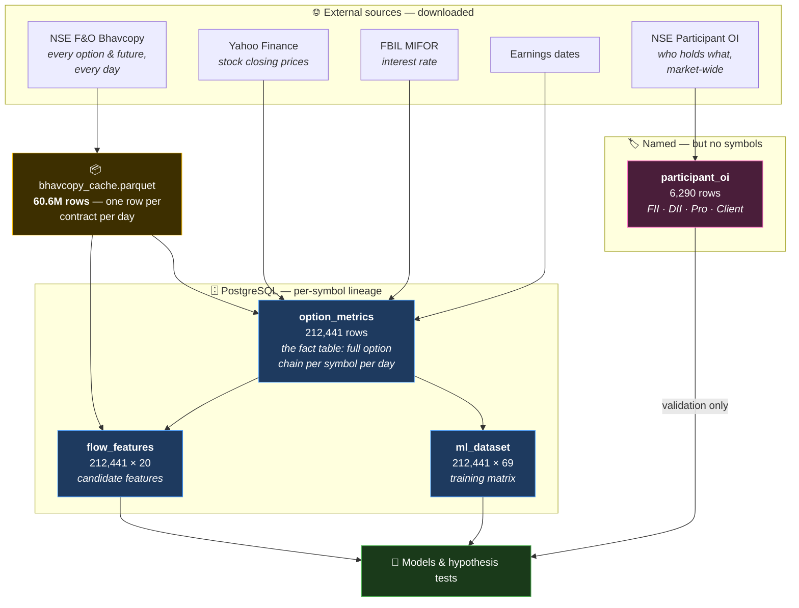

# MktMtm — Architecture Documentation

**What this project is.** MktMtm is a research system for detecting **institutional
positioning** ("whale flow") in India's NSE equity-derivatives market. It is deliberately
*not* a price-prediction system. The question it asks is not *"will this stock go up
tomorrow?"* but *"can we see, in publicly published market data, where large players are
positioning themselves?"*

**Why that distinction matters.** Anyone can download the price of a stock. Almost nobody
tells you *who* bought it. The central bet of this project is that large positions leave a
mechanical, unavoidable footprint in the options market — and that the footprint is
recoverable from data NSE publishes free, at end of day, to everyone.

---

## Read these in order

If you are new to the market, **start with the primer**. Every later document assumes its
vocabulary and links back to it.

| # | Document | What it covers |
|---|---|---|
| 1 | [Market primer](01-market-primer.md) | Options, futures, open interest, expiry, lot size, IV, the Greeks — from zero. **Read first.** |
| 2 | [Data sources](02-data-sources.md) | Every external source we download, field by field, and what each field means in the market. |
| 3 | [Pipeline](03-pipeline.md) | How raw files become a training matrix — every stage, and the invariants that must not break. |
| 4 | [Database](04-database.md) | Every table, every column, every JSONB shape. |
| 5 | [Derived features](05-derived-features.md) | All 89 computed features: the formula, and what it is supposed to mean. |
| 6 | [Storage and files](06-storage-and-files.md) | On-disk layout, parquet caches, sizes, and why each file exists. |

Related reading outside this folder: [`docs/implementation/flow-features.md`](../implementation/flow-features.md)
(the newest feature family and its results), [`docs/models/gex-dealer-positioning-findings.md`](../models/gex-dealer-positioning-findings.md)
(what the dealer-exposure hypothesis actually showed), and
[`docs/data/iv-integrity-audit.md`](../data/iv-integrity-audit.md) (past data defects and their fixes).

---

## The system in one picture

## The numbers, as built

| | |
|---|---|
| **Coverage** | 2021-08-02 → 2026-08-28, **1,254 trading days** |
| **Symbols** | **217** — 214 individual stocks + 3 indices (NIFTY, BANKNIFTY, NIFTYNXT50) |
| **Fact table** | `option_metrics`, 212,441 rows, **24 GB** — holds ~49.5 million individual option-chain entries |
| **Training matrix** | `ml_dataset`, 212,441 rows × 69 columns, 341 MB |
| **Flow features** | `flow_features`, 212,441 rows × 20 columns, 45 MB |
| **Participant data** | `participant_oi`, 6,290 rows (1,258 days × 5 categories) |
| **Raw files** | 20 GB on disk |
| **Total database** | 25 GB |

All four tables are at the **same grain** — one row per `(symbol, trading day)` — and join
one-to-one. That is not an accident; it is enforced and checked.

## The central idea, in plain terms

The reasoning chain the whole project rests on:

1. A large institution wanting a big position often trades **options**, because options give
   leverage and do not require moving the whole stock at once.
2. Whoever sells them those options — a **market maker** or "dealer" — does not want to bet
   on direction. They just want the fee.
3. So the dealer immediately **hedges** by trading the underlying stock.
4. That hedging is **mechanical and forced** — it follows from the maths of their position,
   not from an opinion.
5. Therefore: *open interest × option Greeks* is a map of **hedging flow that must happen**.

You never see the whale. You see the footprint their dealer is *obliged* to leave. See
[the Greeks](01-market-primer.md#8-the-greeks-how-an-option-reacts) for what makes
step 4 mechanical.

## What has actually been established

Honest summary, because a research project's documentation should not oversell it:

- **The original hypothesis failed.** Net dealer gamma exposure (GEX) does *not* predict
  next-day volatility in the direction theory says. It fails twice over — on the confound
  controls, and on the raw sign. See [the findings doc](../models/gex-dealer-positioning-findings.md).
- **A magnitude effect survives.** When a symbol carries unusually little dealer gamma
  *relative to its own history*, its next-day move is larger — and that holds after
  controlling for the symbol's own implied volatility.
- **The strongest single feature so far is the futures basis** (`fut_basis_excess`): a
  within-symbol partial information coefficient of −0.052, beating the dealer-gamma
  measures.
- **The dealer sign in India is inverted** from the US convention. It was measured, not
  assumed: institutional desks are net *short* calls and net *long* puts on 99.9% / 98.3% of
  days.
- **Bhavcopy open interest is in shares, not contracts** — the reference file asserted the
  opposite until it was measured against participant data.

## The problem that shapes everything

**There is no label.** Nobody publishes "an institution accumulated a position in RELIANCE
today." Every target column in `ml_dataset` is a *price* or *volatility* outcome, which is a
proxy for the real question, not the question itself.

The one exception is `participant_oi`, which genuinely names the participants — but only
**market-wide**, with no symbol breakdown. Joined on date alone it is constant within a date
and so contributes nothing to telling symbols apart.

This is why the project's evaluation design is what it is, and why the modelling direction is
unsupervised (latent-state models) plus market-level supervision, rather than a
straightforward classifier. See [the pipeline doc](03-pipeline.md#37-why-there-is-no-simple-supervised-model)
for the full argument.
