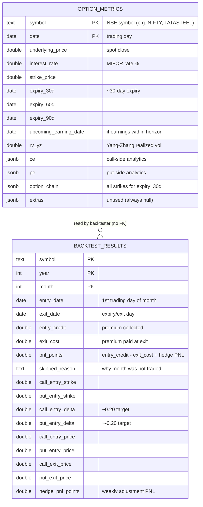
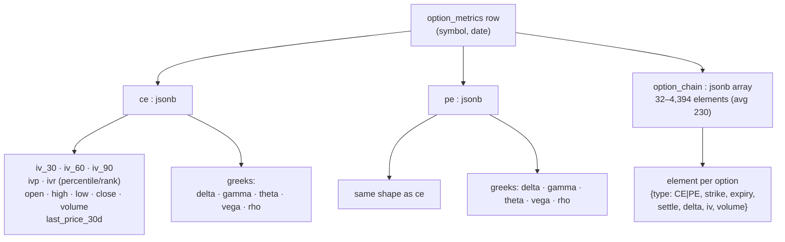
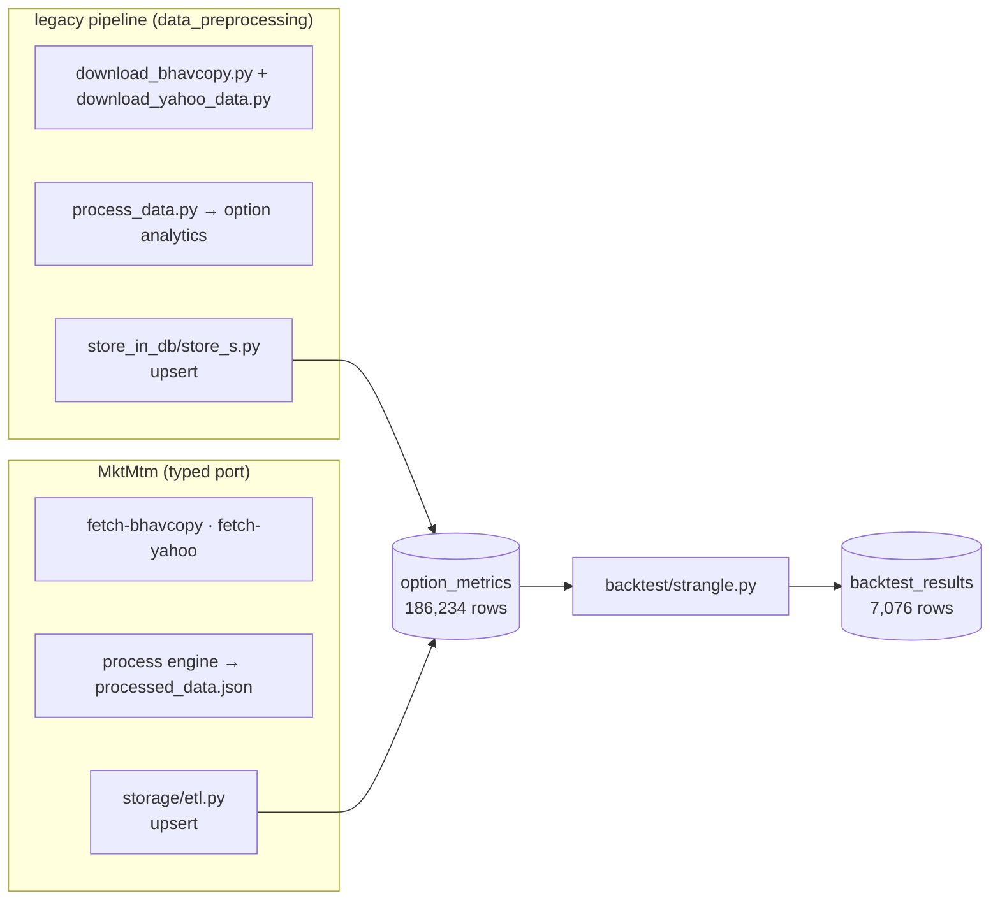
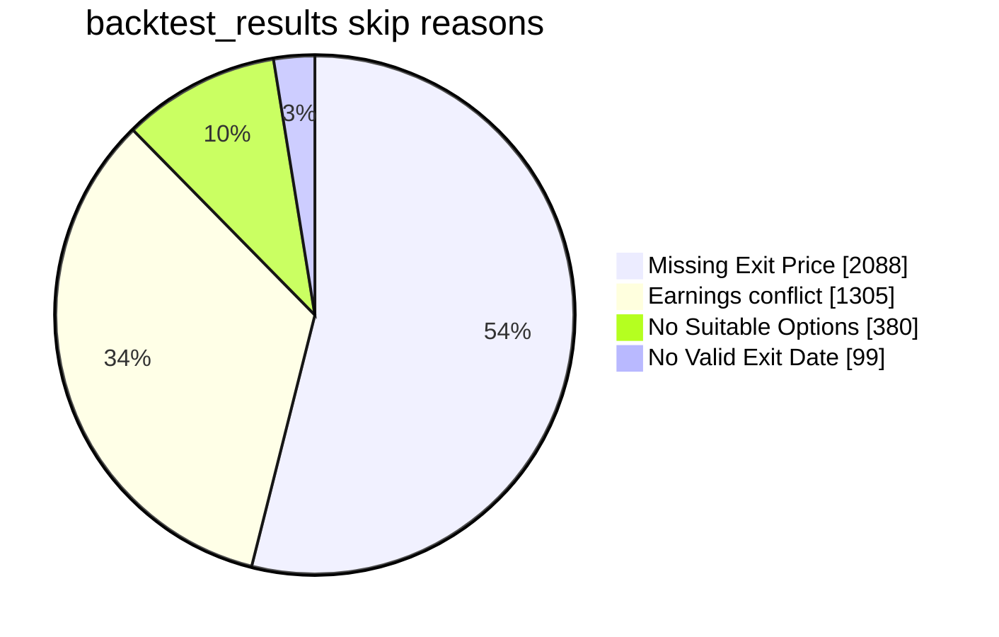
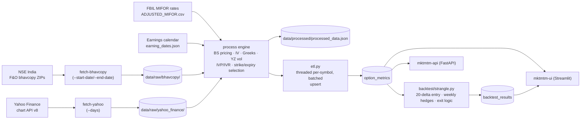

# MktMtm Database Report — `options_db`

> **Scope:** schema, architecture, and contents of the PostgreSQL database backing the MktMtm market-momentum pipeline.
> **Snapshot date:** 2026-08-17 (all numbers verified live from the database).
> **Server:** PostgreSQL 18.6 · database `options_db` · total size **5,337 MB** · owner `yashas` · bound to `localhost:5432` only.

---

## 1. Overview

`options_db` holds two tables:

| Table | Rows | Size | Purpose |
|---|---|---|---|
| `option_metrics` | **186,234** | 5,327 MB | One row per (symbol, trading day): spot price, interest rate, expiries, Yang–Zhang realized vol, and full option analytics as JSONB (`ce`, `pe`, `option_chain`). |
| `backtest_results` | **7,076** | 1,712 kB | One row per (symbol, year, month): short-strangle trade outcomes, entry/exit details, delta-hedge P&L. |
| `symbol_data` | — | — | Catalog table defined in `src/mktmtm/storage/sql/symbol_data.sql` — **not created** (the backtester reads the catalog from the packaged F&O catalog resource instead). |

There are **no foreign-key constraints** — the relationship between the two tables is conceptual: the backtester reads `option_metrics` and writes `backtest_results`.



---

## 2. `option_metrics` — schema

DDL source of truth: `src/mktmtm/storage/sql/init_option_metrics.sql` (identical to the legacy `store_in_db/init_option_metrics.sql`).

**Primary key:** `(symbol, date)`. All writes are upserts (`INSERT … ON CONFLICT (symbol, date) DO UPDATE`), so re-running the ETL is idempotent.

| Column | Type | Nullable | Notes |
|---|---|---|---|
| `symbol` | text | no | |
| `date` | date | no | |
| `underlying_price` | double precision | yes | 0 nulls |
| `interest_rate` | double precision | yes | 0 nulls |
| `strike_price` | double precision | yes | 74 nulls |
| `expiry_30d` | date | yes | 0 nulls |
| `expiry_60d` | date | yes | 33 nulls |
| `expiry_90d` | date | yes | 2,063 nulls |
| `upcoming_earning_date` | date | yes | set on **166,193** rows (89%) |
| `rv_yz` | double precision | yes | **41,976 nulls (22.5%)** |
| `ce` | jsonb | yes | call-side metrics |
| `pe` | jsonb | yes | put-side metrics |
| `option_chain` | jsonb | yes | array of per-strike records |
| `extras` | jsonb | yes | never populated (all rows null) |

### Indexes

| Index | Type | Purpose |
|---|---|---|
| `option_metrics_pkey` | btree `(symbol, date)` | PK |
| `idx_symbol_date` | btree `(symbol, date)` | backtester's per-symbol date-range reads |
| `idx_rv_yz` | btree `(rv_yz)` | vol filtering |
| `idx_strike_price` | btree `(strike_price)` | |
| `idx_ce_iv30` | btree `((ce->>'iv_30'))` | IV lookups |
| `idx_ce_delta` | btree `((ce->'greeks'->>'delta'))` | |
| `idx_option_chain_gin` | GIN `(option_chain jsonb_path_ops)` | chain containment queries |

### JSONB structure

`ce` and `pe` are the analytics blocks for the call and put side of the near-month contract. `option_chain` holds every strike for `expiry_30d`.



Sample `ce` document (NIFTY, recent day):

```json
{
  "ivp": 60.0, "ivr": 57.74,
  "low": 175.65, "high": 237.3, "open": 221.05, "close": 218.1,
  "iv_30": 10.64, "iv_60": 10.34, "iv_90": 15.70,
  "greeks": { "rho": 4.11, "vega": 16.63, "delta": 0.568, "gamma": 0.0009, "theta": -10.94 },
  "volume": 37457795, "last_price_30d": 218.1
}
```

> ⚠️ **`ivp` / `ivr` caveat:** only **9,286 rows (5%)** carry `ivp`/`ivr` — all inside the recently ETL'd window (see §4). The legacy 2020–2025 rows store the other metrics but not the rolling percentile/rank.

---

## 3. `backtest_results` — schema

DDL source: `src/mktmtm/storage/sql/backtest_results.sql`. **Primary key:** `(symbol, year, month)`; writes are upserts (`ON CONFLICT … DO UPDATE`, including `hedge_pnl_points`).

| Column | Type | Nullable | Notes |
|---|---|---|---|
| `symbol` | text | no | |
| `entry_date` | date | no | 1st trading day of the month |
| `exit_date` | date | yes | target exit (expiry day) |
| `year` / `month` | integer | no | trade period |
| `entry_credit` | double precision | yes | null on 1,685 rows (never entered) |
| `exit_cost` | double precision | yes | null on 3,872 rows (= all skipped) |
| `pnl_points` | double precision | yes | net points; null ⇒ month skipped |
| `skipped_reason` | text | yes | see §5 breakdown |
| `call_entry_strike` / `put_entry_strike` | double precision | yes | 20-delta strikes |
| `call_entry_delta` / `put_entry_delta` | double precision | yes | ~±0.20 |
| `call_entry_price` / `put_entry_price` | double precision | yes | |
| `call_exit_price` / `put_exit_price` | double precision | yes | |
| `hedge_pnl_points` | double precision | yes | cumulative weekly-adjustment P&L; set on 5,292 rows |

Indexes: `backtest_results_pkey` `(symbol, year, month)` · `idx_backtest_results_symbol_date` `(symbol, entry_date)` · `idx_backtest_results_pnl` `(pnl_points)`.

---

## 4. Data contents — `option_metrics`

**Coverage:** 222 symbols · 2020-04-13 → 2026-08-14.

| Year | Rows | Notes |
|---|---|---|
| 2020 | 19,987 | starts 13 Apr |
| 2021 | 31,869 | |
| 2022 | 36,574 | |
| 2023 | 36,393 | |
| 2024 | 36,892 | |
| 2025 | 14,758 | **ends 30 Apr** (original download window) |
| 2026 | 9,761 | 2026-06-01 → 2026-08-14 (MktMtm ETL) |

Densest symbols: `TATASTEEL`, `BANKNIFTY`, `BAJAJFINSV` (1,198 rows each), `GLENMARK`, `ASHOKLEY`, `JINDALSTEL`, `HINDUNILVR`, `INDUSINDBK` (≈1,195+).

**Data provenance (two writers, one table):**



- **2020-04-13 → 2025-04-30** rows were written by the legacy `nse-options-last-5-years` pipeline (same schema — the port was built against it).
- **2026-06 → 2026-08** rows were written by the MktMtm ETL (`ON CONFLICT` upsert, so re-runs are safe and rows overwrite in place).
- `rv_yz` is null on 22.5% of rows (early months / thin history); `extras` is entirely unused.

---

## 5. Data contents — `backtest_results`

**Scope:** 222 symbols × 2022–2026 · 7,076 rows · 3,204 months actually traded (45%), 3,872 skipped.

### P&L by year (points, per symbol-month)

| Year | Traded | Skipped | Avg PNL | Sum PNL |
|---|---|---|---|---|
| 2022 | 946 | 971 | **−0.68** | −640.75 |
| 2023 | 720 | 1,212 | **+35.11** | +25,282.25 |
| 2024 | 933 | 1,066 | **+18.67** | +17,421.60 |
| 2025 | 255 | 611 | **−149.55** | −38,134.65 |
| 2026 | 350 | 12 | **−60.60** | −21,211.35 |
| **All** | **3,204** | **3,872** | **−5.39** | **−17,282.90** |

Range: min **−9,325.65** · max **+4,139.35**. *Points are index/price points, not rupees — conversion is downstream.*

> ⚠️ **Coverage caveats:** 2025 only has data through April (255 traded months) and 2026 only June–July (350); the aggregate is skewed by these partial windows. 2023/2024 look materially better than 2022 — worth a per-symbol deep-dive before judging the strategy.

### Skip reasons (3,872 rows)



- **Missing Exit Price (2,088)** — month entered but exit leg not tradeable; these rows still carry `hedge_pnl_points` (adjustments happened mid-month).
- **Earnings conflict (1,305)** — `upcoming_earning_date` fell between entry and expiry; skipped by design (earnings-gap risk).
- **No Suitable Options (380)** / **No Valid Exit Date (99)** — chain/expiry issues.

`hedge_pnl_points` is populated on 5,292 rows — every traded month plus the 2,088 exit-missing months (weekly adjustments are recorded even when the final exit isn't).

---

## 6. Pipeline architecture (how data gets in)

Full data flow, MktMtm side (mirrors the legacy diagram in `docs/architecture/Preprocessing Architecture.png`):



Key behaviours:
- **Idempotent ingestion** — both tables are written with `ON CONFLICT DO UPDATE`; `fetch-bhavcopy` skips dates that already have files.
- **Backtest scope** is hardcoded in `src/mktmtm/backtest/strangle.py` (`RUN SCOPE` block): last 4 years × every catalog symbol × all 12 months, skipping current/future months.
- **`symbol_data` is optional** — the backtester loads the symbol catalog from the packaged F&O catalog resource, not from the DB.

### Control panel (Streamlit UI)

The `mktmtm-ui` Streamlit app (`src/mktmtm/frontend_app.py`, launched via
`uv run mktmtm-ui`) is the browser control panel for this database: dashboard
(live counts), pipeline job runner, data explorer (schema/samples/JSONB + SQL
box) and analytics (P&L, leaderboard, skip reasons, coverage). It binds
athena's tailnet IP:8501 by default and is reachable from any tailnet device
at `http://athena:8501` (magicDNS) or `http://100.82.96.116:8501`. No auth —
tailnet ACLs only; do not bind `0.0.0.0`. See README → UI for details.

---

## 7. Known quirks & notes

1. **No FKs / no logical-relational integrity** — `backtest_results` is not linked to `option_metrics`; joins are by `symbol` (and implicitly by entry date within a month).
2. **`rv_yz` nulls (22.5%)** — Yang–Zhang vol needs a lookback window; early/thin-history days have none.
3. **`ivp`/`ivr` only on ~5% of rows** — rolling percentile/rank populated only for the recent window; legacy rows lack them.
4. **`extras` column is dead weight** — always null; kept for forward compatibility.
5. **2025 gap** — `option_metrics` jumps from 2025-04-30 to 2026-06-01; backtest 2025 rows only cover Jan–Apr, and May 2025+ months are absent entirely.
6. **Database binds localhost only** — remote access requires an SSH tunnel (DBeaver/psql: tunnel → `localhost:5432`).
7. **No `symbol_data` table** — its DDL exists but was never applied; harmless unless something starts reading it.

---

## Appendix — quick reference queries

```sql
-- refresh the headline numbers
SELECT count(*) FROM option_metrics;
SELECT min(date), max(date), count(DISTINCT symbol) FROM option_metrics;
SELECT count(*) FILTER (WHERE pnl_points IS NOT NULL) AS traded,
       count(*) FILTER (WHERE pnl_points IS NULL) AS skipped
FROM backtest_results;

-- monthly PNL
SELECT year, month, round(avg(pnl_points)::numeric, 2) AS avg_pnl,
       count(*) FILTER (WHERE pnl_points IS NOT NULL) AS traded
FROM backtest_results GROUP BY year, month ORDER BY year, month;

-- symbol leaderboard
SELECT symbol, count(*) AS months, round(sum(pnl_points)::numeric, 2) AS total_pnl
FROM backtest_results WHERE pnl_points IS NOT NULL
GROUP BY symbol ORDER BY total_pnl DESC LIMIT 10;

-- JSONB exploration
SELECT symbol, date, underlying_price, rv_yz,
       ce->>'iv_30' AS ce_iv30, pe->'greeks'->>'delta' AS pe_delta
FROM option_metrics WHERE symbol = 'NIFTY' ORDER BY date DESC LIMIT 5;
```

**DDL sources:** `src/mktmtm/storage/sql/` — `init_option_metrics.sql`, `backtest_results.sql`, `symbol_data.sql`.
**Related docs:** `docs/architecture/Preprocessing Architecture.png` (legacy pipeline) · `docs/backtest/` (strategy design).
