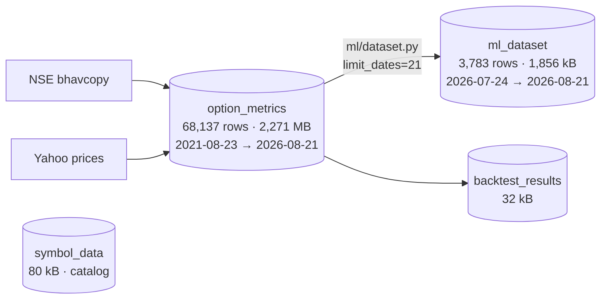

# `ml_dataset` — Dataset Inspection Report

> **Scope:** full audit of the one-month training extract in PostgreSQL (`options_db.public.ml_dataset`), its source table `option_metrics`, and an assessment of whether a market-momentum model can be trained on it — **both as it stands today and after the planned ~2,500-day historical download.**
> **Snapshot:** 2026-08-28. All figures verified live against the database.
> **Server:** PostgreSQL 18.6 · `options_db` · 2,280 MB · `localhost:5432`.

---

## 0. Verdict up front

The current extract is a **one-month pilot (3,783 rows, 21 trading days)** and a ~2,500-day download is planned. Those are two different questions, so this report answers both.

**Today: do not train on `ml_dataset`.** Four features (`ret_1d`, `ret_5d`, `ret_10d`, `ret_20d`) contain a **look-ahead leak** — they are computed from *tomorrow's* price. `ret_1d` is exactly `P(t)/P(t+1) − 1`, an algebraic function of the label. A trivial rule, "if `ret_1d < 0` predict UP", scores **100.00% accuracy on all 3,602 labelled rows**.

**After the 2,500-day download: yes — this becomes a trainable dataset**, provided three defects are fixed *before* the download rather than after. Sample size stops being the binding constraint at that scale; data integrity becomes it.

The single most important consequence of going to 2,500 days: **two of the three defects below get harder to detect, not easier.** At 21 days they are obvious. At 2,500 days they hide in the tails and in the pre/post-2025 regime boundary, and they will quietly corrupt results you would otherwise trust.

| # | Defect | Impact today | Impact at 2,500 days | Status |
|---|---|---|---|---|
| 1 | Look-ahead leak in `ret_Nd` (§2) | Fatal, obvious (AUC 1.000) | **Fatal, and non-deterministic** — heap order may scramble differently | **fixed** |
| 2 | Unadjusted prices / corporate actions (§3) | 2 bad rows, negligible | **Corrupts the label itself**; ~80–90 affected rows expected | **fixed** |
| 3 | Reference feeds frozen mid-2025 (§4) | 2 dead columns — drop them | **Regime-shift trap** — populated in train, dead in live | surfaced; needs data refresh |

> **Code status (2026-08-28):** defects 1 and 2 are fixed in `src/mktmtm/ml/dataset.py`
> and `src/mktmtm/data/yahoo.py`, with regression tests and a build-time guard that
> raises rather than writing a corrupt table. Defect 3 now logs loudly instead of
> failing silently, but the real remedy is refreshing `ADJUSTED_MIFOR.csv`.
> **The `ml_dataset` table in Postgres has not been regenerated** — it still holds
> the corrupt build. Rebuild it before use.

Once the leak is removed, there *is* a small but statistically real signal (walk-forward AUC ≈ **0.56–0.58**, positive in 9–10 of 10 folds). That is a reason to continue, not a result.

| Question | Answer |
|---|---|
| Is the source data usable? | Yes. `option_metrics` is clean and complete — 100% non-NULL chains in every year. |
| Can we train today? | **No** — leak invalidates it; 21 days is too short regardless. |
| Can we train after the 2,500-day download? | **Yes**, and properly — ~400k rows, ~2,500 effective observations. |
| What must happen first? | Fix §2 and §3 **before** downloading. §4 is fixable after. |
| Realistic ceiling | Weak cross-sectional edge, AUC ~0.55. Not a directional predictor. |

---

## 1. What is in the database



| Table | Rows | Size | Role |
|---|---|---|---|
| `option_metrics` | 68,137 | 2,271 MB | Source fact table. One row per (symbol, trading day); JSONB `ce`, `pe`, `option_chain`. |
| `ml_dataset` | **3,783** | 1,856 kB | **The subject of this report.** Flattened 51-column training matrix. |
| `backtest_results` | — | 32 kB | Strangle backtest output; unrelated to training. |
| `symbol_data` | — | 80 kB | Symbol catalog. |

### `ml_dataset` shape

- **3,783 rows × 51 columns**, PK `(symbol, date)`, no duplicates.
- **181 symbols × 21 trading days** (2026-07-24 → 2026-08-21). No calendar gaps — all 21 NSE sessions present.
- 180 symbols have all 21 days. **`EXIDEIND` has only 3 days** (drops out of `option_metrics` after 2026-07-28).
- Every symbol present in `option_metrics` for the window made it into `ml_dataset` (0 dropped).
- Column groups: 2 identity, 3 level, 26 CE/PE (30d ATM), 9 Tier-2 derived, 9 Tier-3 chain aggregates, 2 targets.

### Targets

| | count | share |
|---|---|---|
| `next_day_direction = 0` (down) | 1,829 | 48.4% |
| `next_day_direction = 1` (up) | 1,773 | 46.9% |
| NULL (last day per symbol) | 181 | 4.8% |

Class balance is essentially 50/50 — no resampling needed. The 181 NULLs are each symbol's final day and are correct by design (inference rows). Label/return consistency is exact: **0 mismatches** between `next_day_direction` and `sign(next_day_return)`.

One convention to note: **53 rows have `next_day_return == 0.0` exactly and are labelled DOWN**. These are stale-price days where the underlying closed unchanged (`YESBANK` accounts for 4). A `> 0` threshold silently assigns "flat" to the down class. Harmless at 21 days; at 2,500 days you will accumulate thousands of these, so decide the convention deliberately — a three-class or drop-flat rule is cleaner.

---

## 2. Critical finding #1 — look-ahead leakage in `ret_1d` / `ret_5d` / `ret_10d` / `ret_20d`

### The evidence

```
corr(stored ret_1d, TRUE backward ret_1d)   =  0.0821
corr(stored ret_1d, P(t)/P(t+1) − 1)        =  1.0000      max|diff| = 0.0e+00
corr(stored ret_5d,  reversed 5d return)    =  1.0000      max|diff| = 0.0e+00
corr(stored ret_10d, reversed 10d return)   =  1.0000      max|diff| = 0.0e+00

accuracy of the rule [ret_1d < 0 → tomorrow UP]  =  1.0000   (n = 3,602)
mean daily rank IC of ret_1d vs next_day_return  = −1.0000
```

The stored `ret_Nd` columns are not backward-looking returns. They are **forward-looking returns with the sign flipped**. Worked example (`RELIANCE`):

| date | underlying_price | stored `ret_1d` | true `ret_1d` | `next_day_return` |
|---|---|---|---|---|
| 2026-07-24 | 1278.00 | −0.001563 | *(NaN)* | +0.001565 |
| 2026-07-27 | 1280.00 | +0.009703 | +0.001565 | −0.009609 |
| 2026-07-28 | 1267.70 | −0.006427 | −0.009609 | +0.006468 |
| 2026-07-29 | 1275.90 | −0.013149 | +0.006468 | +0.013324 |

The stored value on each row is the *negated next-day move*, offset by one row from the true backward return.

### Root cause

`src/mktmtm/ml/dataset.py` — momentum features are computed **before the frame is sorted by date**:

- `_load_base()` (line 199) issues `SELECT ... FROM option_metrics` with **no `ORDER BY`**. Row order is whatever the planner emits; with the `limit_dates` semi-join it comes back reverse-chronologically per symbol.
- `_add_derived()` (lines 258–260) runs `groupby("symbol")["underlying_price"].pct_change(n)` on that **unsorted** frame.
- `_add_targets()` (line 282) sorts by `["symbol", "date"]` — too late. The *targets* end up correctly ordered while the *features* do not.

```python
# _add_derived — operates on unsorted rows
g = out.groupby("symbol", sort=False)
for n in (1, 5, 10, 20):
    out[f"ret_{n}d"] = g["underlying_price"].pct_change(periods=n)   # ← wrong row order
```

**Fix** — in `build_dataset()`, immediately after `_load_base()`:

```python
base = _load_base(conn, symbols, limit_dates)
base = base.sort_values(["symbol", "date"]).reset_index(drop=True)   # ← add
```

Belt-and-braces: add `ORDER BY symbol, date` to the SQL in `_load_base` and `_CHAIN_AGG_SQL`, plus a build-time assertion that `ret_1d` equals `groupby(symbol).underlying_price.pct_change(1)`.

### Why this gets *more* dangerous at 2,500 days

Heap order is **not deterministic**. Today the corruption happens to be a clean reversal, which is why it shows up as a perfect −1.0 correlation and is trivially caught. After a 2,500-day download the table will be written in a different order, will span multiple `VACUUM`/plan regimes, and may be loaded in symbol-major or date-major batches. The result is a **partially** scrambled feature — one that produces AUC 0.72 instead of 1.000.

An AUC of 1.000 announces itself. An AUC of 0.72 looks like a great model. **Fix this before the download, and keep the assertion in the build path permanently.**

### How much it is worth

Walk-forward evaluation (expanding window, train on all prior days, test on one held-out day, 10 folds):

| Feature set | Target | Accuracy | AUC |
|---|---|---|---|
| **Leaky `ret_*` only** | next_day_direction | **0.988** | **1.000** |
| All features incl. leak | next_day_direction | 0.979 | 0.998 |
| Clean (leak removed/rebuilt) | next_day_direction | 0.524 | 0.581 |
| Clean, market-neutral target | beat day's median | 0.547 | 0.561 |
| *Shuffled-label control* | — | *0.496* | *0.502* |

The leak is worth roughly **+0.42 AUC**. The shuffled-label control landing at 0.502 confirms the evaluation harness itself is sound.

---

## 3. Critical finding #2 — unadjusted prices and corporate actions

**This is the finding that changes most with a 2,500-day download, and it is the one that corrupts the *label*, not just a feature.**

`src/mktmtm/data/yahoo.py` requests adjusted closes and then does not use them:

```python
# line ~134 — adjusted close IS requested
f"&includeAdjustedClose=true&region=IN"
...
# line ~173 — but the RAW close is what gets read
closes = result.get("indicators", {}).get("quote", [{}])[0].get("close", [])
```

`indicators.adjclose[0].adjclose` is fetched over the wire and discarded. There is no corporate-action handling anywhere else in the pipeline.

### It is already visible in 5 years of thin history

| symbol | date | prev close | close | 1-day move | ratio |
|---|---|---|---|---|---|
| `VEDL` | 2026-04-30 | 773.60 | 271.55 | **−64.9%** | 2.85 |
| `TRENT` | 2026-01-01 | 4279.00 | 2864.93 | **−33.0%** | 1.49 |

Neither is a real return. Both are corporate-action discontinuities (Vedanta's demerger; a Trent adjustment). Across the whole 67,933-row history: **13 moves > 15%, 2 > 25%, 1 > 50%** — a rate of 0.019% for >15% moves.

### Why it matters so much more at scale

The current history covers only **20–28 symbols before 2025**. The planned download covers ~180 symbols over ~2,500 days. Scaling the observed event rate to ~450,000 rows gives on the order of **80–90 extreme-move rows, of which perhaps 15–25 are genuine corporate actions.**

That is not a rounding error, because of *where* the damage lands:

1. **The label flips.** `next_day_direction` for the day before a 3:1 split is computed from a −65% "return". You are training the model to predict a corporate action it cannot see.
2. **`ret_5d`/`ret_10d`/`ret_20d` stay poisoned for weeks.** One split contaminates up to 20 subsequent rows of every momentum feature.
3. **Outliers dominate scaling.** A −65% observation in a series with σ ≈ 1.6% is a 40-sigma event. It will wreck any standardiser and any gradient-boosted split point.
4. **It survives every check you would normally run.** Null counts are clean, types are right, the PK is intact. Only an explicit outlier scan finds it.

### Recommended handling

- **Read `adjclose`, not `close`**, in `yahoo.py`. It is already in the response.
- Adjusted series alone is **not sufficient** — demergers (VEDL) and some Indian corporate actions are frequently not reflected in vendor split factors. Add an explicit guard.
- Add a **corporate-action screen** to the dataset build: flag any `|ret_1d| > 20%`, and either NULL the return/label for that row and the following `N` days, or maintain a small manual adjustment table. Flagging is mandatory; the handling policy is a judgement call.
- Log every flagged row. A silent filter here is how a survivorship-style bias creeps in.

One subtlety worth a line: adjusted prices are restated retroactively by the vendor, so re-downloading 2,500 days *today* applies today's adjustment factors across the whole history. That embeds a mild look-ahead (the 2019 row "knows" about a 2023 split). For daily direction prediction this is second-order and the standard trade-off is to accept it — but it should be a recorded decision, not an accident.

---

## 4. Critical finding #3 — reference feeds frozen mid-2025

| Column | State in the 1-month extract | Root cause |
|---|---|---|
| `days_to_earnings` | **100% NULL** (3,783/3,783) | `option_metrics.upcoming_earning_date` is ~90% populated for 2021–2024, 4.7% for 2025, **0% for 2026**. Last populated date: **2025-05-22**. |
| `interest_rate` | **Single constant** 7.7556, zero variance | The rate feed has 841 distinct values historically (2.948–15.20) but froze on **2025-04-03**. Every row since is 7.7556. |

**Correction worth flagging: the earnings reference file is *not* the problem.** `data/reference/earning_dates.json` currently holds **3,512 events spanning 2022-04-26 → 2026-08-27** — it has been refreshed (see `scripts/refresh_earnings.py`) and covers the present. The gap exists because `option_metrics` has not been re-processed since the refresh. **Re-running the process step recovers `days_to_earnings` for 2022-04 onward at no cost.**

But it also sets a hard floor: **the earnings calendar begins 2022-04-26.** A 2,500-trading-day download reaches back roughly ten years, to ~2016. For everything before April 2022 — potentially **60% of the planned span** — `days_to_earnings` will be structurally unavailable.

### The regime-shift trap

At 21 days these two columns are uniformly dead, so you drop them and move on. **Over 2,500 days they become far more dangerous, because the missingness is not random — it is concentrated at one end of the timeline.**

```
interest_rate:     ●●●●●●●●●●●●●●●●●●●● real, varying ●●●●●●●●●| 2025-04-03 |──── frozen constant ────
days_to_earnings:  ──── absent ────| 2022-04 |●●●●●● populated ●●●●●●| 2025-05-22 |──── absent ────
                   ↑ pre-2022 (~60% of a 2500d span)              ↑ present + live inference
```

A chronological split puts the **populated** era in training and the **dead** era in test and live inference. The model learns to lean on a rate feature that varies, then meets a constant. It learns an earnings-proximity effect, then meets all-NULL. Validation scores degrade for reasons that look like alpha decay and are actually plumbing.

**Rules:**
- A feature is only admissible if it is populated across the **whole** span, including the live inference regime. Otherwise drop it entirely — do not impute across the boundary.
- Fix the rate feed before the download. A frozen policy rate is not a plausible ten-year series.
- Either restrict the training span to **2022-04 onward** (where earnings exist), or drop `days_to_earnings` and take the full ten years. Given that earnings proximity is one of the stronger priors for short-horizon momentum, the first option is likely worth more than the extra years.

### Sentinel zeros masquerading as data

| Column | Zeros | Interpretation |
|---|---|---|
| `ce_iv_30` | 204 | IV solver failed → wrote `0`, not NULL |
| `pe_iv_30` | 186 | same |
| `ce_gamma`, `ce_vega` | 12 each | degenerate greeks; the same 12 rows have `ce_delta == 1.0` exactly |
| `ce_ivr`, `pe_ivr` | 333 / 327 | plausibly genuine 0-percentile; worth confirming |

211 rows (5.6%) have a zero on at least one 30-day IV leg, concentrated in illiquid names (`YESBANK`, `LICHSGFIN`, `VBL`, `JSWSTEEL`). **A zero IV is not a low IV — it is a missing value**, and it will drag any mean or scaler badly. Convert to NULL before training. At 5.6% incidence this is ~25,000 rows at full scale.

---

## 5. Redundant features and scale problems

Pairs with |correlation| > 0.95 — near-identical information, destabilising for linear models:

| Pair | corr | Note |
|---|---|---|
| `ret_1d` ↔ `next_day_return` | **−0.9991** | the leak, seen from the correlation matrix |
| `ce_vega` ↔ `pe_vega` | 0.9998 | put/call vega are the same quantity at ATM |
| `ce_volume` ↔ `chain_volume` | 0.9996 | ATM volume dominates the chain sum |
| `pe_volume` ↔ `chain_volume` | 0.9996 | same |
| `ce_volume` ↔ `pe_volume` | 0.9983 | |
| `ce_rho` ↔ `pe_rho` | −0.9850 | |
| `ce_vega`/`pe_vega` ↔ `ce_rho`/`pe_rho` | ~0.97 | both scale with maturity × spot |
| `ce_iv_90` ↔ `pe_iv_90` | 0.9710 | |

Keep one of each pair, or replace with the spread/ratio (as the schema already does for `put_call_iv_spread`, `term_slope`).

**Scale:** `underlying_price` spans 12.63 → 58,248 (skew 5.2); `chain_oi` spans 2.8e4 → 2.7e9 (skew 10.9); `ce_volume` skew 21.8; `pe_gamma` kurtosis 1,212. Raw levels are unusable across a 181-symbol cross-section — **rank or z-score within each date**, and log-transform the volume/OI family. Over ten years, add detrending: nominal OI and volume grow secularly, so a raw level silently encodes *the year*.

### `ivp` / `ivr` lookback is too short — and the download fixes it

`src/mktmtm/pipeline/process.py:55` sets `_IV_WINDOW = 30`. IV percentile and rank are computed over a trailing **30 observations**, which is why `ce_ivp`/`pe_ivp` have only **30 distinct values** with a 3.33 minimum (= 1/30).

A 30-day IV percentile is a noisy, nearly meaningless statistic — the standard is 252 days (one year). This is currently forced by having only ~1 month of history, and **the 2,500-day download removes the constraint.** Raise `_IV_WINDOW` to 252 as part of the reprocess. Given that `ce_ivp` and `pe_ivp` are among the strongest signals measured (§7), this is one of the highest-value changes available and it costs one constant.

---

## 6. Sample size — the constraint that the download removes

3,783 rows sounds adequate. It is not, because the rows are not independent.

- The panel is **21 trading days wide**. Every row on a date shares the same market factor.
- **Mean pairwise correlation of `next_day_return` across the 180 symbols = 0.109.**
- Daily up-fraction ranges from **0.272 to 0.790**, std **0.162**. Under independence that std would be 0.5/√180 = **0.037**. It is **4.4× larger** — the market move dominates the stock move.

| date | frac. up | | date | frac. up |
|---|---|---|---|---|
| 2026-07-24 | 0.790 | | 2026-08-10 | 0.333 |
| 2026-07-29 | 0.356 | | 2026-08-13 | **0.272** |
| 2026-07-31 | 0.772 | | 2026-08-17 | 0.317 |
| 2026-08-03 | 0.306 | | 2026-08-19 | 0.700 |

**Effective sample size is closer to 21 than to 3,783.** With ~21 effective observations, a 45-feature model has more parameters than data points. This — independent of the leak — is why the pilot cannot support training.

### What 2,500 days changes

| | Today | Since 2025-01-01 | **Planned ~2,500 days** |
|---|---|---|---|
| Rows | 3,783 | 50,806 | **~400,000–470,000** |
| Trading days | 21 | ~400 | **~2,500 (≈10 years)** |
| Effective observations | **~21** | ~400 | **~2,500** |
| Features (post-pruning) | ~45 | ~20 | ~20–30 |
| Obs : feature ratio | **0.5 : 1** ✗ | 20 : 1 | **~100 : 1** ✓ |

At ~2,500 effective observations a regularised model over 20–30 features is comfortably identified, walk-forward gives ~40–60 genuinely independent quarterly folds instead of 10 overlapping daily ones, and gradient boosting becomes viable (on the pilot it *underperforms* logistic regression — AUC 0.520 vs 0.561 — exactly the expected symptom of a high-capacity model on ~2,000 effective rows).

**This is the single biggest argument for the download.** The cross-sectional dependence does not go away, but 2,500 independent time points is enough to measure a 0.55-AUC effect with real confidence. 21 is not.

Note the arithmetic: 2,500 **trading** days ≈ 10 years; 2,500 **calendar** days ≈ 6.8 years ≈ 1,700 trading days. Both work; the earnings-coverage floor of 2022-04 (§4) binds either way.

### Survivorship bias — new at this horizon

The F&O universe churns. In `option_metrics` today:

| year | distinct symbols |
|---|---|
| 2021 | 20 |
| 2022 | 21 |
| 2023 | 21 |
| 2024 | 28 |
| 2025 | **204** |
| 2026 | 187 |

The pre-2025 thinness is a download artifact (only the majors were fetched), but the underlying point is real: **the NSE F&O list adds and removes names constantly.** If the 2,500-day download is issued against *today's* 181-symbol list, the result is a survivorship-biased panel — every symbol in it is one that survived ten years and stayed liquid enough to remain in F&O.

For a cross-sectional ranking model this inflates backtested performance in a way no amount of careful splitting will catch. **Reconstruct the F&O constituent list as of each date** if that history is obtainable; if not, record the bias explicitly as a known limitation and avoid making absolute return claims from it.

---

## 7. Honest signal measurement

With leaky columns removed and `ret_Nd` correctly rebuilt, mean daily rank IC against `next_day_return` (19–20 daily observations; |t| > 2.09 is nominally significant at 95%):

| Feature | IC mean | IC t-stat |
|---|---|---|
| `put_call_iv_spread` | −0.166 | **−4.50** |
| `skew_25d` | −0.132 | **−4.23** |
| `pe_ivp` | −0.114 | **−4.40** |
| `ce_iv_30` | +0.108 | **+3.31** |
| `ce_ivp` | +0.106 | **+3.91** |
| `pe_ivr` | −0.104 | **−4.07** |
| `otm_put_iv_premium` | +0.103 | **+3.33** |
| `ret_1d` *(rebuilt)* | −0.097 | **−2.93** |
| `ce_ivr` | +0.088 | **+3.28** |
| `iv_rv_spread` | +0.085 | **+3.44** |
| `term_slope` | −0.070 | **−3.48** |
| `put_call_oi_ratio` | +0.059 | **+3.15** |
| `rv_yz` | −0.012 | −0.61 |
| `ce_delta` / `pe_delta` | ≈ −0.01 | ≈ −0.6 |
| `chain_oi` | +0.000 | +0.02 |

**Read this table cautiously:** 46 features were tested, so ~2.3 nominally-significant results are expected by chance. A dozen cleared the bar, which is more than chance — but with 19 observations each these t-statistics are fragile, and no multiple-comparison correction has been applied. **Treat this as a hypothesis list to re-test on the full history, not as a finding.** Re-running exactly this IC table on 2,500 days is the cleanest single validation of whether the project's premise holds.

The pattern is at least *economically coherent*, which counts for something: the options-implied variables (put/call IV spread, skew, IV percentile/rank, IV-RV spread, term slope) carry the signal and point the way a practitioner would expect — rich put IV and steep skew precede weakness. The first-order greeks (`delta`, `gamma`, `theta`, `vega`, `rho`) carry **essentially nothing** individually (|IC| < 0.035, all insignificant).

That last point matters for how the project is framed. The value is in the **second-order and cross-sectional IV structure** — skew, term slope, IV-vs-RV, percentile rank — not in the raw greeks. The greeks are the ingredients; the surface *shape* is the signal.

Walk-forward, market-neutral (predict whether a symbol beats the day's median move), clean features, L2 logistic regression:

```
folds=10   accuracy=0.547   AUC=0.561 ± 0.015   (t = +4.08)   AUC > 0.5 in 10/10 folds
shuffled-label control:     AUC=0.502 ± 0.013   (t = +0.15)   ← harness is sound
```

**AUC 0.56, positive in all 10 folds, is a genuine weak edge** — in the range where a cross-sectional equity signal can be economically meaningful. But 10 folds over two weeks cannot establish that. It is a reason to do the download.

---

## 8. Can we train a model on this dataset?

**Not on the pilot extract.** Three blockers: the leak (§2), ~21 effective observations against 45 features (§6), and sentinel-zero corruption (§4).

**Yes, on the 2,500-day dataset** — this is the right call, and sample size stops being the constraint. But the pilot's real value is that it surfaced three integrity defects while the data was small enough to see them. **Two of them must be fixed before the download, not after**, because re-downloading and re-processing ~450,000 rows (~15 GB, §9) is not something to do twice.

### Sequence

**Before the download — blocking:**
1. ~~**Fix the leak** (§2).~~ **Done.** `ORDER BY symbol, date` in `_load_base`; `_add_derived` sorts defensively; `validate_no_lookahead()` runs inside `build_dataset` and raises on any deviation from the true backward return or |corr(ret_1d, next_day_return)| > 0.5. Verified on live data: max deviation 0.0e+00, and the guard correctly rejects the old table.
2. ~~**Use `adjclose` in `yahoo.py`; add a corporate-action screen** (§3).~~ **Done.** `yahoo.py` now reads `indicators.adjclose` with a per-point fallback to raw close. `screen_corporate_actions()` blanks any `|ret_1d| > 20%` row, its whole contaminated momentum window, and the label on the preceding row. Verified against the real VEDL (−64.9%) and TRENT (−33.0%) events.
3. **Fix the interest-rate feed** (§4). *Still open — needs a data refresh, not a code change.* `ADJUSTED_MIFOR.csv` covers **2021-06-15 → 2025-04-04**; every date outside that range silently inherits the boundary value. `rates.py` now logs a loud warning (once per boundary) and exposes `rate_is_stale()`, but a ten-year download needs the actual FBIL series extended at **both** ends.
4. ~~**Raise `_IV_WINDOW` from 30 to 252**~~ **Done** (`process.py`), with `_IV_MIN_PERIODS = 60` so short windows yield NULL instead of a percentile off a handful of points. Also fixed a latent bug where NaNs inflated the percentile denominator. *Takes effect only after `option_metrics` is re-processed — `ivp`/`ivr` live in that table's JSONB.*
5. **Decide the symbol universe** (§6): point-in-time F&O constituents if obtainable, otherwise record the survivorship bias explicitly. *Open — this is a judgement call, not a code fix.*

**During the build:**
6. Rebuild `ml_dataset` over the full span (drop `limit_dates`). Verify `ret_1d` reconciles against `pct_change(1)` before proceeding further.
7. Convert sentinel `0` → NULL for `ce_iv_30`, `pe_iv_30`, and the degenerate greek rows.
8. Either restrict to 2022-04 onward (earnings available) or drop `days_to_earnings`. Do not impute across the coverage boundary.

**Modelling setup:**
9. Split **chronologically by date** with an embargo. Never random-split, never plain k-fold — cross-sectional dependence (§6) makes those meaningless.
10. Use the **market-neutral target** (excess over the day's cross-sectional median) as the primary objective. The absolute up/down target is dominated by the market factor, which these features do not predict.
11. **Rank or z-score features within each date**; log-transform volume/OI; detrend levels across the ten-year span.
12. Prune the redundant pairs in §5 to ~20–30 features.
13. Start with regularised logistic regression, then try gradient boosting — at 2,500 observations it should finally have room to help.
14. **Keep the shuffled-label control permanently.** It is what calibrated the scale of the leak here, and it is the cheapest insurance against the next one.

**Re-validate:**
15. Re-run the §7 IC table on the full history. If `put_call_iv_spread`, `skew_25d`, and the IV-percentile family hold up over ~2,500 days, the project premise is confirmed. If they collapse, the pilot's dozen significant features were the ~2.3 expected false positives plus noise — and that is a valuable answer too.

---

## 9. Engineering considerations at 2,500-day scale

Sizing from the current table (34,942 bytes/row measured):

| | Current | Projected (2,500 d × ~180 symbols) |
|---|---|---|
| `option_metrics` rows | 68,137 | **~450,000** (6.6×) |
| `option_metrics` size | 2,271 MB | **~15 GB** |
| `option_chain` elements | ~10.4 M | **~69 M** (avg 153/row, max 1,874) |
| `ml_dataset` rows | 3,783 | ~450,000 |

Two practical consequences:

**The chain-aggregate SQL will not scale as written.** `_CHAIN_AGG_SQL` in `ml/dataset.py` uses four `LEFT JOIN LATERAL` blocks, each independently calling `jsonb_array_elements(m.option_chain)` — so the chain is parsed **four times per row**. The docstring notes this is "acceptable for a one-shot build", which was true at 68k rows. At 450k rows that is ~275 M element parses. Expect this step to go from minutes to hours. Restructure to a single `jsonb_array_elements` pass with conditional aggregation, or materialise a normalised `option_chain_flat` table once and aggregate from it.

**Plan for disk and for incremental loads.** 15 GB plus indexes on a single table, with a GIN index on `option_chain`, is workable but should be a deliberate choice. Consider partitioning `option_metrics` by year, and confirm the download is resumable — a ten-year fetch against Yahoo at the current `time.sleep(0.5)` per symbol is a long-running job that will hit rate limits and need to restart cleanly.

---

## Appendix — reproduction

Scripts used for this audit (scratchpad, not committed): column profile, leak verification, IC computation, walk-forward baseline. Four checks worth promoting into the repo's test suite before the download:

```python
# 1. no look-ahead: rebuilt returns must match stored ones
truth = df.sort_values(["symbol","date"]).groupby("symbol")["underlying_price"].pct_change(1)
assert np.allclose(df["ret_1d"].dropna(), truth.dropna(), atol=1e-12)

# 2. no feature is a function of the label
for f in FEATURES:
    assert abs(df[f].corr(df["next_day_return"])) < 0.5

# 3. no unhandled corporate actions
assert (df["ret_1d"].abs() > 0.20).sum() == 0, "unadjusted split/demerger present"

# 4. shuffled labels must score ~0.50 AUC
```
