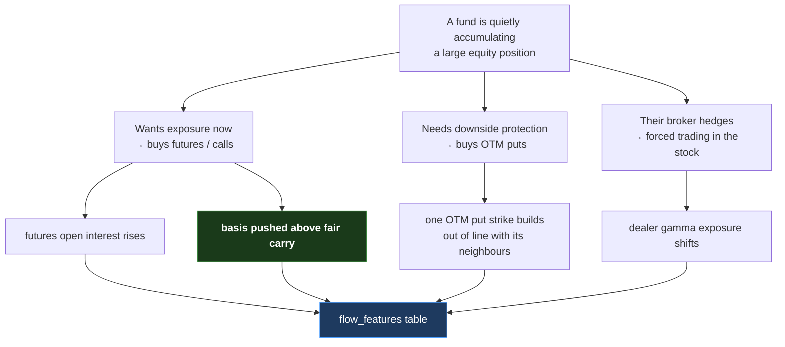

# 04 — Open Interest: The Footprint

[← Futures and options](03-futures-and-options.md) · [Index](README.md) · Next: [Pricing and Greeks →](05-pricing-iv-and-greeks.md)

If you read only one background document, read this one. Open interest is the
quantity that makes the entire project possible, and the distinction it draws is
subtle enough that most people who trade for a living still get it slightly
wrong.

---

## 1. Volume vs open interest

Two numbers are reported daily for every contract, and they look similar:

- **Volume** (`CONTRACTS` in the raw files) — how many contracts **changed hands
  today**.
- **Open interest** (`OPEN_INT`) — how many contracts are **currently open and
  unsettled**, right now, carrying real risk overnight.

Watch what happens across three days with the same ten contracts:

```
   Day 1:  A buys 10 contracts from B     →  volume 10,  open interest 10
   Day 2:  A sells those 10 to C          →  volume 10,  open interest 10
   Day 3:  C sells them back to B         →  volume 10,  open interest  0
                                              ▲              ▲
                                    same every day    tells the real story
```

Volume was 10 on all three days. Open interest tells you that a genuine position
existed on days 1 and 2, and was closed out on day 3.

**This is the whole game.** Volume can be one contract passed back and forth all
day by high-frequency algorithms that end the day holding nothing — pure noise.
A **change in open interest** means somebody opened or closed a real position and
is carrying it overnight, which requires capital, conviction and margin.

> `CHG_IN_OI` — the day-over-day change in open interest — is the single most
> important raw field in this project.

### 1.1 The four things a change in open interest can mean

Because every contract has two sides, an OI change on its own is ambiguous:

| Open interest | Price of the contract | What happened |
|---|---|---|
| **Up** | Up | New **buyers** are aggressive — a long buildup |
| **Up** | Down | New **writers** are aggressive — a short buildup |
| **Down** | Down | Longs are **closing** — long unwinding |
| **Down** | Up | Shorts are **closing** — short covering |

This 2×2 is called the **buildup quadrant**, and giving the project's OI
features a direction using it is what document 12 calls Stage 1b. It is one of
the few pieces of feature engineering here that measurably worked.

It also contains a trap that cost real effort to find, described in §4 below.

## 2. The units trap

> ⚠️ **NSE's bhavcopy reports `OPEN_INT` and `CHG_IN_OI` in SHARES, not
> contracts.** To get a contract count you **divide** by the lot size.

This project's own reference file asserted the reverse — that you *multiply* —
until 2026-09-04, when it was actually measured. The check that settled it:

- Take every stock future on a day and compute `SUM(OPEN_INT / lot_size)`.
- Compare against NSE's participant-wise file, which genuinely does report
  contracts.
- **They match to within 0.02%.** The undivided sum is off by a factor of
  ~2,158.

The practical consequence is a pleasant one: because OI is already in shares,
a rupee notional value is simply `oi × spot`, with **no lot factor at all**.

## 3. The futures basis, revisited

Document 03 introduced the basis. Here is why it belongs in a document about
footprints.

```
   fut_basis        = futures price − spot price          (rupees)
   fut_basis_pct    = futures / spot − 1                  (proportional)
   fut_basis_annual = basis_pct × 365/days_to_expiry × 100
   fut_basis_excess = fut_basis_annual − interest_rate    ⭐
```

The first three are mostly just interest. The fourth is the interesting one:
**how much more than fair value somebody is paying for leveraged long
exposure.**

Sanity check that it measures what it claims: across five years its median is
**+0.005% annualised** — essentially exactly zero, which is what "excess over
fair carry" should be — with a fat left tail (1st percentile −28.9%). That tail
is the dividend signature: futures trade at a discount ahead of an expected
dividend, because the futures holder does not receive it.

**One known structural gap.** `fut_basis_excess` is set to `NULL` whenever fewer
than 5 days remain to expiry, because annualising a one-day basis multiplies it
by 365 and produces nonsense. Since all NSE stock futures share one expiry date,
*every* symbol enters that window simultaneously — so the feature vanishes for
the whole of every expiry week: **448 of 1,254 dates, 36% of the sample**, and
not at random. Those are exactly the days institutional positioning is most
active. This is an acknowledged, unresolved limitation (document 14 §6).

## 4. The delta trap — why the naive quadrant is wrong

Return to the 2×2 table in §1.1. It says: OI up + contract price up = buyers were
aggressive.

Here is the problem. **A call option's price rises when the underlying stock
rises, whether or not anybody traded it at all.** Its price is mechanically
linked to the stock through a quantity called *delta* (document 05). So on a day
the stock rose 2%, nearly every call in the chain shows a price increase, and the
naive rule labels nearly every call build as "bullish buying" — regardless of who
actually did what.

The fix is to subtract the part of the price move that the stock's own move
explains, and classify on what is left over:

```
   premium_residual  =  (price_today − price_yesterday)
                        −  delta_yesterday × (spot_today − spot_yesterday)
```

**How much did this matter?** It was measured across **163,383 traded contracts**
over 47 sampled days:

| Measure | Value |
|---|---|
| Contracts classified differently, raw vs delta-adjusted | **35.8%** |
| Same, weighted by rupee notional | **36.9%** |
| Writer share, raw → adjusted | 63.4% → 61.0% |

More than a third of individual contracts flip their label — **while the
aggregate barely moves.** That last point is the methodological lesson worth
carrying:

> A validation that checked only summary statistics would have passed a feature
> that was wrong on a third of its inputs.

## 5. Putting it together: what a whale's footprint looks like

Combining documents 02, 03 and this one, here is the trace the project is
actually hunting for:



Of those four traces, exactly one survived every test the project put it
through: **the basis pushed above fair carry**. The others are documented
honestly in document 14 as things that did not work.

## 6. Vocabulary

| Term | Meaning |
|---|---|
| **Volume** | Contracts traded today, including churn |
| **Open interest (OI)** | Contracts currently open and carrying risk |
| **`CHG_IN_OI`** | Day-over-day change in OI — *new positioning*. The key field. |
| **Buildup quadrant** | OI direction × price direction → who was aggressive |
| **Premium residual** | Price change with the stock's own contribution removed |
| **Notional** | Rupee value of a position — here, `oi × spot` |
| **`fut_basis_excess`** | Futures premium above fair cost of carry |
| **Settlement price** | The exchange's official daily mark, which exists even if nothing traded |

[← Futures and options](03-futures-and-options.md) · [Index](README.md) · Next: [Pricing and Greeks →](05-pricing-iv-and-greeks.md)
