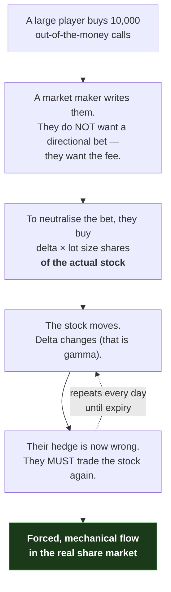

# 06 — How Derivatives Feed Back Into the Stock Market

[← Pricing and Greeks](05-pricing-iv-and-greeks.md) · [Index](README.md) · Next: [The project idea →](07-the-project-idea.md)

A reasonable objection to everything so far: *derivatives are just side bets.
Why would a side bet tell you anything about the real stock?*

This document answers that. It is the conceptual bridge between the background
material and the project itself — and it is also where the project's honest
limits start, because one of the two mechanisms described here was tested and
did not hold up.

---

## 1. Mechanism one: derivatives are where the information arrives first

A large investor who wants exposure faces a choice of route:

| Route | Speed | Visibility | Cost |
|---|---|---|---|
| Buy the actual shares | Weeks | Everyone sees a persistent buyer | Market impact |
| Buy futures | One trade | Anonymous, in a deep pooled market | Basis premium |
| Buy calls | One trade | Anonymous | Premium + time decay |

The derivatives routes are *faster and quieter*. So a rational large participant
who has decided something will often express it in F&O **before** they finish
expressing it in the stock.

That is the first mechanism, and it is a claim about **information timing**:

> Positioning appears in the derivatives book earlier and more completely than
> it appears in the share register.

The project's supporting evidence for this is its one surviving positive
result — the futures basis detecting mutual-fund accumulation *during* the
quarter it happens, roughly four months before the public filing reveals it
(documents 12 and 14).

## 2. Mechanism two: dealer hedging causes real, forced buying and selling

This is the stronger and more interesting claim, and it is the one the project
originally bet on.

Follow the chain:

Steps C and E are not opinions. They follow from the arithmetic of the dealer's
book. A dealer who does not hedge is running a risk their business model does not
permit.

So: **`open interest × the Greeks` is a map of hedging flow that must happen.**
You never see the whale. You see the footprint their counterparty is *obliged* to
leave.

### 2.1 Two regimes

| Dealer position | On a rally they… | On a dip they… | Effect on the market |
|---|---|---|---|
| **Short gamma** (has written options) | buy | sell | **Amplifies** moves — volatility rises |
| **Long gamma** (has bought options) | sell | buy | **Damps** moves — volatility falls |

The **gamma flip level** is the price at which the net position crosses from one
regime to the other. Approaching it is, in theory, approaching a change in the
market's character.

### 2.2 What the project actually found

This is the point where a beginner-friendly document has to stop being a
textbook and start being a research report.

The hypothesis was: *dealers short gamma → higher realised volatility tomorrow*.
Tested across 212,441 symbol-days:

| Test | Result | Reading |
|---|---|---|
| Days with negative GEX vs positive | 1.360% vs **1.547%** average next-day move | **Backwards** — the rare long-gamma days are the volatile ones |
| Does the *sign* of GEX carry the information? | Ranking on `−\|GEX\|` (ignoring sign entirely) scores **better** | **No.** It is a size proxy, not a positioning signal |
| Does it add anything over implied volatility? | Partial correlation **+0.0099** vs IV's own **+0.2114** | **Negligible** |

Three independent failures. The mechanism in §2 is real physics; the *tradeable
prediction built on it* is not supported by this data.

**What did survive**, and it is worth stating precisely because it is the sort of
narrower claim that honest research ends up with:

> When a symbol carries **unusually little dealer gamma relative to its own
> history**, its next-day move is larger — and that holds after controlling for
> the symbol's own implied volatility (partial ρ = +0.0436, same sign in all six
> years).

Note what changed to make that survive: comparing a symbol **against itself**
rather than against other symbols. The pooled version was silently ranking
stocks by size, because GEX scales with a company's size and option liquidity,
and small illiquid names are more volatile for reasons that have nothing to do
with dealers.

## 3. Mechanism three: the expiry calendar

A third, much duller mechanism deserves naming because it defeated one of the
project's stages.

Positions expire on a schedule published years in advance. In the days before
expiry, everybody rolls at once, hedges get unwound and rebuilt, and both
volumes and flows follow a strong, entirely predictable pattern.

This creates a permanent hazard for research:

> **Anything that appears to predict institutional flow may simply have
> rediscovered the calendar.**

The project's response was to make the calendar an explicit opponent. A baseline
model using **only** five calendar features — days to near-month expiry, plus
four day-of-week dummies — reaches an AUC of **0.61 to 0.72** on next-day
market-wide institutional flow.

**No feature set built in this project beats it.** Document 12, Stage 1.

## 4. Why derivatives data is worth the trouble anyway

Even with two of three mechanisms delivering negative results, the case for
looking here remains strong:

| Property | Spot market | Derivatives market |
|---|---|---|
| Published daily, free | ✅ | ✅ |
| Tells you *how much* was traded | ✅ | ✅ |
| Tells you positions **held overnight** | ❌ | ✅ (open interest) |
| Distinguishes new positions from churn | ❌ | ✅ (change in OI) |
| Encodes the **direction of conviction** | Weakly | ✅ (calls vs puts, strikes) |
| Encodes **expected volatility** | ❌ | ✅ (implied volatility) |
| Reveals **who is aggressive** | ❌ | ✅ (buildup quadrants) |
| Shows **leveraged demand** | ❌ | ✅ (futures basis excess) |

Roughly speaking: the stock market shows you the *result*, the derivatives market
shows you the *intent*.

## 5. The chain of reasoning, in full

Everything in this project rests on this sequence. If you can say it back in
your own words, you understand the project.

1. Large investors cannot trade quietly in the spot market, so they use
   derivatives — for speed, leverage, hedging, or all three.
2. Derivatives leave a public daily record: **open interest**, which is positions
   held, not volume churned.
3. Whoever takes the other side is a professional who **must hedge**, and their
   hedging is mechanical, calculable from the Greeks, and executed in the real
   stock.
4. Therefore the option chain contains a recoverable trace of large positioning.
5. And SEBI's quarterly filings give us — four times a year, six weeks late — a
   way to **check whether we recovered it**.

Steps 1–4 are the hypothesis. Step 5 is what makes this research rather than
speculation, and it is the subject of document 07.

[← Pricing and Greeks](05-pricing-iv-and-greeks.md) · [Index](README.md) · Next: [The project idea →](07-the-project-idea.md)
