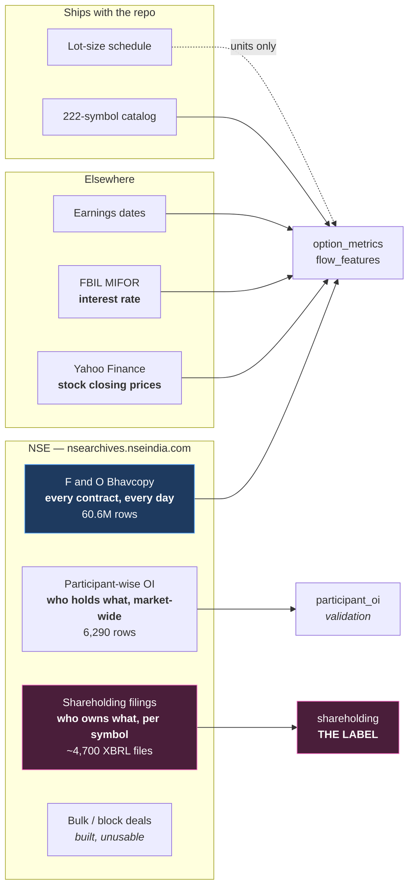

# 08 — The Data

[← The project idea](07-the-project-idea.md) · [Index](README.md) · Next: [The pipeline →](09-the-pipeline.md)

Seven sources. All free, all public, all end-of-day. No paid feed, no intraday
ticks, no broker API. This document explains each one, what its fields mean in
the market, and — as importantly — what it cannot tell us.

---

## The sources at a glance

---

## 1. NSE F&O Bhavcopy — the backbone

> **What it is:** NSE's official end-of-day report of **every single derivatives
> contract that existed that day** — every strike, every expiry, calls and puts,
> plus every future. "Bhavcopy" is from *bhav*, Hindi for price.

| | |
|---|---|
| Command | `uv run mktmtm fetch-bhavcopy` |
| Code | `src/mktmtm/data/bhavcopy.py` |
| Lands in | `data/raw/bhavcopy/extracted/` (11 GB) → `filtered/` (9.1 GB) |
| Coverage | 1,255 daily files, 2021-08-02 onwards |
| Volume | **60.6 million rows** once cached |

### 1.1 Every field, and what it means

| Field | What it is | Why it matters |
|---|---|---|
| `INSTRUMENT` | `OPTSTK`, `OPTIDX`, `FUTSTK`, `FUTIDX` | Separates stock/index and option/future |
| `SYMBOL` | The underlying, e.g. `RELIANCE` | Join key |
| `EXPIRY_DT` | Expiry date | Days-to-expiry; separates near from far month |
| `STRIKE_PR` | Strike price (0 for futures) | Where the position sits relative to spot |
| `OPTION_TYP` | `CE` call, `PE` put, `XX` future | Direction of the bet — partially |
| `OPEN` `HIGH` `LOW` `CLOSE` | The contract's own OHLC | Price action of the option itself |
| `SETTLE_PR` | **Official settlement price** | The correct mark. Exists even if the contract never traded, where `CLOSE` would be a stale last-traded price. Used for IV and for the basis. |
| `CONTRACTS` | Volume traded today | Activity — but includes intraday churn |
| `VAL_INLAKH` | Traded value in lakhs | Not used |
| `OPEN_INT` | **Open interest, in shares** | Positions currently open |
| `CHG_IN_OI` | **Change in OI, in shares** | ⭐ *New positioning* — the most important field in the project |
| `TIMESTAMP` | Trade date | Join key |

### 1.2 Two file formats

NSE changed its format mid-history, at `UDIFF_CUTOFF_DATE = 2024-07-08`.
`normalize_bhavcopy_columns` maps the new (UDiFF) names back to the legacy ones,
and **everything downstream uses legacy names only**:

| UDiFF | Legacy | | UDiFF code | Legacy code |
|---|---|---|---|---|
| `TckrSymb` | `SYMBOL` | | `IDF` | `FUTIDX` |
| `XpryDt` | `EXPIRY_DT` | | `STF` | `FUTSTK` |
| `StrkPric` | `STRIKE_PR` | | `IDO` | `OPTIDX` |
| `SttlmPric` | `SETTLE_PR` | | `STO` | `OPTSTK` |
| `OpnIntrst` | `OPEN_INT` | | | |
| `ChngInOpnIntrst` | `CHG_IN_OI` | | | |

### 1.3 What is actually in those 60.6M rows

| Instrument | Rows | Share |
|---|---|---|
| `OPTSTK` — stock options | 52,829,025 | **87.2%** |
| `OPTIDX` — index options | 7,028,460 | 11.6% |
| `FUTSTK` — stock futures | 733,488 | 1.2% |
| `FUTIDX` — index futures | 18,911 | 0.03% |

Stock options dominate. That is why the option chain is the primary signal
source and futures are a thin but unusually high-quality secondary one — thin in
rows, but every row is a liquid, single contract with a clean price.

---

## 2. Yahoo Finance — the underlying price

Bhavcopy tells you about the *contracts*. This tells you what the *stock* did.

| | |
|---|---|
| Command | `uv run mktmtm fetch-yahoo` |
| Endpoint | `query1.finance.yahoo.com/v8/finance/chart/{SYMBOL}.NS` |
| Lands in | `data/raw/yahoo_finance/`, 434 files |

### ⚠️ Two price series, and mixing them corrupts data

Yahoo returns **two** price series and they are for different purposes.
Confusing them is the single most damaging mistake possible in this pipeline.

| Series | Stored as | What it is | Correct use |
|---|---|---|---|
| **Raw / unadjusted** | `underlying_price` | The price actually printed that day | ⭐ Strike selection, IV, Greeks, futures basis, moneyness |
| **Adjusted** | `underlying_price_adj` | Back-adjusted for splits, bonuses, dividends | ⭐ Returns, momentum, training labels |

**Why raw for strikes.** If a stock splits 1:2, its price halves overnight. The
adjusted series rewrites all history so there is no jump. But NSE's strikes and
settlement prices are **unadjusted** — last year's bhavcopy really does show a
₹2,000 strike. Matching an adjusted ₹1,000 price against unadjusted ₹2,000
strikes selects entirely the wrong part of the chain.

**Why adjusted for returns.** The reverse. A 1:2 split is not a −50% return.

Getting this backwards corrupted roughly **10% of implied-volatility rows**
before it was caught.

**Known gap:** FINNIFTY and MIDCPNIFTY have no working Yahoo ticker, so they have
no spot price and are legitimately absent from the dataset.

---

## 3. NSE Participant-wise Open Interest — the only *named* daily data

Once per day, NSE publishes how many contracts each participant *category* holds.

| | |
|---|---|
| Command | `uv run mktmtm fetch-participant-oi` |
| URL | `nsearchives.nseindia.com/content/nsccl/fao_participant_oi_{DDMMYYYY}.csv` |
| Coverage | 1,258 days × 5 categories = **6,290 rows** |

Fourteen measured columns, each a contract count:

| Column family | Meaning |
|---|---|
| `future_index_long` / `_short` | Index futures held long / short |
| `future_stock_long` / `_short` | Stock futures held long / short |
| `option_index_call_long` / `_short` | Index calls bought / written |
| `option_index_put_long` / `_short` | Index puts bought / written |
| `option_stock_call_long` / `_short` | Stock calls bought / written |
| `option_stock_put_long` / `_short` | Stock puts bought / written |
| `total_long_contracts` / `total_short_contracts` | Row totals |

Derived on read (never stored, so the table stays a faithful copy of NSE's file):
`net_* = long − short`, and `d_net_*` = its day-over-day change, which is the
actual **flow**.

### 3.1 Two integrity properties, and one that is only nearly true

1. Every open long is somebody's short → the `TOTAL` row's legs must match.
2. The five categories must sum to `TOTAL`.

Both hold — **to within 1 contract.** NSE rounds each leg independently, so a
perfectly valid file can be off by one. An exact-equality check silently rejected
**14 legitimate trading days** before this was measured and a tolerance added.

### 3.2 What it is used for

Not as a feature — as an **instrument of verification**. Because it is
market-wide, joined to a per-symbol table it takes the same value for every
symbol on a date and contributes exactly zero cross-sectional information. Its
real uses:

- Establishing which way dealers actually lean (that is how `DEALER_SIGN` was
  measured — document 05 §4.3).
- Settling the shares-vs-contracts units question to within 0.02%.
- Checking whether a per-symbol feature's *market aggregate* tracks real
  institutional flow.

That last one produced a genuinely nice result: the outlier-strike rate,
aggregated across symbols, correlates with institutional option flow at FII
+0.225 and Pro +0.205, and with retail at **−0.281** — retail on the opposite
side, exactly as the closed-book structure requires.

---

## 4. SEBI quarterly shareholding — the label

**This is the source that made Stage 5 possible.**

| | |
|---|---|
| Command | `uv run mktmtm fetch-shareholding` |
| Index API | `/api/corporate-share-holdings-master?index=equities&symbol=X` |
| Volume | ~217 index calls + **~4,700 XBRL filings** (~500 KB each) |
| Cached | gzipped under `data/raw/shareholding/`, so a re-run costs nothing |
| Table | `shareholding`, ~4,400 rows |

The master API record carries only promoter/public percentages. The FII/DII/MF
breakdown lives inside the linked **XBRL** filing — a structured XML format used
for regulatory reporting.

Columns extracted: `fii_shares`, `dii_shares`, `mf_shares`, `insurance_shares`,
`total_shares`, plus the corresponding percentages.

### 4.1 Three things that are easy to get wrong here

**Use share counts, not percentages.** (See document 07 §4.)

**The XBRL stores percentages as fractions** — `0.1720` means 17.20%. The scale
is *inferred from the data* on ingest and validated against the master API rather
than hard-coded, so a taxonomy change cannot silently multiply every holding by
100.

**`total_shares` is derived**, as `shares ÷ percentage` across categories, and
returns `NULL` when the categories disagree by more than 1% — rather than
picking one and hoping.

### 4.2 The taxonomy trap that produced two silent bugs

SEBI changed the XBRL taxonomy in 2023, and the pre-2023 filings do two hostile
things:

1. They use **different member names** for the same categories.
2. They keep **dead categories as explicit zeros**. `ForeignInstitutionsMember`
   is the legacy FII bucket, emptied when SEBI folded FII into FPI in 2014 — and
   it sits in the *same filing* as `InstitutionsForeignPortfolioInvestorMember`
   carrying the real holding.

Resolving aliases by "first one present" picked the zero, and reported **no
foreign holding for every filing before 2023** — while simultaneously inflating
DII by the same amount through the institutions-minus-foreign fallback. Both
target variables were wrong and nothing failed.

The fix: `_pick` prefers the first **non-zero** alias. Full account in
[document 15](15-bugs-and-lessons.md).

---

## 5. NSE bulk and block deals — built, and structurally unusable

Worth documenting because the negative result is informative.

Bulk and block deals are individually reported large trades — **with the buyer
named**. That sounds like the perfect label. It is not, for two independent
reasons:

**It cannot be fetched.** `bulk.csv` / `block.csv` serve only the latest trading
day, and `/api/historical/*-deals` returns HTTP 503 to any programmatic client
even with a fully warmed session. It is bot detection — the same report
downloads fine from a browser. History must be downloaded by hand.

**And even with the history, bulk deals structurally exclude our universe.** The
reporting threshold is 0.5% of a company's listed shares — which selects
microcaps by construction. On the day measured, **0 of 158 bulk-deal rows were
among our 217 F&O symbols.** Block deals do reach large caps but are rare
(~2/day).

The fetcher and table exist and work. The data does not serve the purpose.

---

## 6. The small sources

### FBIL ADJUSTED MIFOR — the interest rate

The *r* in Black-Scholes, and the cost of carry that sets the fair futures basis.
Ships as `data/reference/ADJUSTED_MIFOR.csv`; stored in percent (6.5 = 6.5%).

Rates are not published every calendar day, so the nearest prior observation is
carried forward — but **beyond 7 days that stops being interpolation and becomes
a fabricated constant**, so staleness is tracked rather than hidden. (It is
carried across an 11-day gap around 2025-04-15, which is why `interest_rate` is
not usable as a *feature* — only as the constant it is meant to be.)

### Earnings dates

`data/reference/earning_dates.json`. Implied volatility rises predictably into an
earnings date and collapses after it, so "days until earnings" is a genuine
confounder for any volatility feature and is kept as an explicit control.

### The symbol catalog

222 symbols, shipped inside the package (`mktmtm.data.catalog`) and loaded via
`importlib.resources`. **217 reach the dataset** — 214 stocks + 3 indices
(NIFTY, BANKNIFTY, NIFTYNXT50).

The five absentees: FINNIFTY and MIDCPNIFTY (no Yahoo ticker — legitimate);
LTIM, PEL and TATAMOTORS (zero rows — an open, undiagnosed issue).

### The lot-size schedule

`data/reference/lot_sizes.csv`, **852 change-points** (853 lines including the header), shaped
`symbol, effective_from, lot_size, source` — a sparse **change-point schedule**,
not a constant. All 217 symbols covered, median 3 revisions each, max 8.

---

## 7. Summary — and the tension that defines the project

| Source | Grain | Rows | Names participants? | Per symbol? |
|---|---|---|---|---|
| Bhavcopy | contract × day | 60.6M | ❌ | ✅ |
| Yahoo | symbol × day | ~272K | ❌ | ✅ |
| Participant OI | category × day | 6,290 | ✅ | ❌ |
| **Shareholding** | **symbol × quarter** | **~4,400** | ✅ | ✅ |
| Deals | trade | — | ✅ | ✅ (but wrong universe) |
| MIFOR | day | — | — | ❌ |
| Earnings | event | — | — | ✅ |

Look at the last two columns. Only one row has ticks in both — and it arrives
**four times a year, six weeks late.** That single fact explains the entire
shape of this project's modelling work.

[← The project idea](07-the-project-idea.md) · [Index](README.md) · Next: [The pipeline →](09-the-pipeline.md)
