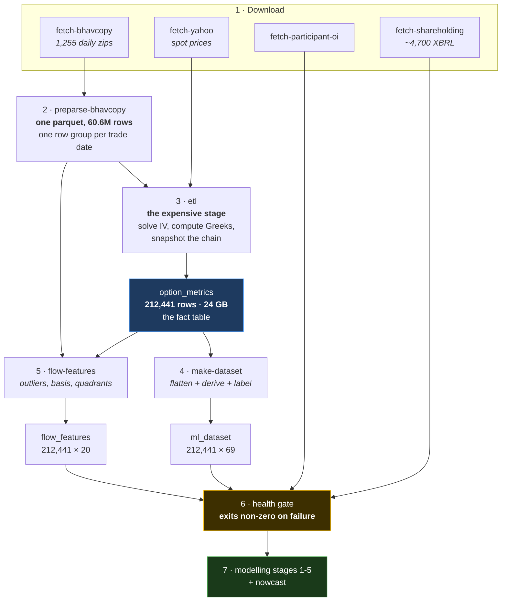
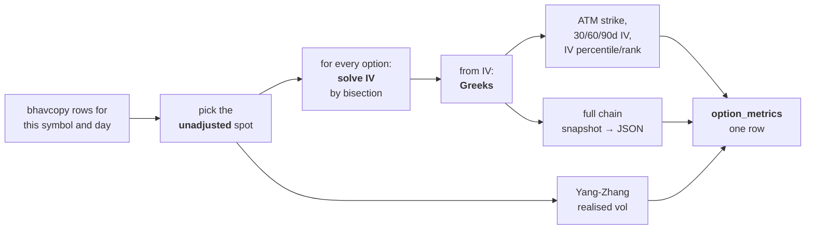

# 09 — The Pipeline: From Raw Files to a Table a Model Can Read

[← The data](08-the-data.md) · [Index](README.md) · Next: [The features →](10-the-features.md)

Sixty million rows of exchange CSVs are not something a model can learn from.
This document is the plumbing: how those files become a clean, checked,
one-row-per-stock-per-day table — and the several places where getting it
slightly wrong destroys everything downstream *without producing an error*.

---

## 1. The whole pipeline



One command runs all of it:

```bash
uv run mktmtm run-pipeline
```

Seventeen stages, each timed, each with its own progress bar, stopping at the
first failure. Document 16 covers the operational detail.

---

## 2. Step 2 — the parquet cache, and two out-of-memory failures

Re-parsing 1,255 CSVs once per symbol would mean reading the same files 217
times. So `preparse-bhavcopy` writes everything into **one parquet file** and the
ETL slices it.

Getting that to fit in 14 GiB of RAM took three attempts:

| Approach | Outcome |
|---|---|
| A dictionary of per-symbol DataFrames | Duplicated every row — **out of memory at 12.5 GB** |
| Boolean-mask the full frame, once per symbol | Memory-safe, but re-scanned 60M rows 217 times — impractically slow |
| **One sorted frame + a `{symbol: (start, stop)}` offset map** | ✅ `df.iloc[start:stop]` per symbol, no copying |

> ⚠️ **And then a trap inside the fix.** Parquet stores text columns as
> dictionary-encoded categories, and each row group carries its own dictionary.
> Read back, the categories follow *first-appearance* order across 1,254 row
> groups — **not alphabetical**. Sorting then orders by category *code*, leaving
> the column unsorted for the binary search, which silently returns nonsense
> spans. In one five-year build this dropped **75 of 222 symbols** and gave
> TATASTEEL, TATAPOWER and TATAMOTORS spans containing *other symbols' rows*.
> The fix is casting to `str` before sorting; an assertion now makes any
> regression loud.

The cache is written **one row group per trade date**, which is what later lets
`flow-features` stream one day at a time rather than loading 60M rows.

---

## 3. Step 3 — the ETL, where the real computation happens

This is the expensive stage — **3–5 hours for five years** — and the one that
cannot be repaired afterwards. For each `(symbol, date)` it:



Concretely, seven things happen per symbol-day:

1. **Pick the spot** — unadjusted, from bhavcopy's own `UNDERLYING_PRICE` where
   present, else the near-month futures price.
2. **Solve implied volatility** for every option, by bisection on the settlement
   price.
3. **Compute the Greeks** from that IV — delta, gamma, theta, vega, rho, vanna,
   charm.
4. **Snapshot the whole chain** as JSON — ~233 entries per row, ~49.5 million in
   total.
5. **Realised volatility** via Yang-Zhang from the futures OHLC.
6. **Pick the at-the-money strike** and lift its call/put detail into dedicated
   columns.
7. **Gamma flip level** — the spot price at which net dealer gamma crosses zero,
   found by evaluating on a ±10% grid and interpolating the crossing. It resolves
   on 91.4% of rows; the rest genuinely have no crossing in that band, which is a
   real state rather than a failure.

> ⚠️ **Re-running `make-dataset` cannot repair IV, strike or Greek defects.**
> They are baked into `option_metrics` at ETL time. Fixing one means a full ETL
> re-run.

### 3.1 The ETL is incremental by default

A full rebuild loads the entire 60M-row cache — about 9 GB resident — and
recomputes five years to add a few days. On this 14 GiB machine that was
**killed by the operating system twice on 2026-09-05**, and *silently*: SIGKILL
cannot be caught, so the log simply stops mid-line with no error at all.

Incremental mode reads each symbol's last processed date from `option_metrics`,
pushes a date floor into the parquet reader, and writes only days a symbol is
missing:

| | Full rebuild | Incremental |
|---|---|---|
| Cache rows loaded | 60,768,679 | **10,450,235** |
| Cache load time | ~1m 45s | **7s** |
| Peak memory | ~5–9 GB (OOM) | **~2.5 GB** |
| Runtime | 10–12 h | **~1 h** |

Two design decisions inside that are worth understanding, because both encode a
real failure:

- **The write cutoff is per symbol, not global.** After the OOM, three symbols
  sat at 09-04 while 214 stopped at 08-28. A single global frontier would have
  frozen that partial state permanently.
- **The recomputed overlap is not rewritten.** Those existing rows hold IV
  percentile and rank computed with a complete 252-day history; a trailing
  window cannot reproduce that, so rewriting them would replace correct values
  with worse ones.

---

## 4. Steps 4 and 5 — the two derived tables

### `make-dataset` → `ml_dataset` (212,441 × 69)

1. **Base load** — the scalar columns, `ORDER BY symbol, date`.
2. **Chain aggregates in SQL** — max pain, option walls, GEX, DEX, concentration
   indices. Written in SQL with lateral joins over the JSON because a Python pass
   over 49.5M chain elements takes minutes.
3. **Lift the ATM call and put** out of JSON into flat columns.
4. **Derived features** — momentum, spreads, ratios, day counts.
5. **Targets** — forward-shifted, per symbol.
6. **Look-ahead validation** — raises an exception rather than writing a corrupt
   table.
7. **Corporate-action screening** — blanks contaminated rows, *with logging*.

### `flow-features` → `flow_features` (212,441 × 20+)

Runs independently, reading the parquet cache and `option_metrics`. It does
**not** touch `ml_dataset`, deliberately: a candidate feature can be built and
tested without disturbing a validated matrix.

Document 10 covers what it computes.

---

## 5. The invariants — what breaks silently

Every item here is a bug this project actually shipped, found, and fixed. They
are collected in [document 15](15-bugs-and-lessons.md) with the full story; this
is the operational summary.

| Invariant | What happens if you break it |
|---|---|
| **Two price series, two purposes** — raw for strikes/IV/Greeks, adjusted for returns/labels | ~10% of IV rows corrupted |
| **`NULL` is never a number** — non-converged IV must stay `None` | Fake `0.0`/`500.0` values propagate into every volatility feature |
| **Row order is load-bearing** — every momentum feature is a `groupby().pct_change()` | Momentum computed across symbol boundaries |
| **Column lists are a contract** — `DATASET_COLUMNS` and the SQL DDL must mirror each other | Columns silently shift meaning |
| **Targets are NULL on each symbol's last day** — there is no "tomorrow" | Inference rows leak into training |
| **Corporate actions are blanked, not dropped** | Dropping introduces survivorship bias silently |
| **The parquet's row groups are NOT chronological** | Each day joined against an arbitrary other day, and *nothing fails* |

That last one deserves its own paragraph, because it is the purest example of
the failure mode this project keeps running into:

> The cache holds one row group per trade date, but the frame is sorted by
> symbol, so the row groups come out with **~293 backward steps** across five
> years. The first version of the buildup-quadrant code streamed them in file
> order and treated the previous group as "yesterday". Every merge **succeeded** —
> the same contract exists on both days — and returned a price change spanning
> months. It surfaced only as a coverage discontinuity that initially looked like
> the 2024 file-format change and was not.

---

## 6. The health gate

```bash
uv run python scripts/verify_db_health.py
```

Seven sections of structural checks. It **exits non-zero and stops the pipeline**
on failure, and it sits deliberately between the data and every model, because:

> **Both of the data defects this project has hit were silent.** Neither raised
> an exception. Neither made a stage fail. One of them made a stage report
> success in 58 seconds while the table it was supposed to update stayed exactly
> as stale as before.

Among the things it checks: the three per-symbol tables must have **exactly
equal row counts**, because every evaluation depends on a 1:1 join between them.

---

## 7. What the finished database looks like

| Table | Rows | Size | Grain | What it is |
|---|---|---|---|---|
| `option_metrics` | 212,441 | **24 GB** | symbol × day | The fact table — the full enriched chain |
| `ml_dataset` | 212,441 | 341 MB | symbol × day | Flat training matrix, 69 columns |
| `flow_features` | 212,441 | 45 MB | symbol × day | Candidate flow features |
| `flow_regimes` | 161,717 | small | symbol × day | Stage 2 output |
| `flow_attribution` | 518,613 | small | symbol × day × participant | Stage 3 output |
| `shareholding` | ~4,400 | small | symbol × quarter | **The label** |
| `participant_oi` | 6,290 | small | category × day | Named, market-wide |
| `symbol_data` | 222 | small | symbol | The catalogue |

Coverage: **2021-08-02 → 2026-08-28, 1,254 trading days, 217 symbols.** (The
most recent pipeline run extends this to 2026-09-04 and ~213,379 rows; the
figures throughout this folder are quoted as of the report runs that produced
them.)

The first three tables are all at the **same grain** and join one-to-one. That is
not an accident, it is enforced, and the health gate checks it.

[← The data](08-the-data.md) · [Index](README.md) · Next: [The features →](10-the-features.md)
