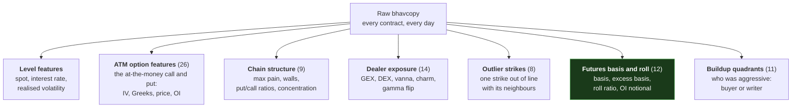

# 10 — The Features: What We Compute, and What It Means

[← The pipeline](09-the-pipeline.md) · [Index](README.md) · Next: [ML basics →](11-machine-learning-basics.md)

A **feature** is a number computed from raw data that we hope carries
information. This document lists every family this project builds, explains what
each is *supposed* to mean, and says plainly whether it worked.

The short version: about 89 features exist, and **one of them matters.**

---

## 1. The families



Groups 1–4 live in `ml_dataset`; groups 5–7 live in `flow_features`. The green
box is the one that survived.

---

## 2. The outlier-strike detector

### What problem it solves

Every chain-structure feature is a **sum or average over ~300 strikes**, and
averaging is exactly what destroys a localised signal.

Nobody accumulates 50,000 contracts of a 15%-out-of-the-money call by accident.
But that build vanishes the moment it is summed alongside the at-the-money churn.
This detector finds the individual strike instead — its output is deliberately
sparse and *pointable*: a date, a symbol, a strike.

### How it works

A contract is flagged when it clears **both** gates:

1. **`|z| ≥ 25`** — a robust z-score of its `chg_oi` computed **within
   `(symbol, date, expiry)`**
2. **`share ≥ 0.05`** — it holds at least 5% of that symbol-day's entire
   `|chg_oi|`

Three design decisions, each of which was measured rather than assumed:

**The scale is estimated only from contracts that actually traded.** A standard
deviation would be inflated by the very build being hunted. But a robust
median-based estimate over the *whole* chain fails the opposite way: an option
chain is heavily zero-inflated, so the median and its spread both collapse toward
zero and everything that moved scores an enormous z. That version flagged
**99.4% of symbol-days** — it was measuring the noise floor. Restricting the
estimate to non-zero changes drops it to ~13%.

**Comparison happens within a single expiry.** Near-month contracts carry
systematically bigger OI changes, so a pooled scale would flag the front month
every day and never see a far-dated build.

**Both gates are required.** With the corrected scale the `|z|` distribution runs
median 0.7, 90th percentile 3.1, 99th 18.4, 99.9th 53 — so a nominal-looking
"z ≥ 4" actually sits near the 92nd percentile and is not unusual at all.

The resulting flag rate is **stable across all five years** (10.8%–16.6%, no
trend). That is the check that matters, because F&O liquidity grew several-fold
over the window and a drifting rate would mean the feature was tracking volume.

### The eight columns

| Column | Meaning |
|---|---|
| `oi_outlier_count` | How many contracts flagged |
| `oi_outlier_max_absz` | The strongest one |
| `oi_outlier_share` | How concentrated the day's activity was in them |
| `oi_outlier_call_frac` | Calls vs puts |
| `oi_outlier_moneyness` | `(K − S) / S` — how far out of the money |
| `oi_outlier_dte` | Days to expiry of the flagged builds |
| `oi_outlier_build_notional` | Rupees of position **opened** |
| `oi_outlier_unwind_notional` | Rupees of position **closed** |

### Verdict: mixed, and the distinction matters

At predicting **price movement**, this family fails. `oi_outlier_moneyness` had
a raw correlation of +0.0368 that collapses to +0.0004 under the implied-volatility
control — the textbook example of the failure the standing evaluation rule exists
to catch.

But at measuring **positioning**, it works. Aggregated across symbols and
compared against NSE's participant data, the outlier rate tracks institutional
option flow: **FII +0.225, Pro +0.205, Client −0.281** — retail on the opposite
side, exactly as a closed book requires.

> Those are two different claims and only the second one is the project's
> question. The family measures positioning; it just does not forecast
> volatility.

---

## 3. The buildup quadrants — giving open interest a direction

### The problem

Before this, an open-interest build said *"₹400 crore of new interest appeared at
this strike"* and could not say whether it was **bought** (bullish, paying
premium) or **written** (bearish or income-seeking, collecting premium). Opposite
market views producing an identical print.

### The solution, and the trap inside it

Cross each contract's OI change against its price change (document 04 §1.1):

```
                    price UP              price DOWN
                ┌──────────────────┬──────────────────┐
      OI UP     │  LONG BUILDUP    │  SHORT BUILDUP   │
                │  buyers          │  writers         │
                │  aggressive      │  aggressive      │
                ├──────────────────┼──────────────────┤
      OI DOWN   │  SHORT COVERING  │  LONG UNWINDING  │
                │  writers         │  buyers          │
                │  closing         │  closing         │
                └──────────────────┴──────────────────┘
```

**The trap:** a call's price rises when the stock rises, whether or not anybody
traded it. So classification must use the **delta-adjusted premium residual**,
not the raw price change:

```
   (mark − mark_prev)  −  delta_prev × (spot − spot_prev)
```

Measured across **163,383 traded contracts** over 47 sampled days: raw and
adjusted classification **disagree on 35.8% of contracts** (36.9% weighted by
notional) — while the aggregate writer share barely moves, 63.4% → 61.0%.

> **A validation that checked only summary statistics would have passed a
> feature that was wrong on a third of its inputs.**

### The eleven columns

| Column | Meaning |
|---|---|
| `q_long_buildup_notional` | Rupees in the buyers-aggressive quadrant |
| `q_short_buildup_notional` | Rupees in the writers-aggressive quadrant |
| `q_short_cover_notional` | Rupees of writers closing |
| `q_long_unwind_notional` | Rupees of buyers closing |
| `q_fut_direction` | Net futures direction from the quadrants |
| `q_fut_direction_resid` | The same, built on the basis change instead of the raw price |
| `ce_writer_frac` | Share of call activity that was writer-driven |
| `pe_writer_frac` | Same for puts |
| `opt_direction` | Net option-market direction |
| `oi_outlier_writer_frac` | Writer share *within the flagged outlier strikes* |
| `oi_outlier_direction` | Net direction of the flagged builds |

Coverage is 97–100% of symbol-days and **flat across all five years**.

### Verdict: the feature engineering worked; the features mostly did not

This is the only place in the project where a constructed feature block
**measurably improved a task**. Adding it to Stage 1's market-flow model raised
Ridge AUC for two of three participants:

| Participant | core features | + direction | + extended |
|---|---|---|---|
| Pro | 0.5757 | 0.5942 | **0.6137** |
| Client | 0.6846 | 0.7117 | **0.7176** |
| FII | 0.6357 | 0.6208 | 0.6326 |

It roughly **halves** the damage the directionless core features do — for Pro it
closes the gap to the calendar baseline entirely.

But the direction features carry a poison pill: **price direction is baked into
their construction** (price up + OI up = long buildup). So they behave partly as
momentum proxies. In Stage 5, `q_fut_direction` posts a large raw correlation
with FII accumulation, collapses to the shuffled baseline once momentum is
controlled for, and **flips sign** between momentum-chasing foreign funds and
contrarian mutual funds.

A later rebuild on the basis change instead of the price change
(`q_fut_direction_resid`) confirmed the *fix* works — and the feature still does
not.

---

## 4. The futures family — where the one real result lives

| Column | Formula | Meaning |
|---|---|---|
| `fut_basis` | `mark − spot` | Rupee premium of the future over the stock |
| `fut_basis_pct` | `mark / spot − 1` | Same, proportional. Well-behaved at any horizon. |
| `fut_basis_annual` | `basis_pct × 365/dte × 100` | Annualised. **NULL below 5 days to expiry.** |
| **`fut_basis_excess`** | `fut_basis_annual − interest_rate` | ⭐ **Basis minus fair carry** — leveraged demand pressure |
| `fut_roll_ratio` | `next_oi / (near_oi + next_oi)` | How far positions have migrated to next month |
| `fut_roll_spread` | `(next_mark − near_mark) / near_mark` | The cost of carrying forward |
| `fut_oi`, `fut_oi_chg`, `fut_volume` | Raw counts (**OI in shares**) | Position size and turnover |
| `fut_oi_notional`, `fut_oi_chg_notional` | `× spot` | Rupee equivalents |
| `fut_dte` | `expiry − date` | Days to expiry — an explicit calendar control |

**The mark is `SETTLE_PR` with a `CLOSE` fallback**, because settlement is the
official daily price and exists even on a day the contract did not trade, where
`CLOSE` would be a stale last-traded price showing a fictitious basis.

### Why the carry adjustment is not cosmetic

Measured against next-day movement, with implied volatility controlled:

| Feature | Partial correlation |
|---|---|
| `fut_basis_excess` | **−0.0516** |
| `fut_basis_pct` (the un-adjusted version) | −0.0236 |

**Subtracting the interest rate doubles the signal.** It is what turns a price
ratio into a measure of demand.

### Verdict: ⭐ this is the project's one durable finding

`basis_excess_mean` — the mean excess basis over a quarter — detects
**actively-managed mutual-fund accumulation** at a partial correlation of
**+0.1374 across 18 of 19 quarters**. Document 12 Stage 5 and document 14 give
the full result and its limits.

### One acknowledged flaw

`fut_basis_excess` is NULL whenever fewer than 5 days remain to expiry, and since
every NSE stock future shares one expiry, that removes **448 of 1,254 dates
(36%)** all at once — precisely the days when positioning is most active. This is
unresolved and materially limits what Stage 1's null result can be said to have
tested.

---

## 5. The dealer-exposure family (GEX)

Fourteen columns implementing the mechanism from document 06 §2.

| Column | Meaning |
|---|---|
| `gex` | Net gamma exposure — `Σ (OI × Γ × S² × dealer_sign)` |
| `gex_chg` | Its day-over-day change |
| `dex` | OI-weighted net delta of the chain |
| `vanna_exp`, `charm_exp` | Second-order exposures |
| `gamma_flip` | The spot level where net gamma crosses zero |
| `dist_to_flip` | How far spot sits from it |
| `otm_put_oi_build` | OTM put building — the hedging signature |
| ...plus concentration and wall measures | |

The `dealer_sign` constant is `{"CE": −1.0, "PE": +1.0}` — **inverted from the US
convention, and measured rather than assumed** (document 05 §4.3).

### Verdict: the headline hypothesis failed; a narrower claim survives

Failures, any one of which would be sufficient:

| Test | Result |
|---|---|
| Do short-gamma days precede bigger moves? | **No** — 1.360% vs 1.547%, the wrong way round |
| Does the *sign* carry information? | **No** — ranking on `−\|gex\|` scores better |
| Anything left over implied volatility? | Partial +0.0099 against IV's own +0.2114 |

The survivor, and the reason it survives, is worth internalising:

> **Comparing a symbol against itself instead of against other symbols.** The
> pooled test was ranking stocks by size, because GEX scales with company size
> and option liquidity. Within a symbol, `dist_to_flip` — distance to the gamma
> flip level — is the strongest dealer feature at partial +0.0210, and it is the
> one that is *invariant* to the sign convention that turned out to be wrong.

That ordering is itself informative: **what predicts is proximity to the regime
boundary, not how much gamma is outstanding.**

---

## 6. The scoreboard

Measured on next-day absolute return, within-symbol, after controlling for
implied volatility:

| Feature | Partial correlation | t | Verdict |
|---|---|---|---|
| `fut_basis_excess` | **−0.0516** | −20.7 | ⭐ Strongest in the project |
| `gex` | +0.0407 | 17.6 | The previous best |
| `fut_basis_pct` | −0.0236 | −10.2 | Half the signal — carry matters |
| `dist_to_flip` | +0.0210 | +7.5 | The best dealer feature |
| `oi_outlier_share` | +0.0078 | 3.4 | Marginal |
| `oi_outlier_call_frac` | +0.0101 | 1.4 | No |
| `oi_outlier_max_absz` | +0.0055 | 0.8 | No |
| `oi_outlier_moneyness` | +0.0036 | 0.5 | No — and its raw value was +0.0368 |

And for scale: `ce_iv_30` — plain implied volatility, on its own — scores
**+0.2114**. Every constructed feature in this project is small against simply
knowing what the market already expects.

[← The pipeline](09-the-pipeline.md) · [Index](README.md) · Next: [ML basics →](11-machine-learning-basics.md)
