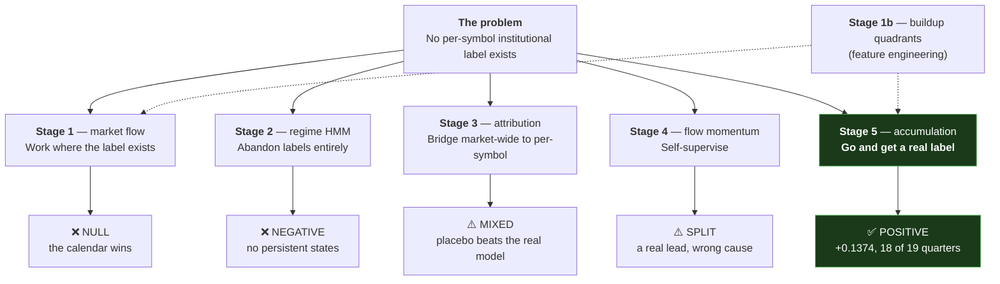

# 12 — The Models, Stage by Stage

[← ML basics](11-machine-learning-basics.md) · [Index](README.md) · Next: [The journey →](13-the-journey.md)

Six modelling efforts, built in order, each a response to the previous one's
failure. This document takes each in turn: what it asked, how it was built, what
it answered, and why.

**Three of six returned null or negative results.** That is normal in this
domain, and the documents that record those nulls are as carefully written as the
one that records the success.

---

## The map



---

## Stage 1b — Buildup quadrants (built first, used by everything)

Not a model — feature engineering, covered fully in
[document 10 §3](10-the-features.md#3-the-buildup-quadrants--giving-open-interest-a-direction).

**Verdict: ✅ success.** It is the only constructed feature block in the project
that measurably improved a task, and the delta-adjustment finding (35.8% of
contracts classified differently) is a methodological result in its own right.

---

## Stage 1 — Market-level flow model

**Command:** `uv run mktmtm market-flow` · **~4 minutes**

### The question

*Can today's aggregated option and futures features predict the sign of
tomorrow's market-wide institutional flow?*

This works where the label actually exists (document 08 §3): NSE's participant
data is market-wide, so aggregate the per-symbol features to market level and
predict `d_net_opt_stock_call` — the day-over-day change in net stock-call
positioning — for FII, Pro and Client.

Scored on 806 common rows; 556 validation rows after the walk-forward warm-up.

### The result: the calendar wins

| Participant | Calendar-only AUC | Best model AUC | Margin |
|---|---|---|---|
| Client | **0.720** | 0.718 | −0.002 |
| FII | **0.654** | 0.654 | +0.0005 |
| Pro | **0.612** | 0.614 | +0.002 |

Across all 18 combinations of (feature set × model × participant):

- **Zero** margins are significantly positive.
- **Four** are significantly *negative* — worst is −0.043.

> Adding flow features to the calendar model does not merely fail to help; it
> **actively degrades** it. They behave as noise diluting a real signal.

### The baseline is the actual story

The calendar-only model uses five features: days to near-month expiry, plus four
day-of-week dummies. Nothing else. It reaches AUC 0.61–0.72.

That is a **far larger effect than anything else measured in this project**, and
it is entirely mechanical — positions roll on a schedule published years in
advance. A model that only rediscovers the roll cycle has found nothing.

This is exactly why the calendar comparison was specified as the headline
*before* any model was fitted. Without it, an AUC of 0.72 would have looked like
a triumph.

### One prediction that was wrong, and reported

Persistence — predicting tomorrow's flow sign from today's — was expected to
score ≈0.50, because the linear autocorrelation of participant flow is ≈0 (FII
lag-1 = −0.019). It scored **0.526 / 0.555 / 0.604**.

Sign persistence exists where Pearson correlation does not see it. Recorded as a
correction rather than quietly dropped.

**Verdict: ❌ NULL.**

---

## Stage 2 — Latent regime model (HMM)

**Command:** `uv run mktmtm flow-regimes` · **~11 minutes**

### The question

With no per-symbol label available, *forget labels*. Fit a Hidden Markov Model
over six per-symbol flow observables and ask: **do symbol-days fall into
persistent latent positioning states?**

If they do, the state itself becomes a feature for later stages. 161,717
symbol-days retained (76.1%), 211 symbols, fitted on training dates only and
decoded forward.

### The pre-registered test, and its failure

The requirement, fixed in advance: **every state's self-transition probability
must exceed 0.5** — a regime must at minimum survive to the next day.

| States (k) | BIC | **Min self-transition** | Restart spread |
|---|---|---|---|
| 2 | −297,668 | **0.367** | 0 |
| 3 | −544,977 | **0.255** | 0 |
| 4 | −605,915 | **0.255** | 29,501 |
| 5 | −643,110 | **0.253** | 18,934 |
| 6 | −645,699 | **0.168** | 6,859 |
| 8 | −892,883 | **0.072** | 112,865 |

**No state count satisfies it.** Even the two-state model has a state with a
0.367 diagonal — a mean dwell time of 1/(1−0.367) ≈ **1.6 days**. That is a
day-to-day flicker, not a positioning regime.

Three signatures point at the same explanation:

1. **Persistence gets monotonically worse with more states.** A model finding
   real regimes and given too many states usually splits them into sub-states
   that stay persistent. This one produces ever more transient states.
2. **BIC never turns around** — still improving at k=8, the largest tried. A
   selection criterion that does not turn around inside the search grid has not
   selected anything.
3. **The fits are not reproducible.** At k=8, six restarts of the fitting
   algorithm differ by **112,865** log-likelihood units.

### The conclusion

**These observables vary continuously.** An HMM asked to find discrete modes in a
continuum will always return *something*, while meaning nothing.

Per the pre-registered falsification clause, this is reported rather than tuned
away. The temptation to keep searching for a feature set that makes persistence
appear is exactly what such a clause exists to prevent.

**Verdict: ❌ NEGATIVE.**

---

## Stage 3 — Attribution bridge (LLP)

**Command:** `uv run mktmtm flow-attribution` · **~25 seconds**

### The question

*Can the observed market-wide flow be attributed across individual symbols?*

Formally this is **Learning from Label Proportions** (document 11 §10): each date
is a bag of ~170 symbols, and only the bag total is observed.

### The results, in one table

| Participant | Out-of-sample R² | Placebo R² | Earnings lift | **Placebo earnings lift** | Identifiability |
|---|---|---|---|---|---|
| Pro | **+0.451** | −0.008 | +0.012 | **−0.129** | 0.887 ✅ |
| Client | **+0.432** | −0.002 | +0.047 | **+0.097** | 0.807 ✅ |
| FII | +0.069 | −0.015 | +0.053 | **+0.187** | 0.503 ❌ |

### What works

The aggregate decomposition is real for Pro and Client, and the placebo confirms
it comes from the labels rather than from feature structure.

> ⚠️ **This R² must not be read as predictive.** It is *contemporaneous*
> decomposition — features at time `t` explaining flow at time `t` — not
> forecasting. It does not contradict Stage 1's null, and presenting it as
> forecasting performance would be a serious misreading.

### What fails

**The independent validation.** The only external check available was whether
the model's per-symbol scores cluster around earnings announcements, when
institutional activity should be elevated.

For **Client and FII, a model fitted on randomly shuffled labels clusters around
earnings *more strongly* than the real model does** — twice as much for Client,
3.5× for FII. So the clustering comes from the per-symbol features' own structure
(symbols behave unusually near earnings regardless of who traded) and **not** from
the flow labels.

FII fails on two further counts: its post-event lift (+0.098) exceeds its
pre-event lift (+0.053) — that is reaction, not positioning — and its
identifiability of 0.503 means linear and tree-based models rank symbols almost
independently of one another, so its ranking is a property of the model, not of
the data.

### The deeper problem

The per-symbol allocation is **not uniquely determined by the data**. With ~170
symbols and one equation per day, the system is underdetermined by construction.
What selects one allocation among the many that fit is a set of modelling
assumptions.

For Pro and Client the allocation at least survives a change of functional form
(rank correlation 0.81–0.89). For FII it does not.

**Verdict: ⚠️ MIXED, leaning negative.**

---

## Stage 4 — Flow momentum

**Command:** `uv run mktmtm flow-momentum` · **~35 seconds**

### The question

*Does a directional build in a symbol continue?* Self-supervised — both the
signal and the target come from `flow_features`, so no external label is needed.

### Why a cross-sectional rank IC is the right metric here

All NSE stock futures share one monthly expiry, so days-to-expiry is
near-constant within a date — a **single value on 83.6% of dates**, median spread
**0**. A within-date rank correlation is therefore automatically neutral to both
the market-wide factor and the expiry cycle that defeated Stage 1.

### Result 1: no momentum in the signal itself

Within-symbol autocorrelation of `q_fut_direction`: **−0.009 / −0.001 / +0.000 /
−0.012 / +0.007** at lags 1/2/3/5/10 — essentially exactly zero.

`opt_direction` actively **reverses** (−0.092 at lag 1, negative for **98.6%** of
symbols). That is the bounded-open-interest mechanism: a position opened today
must eventually be closed.

### Result 2: but futures lead options

| Direction | lag 0 | lag 1 | lag 2 | lag 3 |
|---|---|---|---|---|
| **futures → options** | −0.218 (99%) | **+0.030** (77%) | **+0.035** (86%) | **+0.022** (79%) |
| **options → futures** | −0.218 (99%) | +0.003 (55%) | +0.001 (51%) | +0.002 (55%) |

**The asymmetry is the result** — a symmetric confound cannot produce a
one-directional lead. Cross-sectionally the effect is +0.047 to +0.055,
significant at every horizon: the largest consistent signal in the project at
that point (Stage 1's best margin was +0.002).

Same-day the relationship is strongly *negative*: futures long buildup coincides
with writer-dominated option flow, and *then* option positioning turns bullish
over the next one to three days. **That sign flip is what makes it a lead rather
than a correlation.**

Partialling out the same-day relationship — which removes the mechanical route
*signal → target today → target tomorrow* — leaves the lead intact from lag 2
onward and shows that lag 1 was mostly mechanical:

| Lag | Raw | **Partial** | Mechanical share |
|---|---|---|---|
| 1 | +0.0297 | +0.0102 | **66%** |
| 2 | +0.0351 | **+0.0325** | 7% |
| 3 | +0.0226 | **+0.0217** | 4% |

### Result 3: and it is not institutional

Split each symbol's days into terciles by how much futures open interest changed
— a proxy for whale activity — and re-measure the lead:

| Activity on day `t` | Partial lead at lag 2 |
|---|---|
| Low (quiet days) | +0.0306 |
| Mid | +0.0347 |
| **High (heavy OI change)** | **+0.0285** |

**Flat.** A lead driven by whales should concentrate where whales are active.
This one is just as strong on a symbol's quietest third of days, so it is a
pervasive **microstructure** property — not episodic institutional accumulation.

### Two spurious findings caught here

`ce_writer_frac` appeared to lead `opt_direction` at **+0.071** — larger than the
futures lead. But its *same-day* correlation with the target is **−0.75**: they
share construction, so it is a mirror of the target's own reversal, not a lead.

An intermediate version used causal within-symbol z-scoring to strip symbol fixed
effects, and reported self-persistence of **+0.2979** with smooth decay — by far
the project's largest number. It was an artefact: the causal z subtracts a
*slowly updating* expanding mean, so consecutive z-scores share a baseline error
and look persistent on a series with zero autocorrelation.

> **The standard repair for symbol fixed effects introduced a worse confound
> than the one it removed.**

**Verdict: ⚠️ SPLIT — a genuine, replicable lead, with a non-institutional
cause.**

---

## Stage 5 — Accumulation detection ⭐

**Command:** `uv run mktmtm accumulation` · **~60 seconds**

### The reframe that made it work

After Stage 4 the project's framing was corrected. Stages 1 and 4 asked
*forecasting* questions; Stage 3 had the right shape but validated against an
earnings calendar its own placebo beat.

| Stage | Question | Right shape? |
|---|---|---|
| 1 | Will flow rise *tomorrow*? | ❌ forecasting |
| 2 | Do days cluster into states? | ❌ no target at all |
| 3 | Where did *today's* flow go? | ✅ contemporaneous, per-symbol |
| 4 | Does today's direction continue? | ❌ forecasting |
| **5** | **Have institutions been buying this stock?** | ✅ **detection** |

And crucially, Stage 5 has a **real label**: SEBI quarterly shareholding
(document 07 §4). ~20 filings × ~200 symbols = 19 usable quarters.

### The trap in the label itself: corporate actions

Before any of that, a problem with the target has to be dealt with, and it is
severe enough that leaving it in would have dominated the result.

**A bonus issue or a stock split changes every holder's share count without
anybody buying or selling anything.** Measured across the raw target
distribution, the 99th percentile is foreign institutions apparently acquiring
**31% of a company in a single quarter** — which no institution does organically.
That is arithmetic being read as behaviour.

`flag_corporate_actions` uses **two independent detectors**, because neither
covers everything on its own:

| Detector | How it works | Its blind spot |
|---|---|---|
| **Share-count ratio** between consecutive filings | Direct: if total shares jumped >5%, something structural happened | `total_shares` is derived and is NULL on ~11% of filings |
| **Raw vs adjusted price divergence** inside the window | Yahoo adjusts retroactively, so the ratio between the two price series jumps on the ex-date | Needs price data in the window |

The second exists precisely to cover the rows where the first is blind. The
threshold separates cleanly because dividends move the adjustment factor by ~1%
while splits move it by 50% or more.

Flagged periods are **blanked, not silently dropped** — 3.4% of periods — and
this is why [document 16](16-running-it.md) insists the scoring run must apply
the same filter: a bonus issue in the scored quarter would otherwise read as a
spectacular detection failure.

### The mandatory baseline: price momentum

Momentum plays the role here that the expiry calendar played in Stage 1 — the
obvious explanation that must be ruled out before any derivatives feature earns
credit. Institutions buy what is going up; a feature that detects rising stocks
has discovered nothing.

### The result

| Holder | Momentum IC | `basis_excess` raw | **Partial (momentum controlled)** | Positive periods |
|---|---|---|---|---|
| **FII** | **+0.360** | −0.057 | −0.054 | 11% of 19 |
| DII (all) | −0.122 | +0.094 | +0.090 | 95% |
| **Mutual funds** | −0.064 | **+0.140** | **+0.137** | **18 of 19** |
| Insurers | −0.098 | −0.029 | −0.035 | 42% |

Read that table row by row, because each row is a separate finding.

**FII accumulation is a price-momentum phenomenon** (IC +0.360). No derivatives
feature survives its control. This is the more robustly established of the two
headline findings, and it is negative.

**Domestic institutions are contrarian** (−0.122) — they buy weakness, consistent
with retail SIP money being deployed on dips. With momentum no longer dominant, a
real signal has room to appear.

**Mean futures basis above carry detects mutual-fund accumulation**: partial IC
**+0.1374**, retaining **98%** of its raw value under the momentum control,
positive in **18 of 19 quarters** (binomial p = 0.000038; Bonferroni-corrected
over ~120 cells, p = 0.0046). Shuffled baseline: +0.0014 at 47%.

**Splitting mutual funds from insurers raises the IC by half.** Insurers show
nothing. Pooling them as "DII" was diluting the signal — the granularity was
load-bearing.

### The counterparty check

`basis_excess` carries **opposite signs** for FII (−0.054) and mutual funds
(+0.137). A basis rich to carry goes with domestic funds accumulating *and*
foreign investors distributing. One trade, both sides — a coherence check that
neither number gives on its own.

Confirmed independently: FII and mutual-fund accumulation correlate at
**−0.4807, negative in 19 of 19 quarters.**

This one is worth trusting for a specific reason. Stage 1's analogous Pro/Client
check turned out to be near-tautological — those two labels are already −0.80
correlated *by construction*, because the derivatives book is closed and Client
is the other side of it. **Here the two series are filed independently, by
different holders, and nothing forces them to oppose.**

### It detects accumulation in progress, not before it

| Window used | Partial IC |
|---|---|
| The *prior* quarter (pure forecasting) | nothing |
| First **30 days** of the quarter | **+0.085** (11 of 13 quarters) |
| The full quarter | **+0.137** |

That is exactly the shape the project wanted: **detect that they have been
buying, not predict that they will.** And since the filing publishes ~6 weeks
after quarter end, a detector firing 30 days in leads public disclosure by about
four months.

### Robustness — every split tried

| Subset | Partial IC | Positive |
|---|---|---|
| Full sample | +0.1374 | 95% of 19 |
| First half (2021-10 → 2023-10) | +0.0701 | 89% of 9 |
| **Second half (2024-01 → 2026-04)** | **+0.1981** | **100% of 10** |
| Large caps | +0.1665 | 79% |
| Small caps | +0.1055 | 79% |

Bootstrap over *periods* rather than rows: **+0.1374, 95% CI [+0.0902,
+0.1801]** — excludes zero.

### The time gradient, investigated

The effect nearly triples between the first and second halves. Is that
degraded early data?

No — the pre-2023 half has the same NULL rates and a *narrower* accumulation
distribution. Correlating per-period IC against period covariates with calendar
time partialled out, **gross mutual-fund flow is the only survivor** (+0.369);
F&O market depth collapses to −0.067 and cross-sectional dispersion to −0.040.

So detection strength appears to scale with **how much flow there is to detect**,
rather than being specific to 2024–26. At 19 periods that partial gives p = 0.13:
the best available explanation, not an established one.

### And a second explanation, found later and ruled out

That covariate list had a hole in it, spotted on 2026-10-03: **it never tested
the size of the sample itself.**

The number of symbols carrying the feature in a quarter is not constant. It sits
at 126–144 from 2021 through mid-2024, then steps up to 165–191 — because NSE
widened F&O eligibility in late 2024, so more names clear the feature's own
"at least 5 days to expiry" gate.

Why that is a threat: an IC is a correlation measured *within* each quarter, and
a correlation over 190 names is simply less noisy than one over 130. So the
second half could score higher purely because its cross-sections are wider —
no change in the underlying signal at all. **And the step lands almost exactly
on the half boundary**, which is the worst possible coincidence.

The test is to hold the universe fixed: keep only symbols present in every
period, so every quarter is the same width, and re-measure. Because "every
period" is one arbitrary cut, the whole curve is swept:

| Symbols must appear in… | Symbols kept | First half | Second half | **Gradient** |
|---|---|---|---|---|
| (no restriction — as published) | 209 | +0.0701 | +0.1981 | **+0.1280** |
| ≥ 50% of quarters | 144 | +0.0701 | +0.2017 | +0.1316 |
| ≥ 70% | 136 | +0.0753 | +0.2078 | +0.1326 |
| ≥ 80% | 120 | +0.0675 | +0.1961 | +0.1286 |
| ≥ 90% | 93 | +0.0940 | +0.2131 | +0.1191 |
| **every quarter** | **62** | **+0.1045** | **+0.1980** | **+0.0935** |

**The gradient survives.** It holds between +0.119 and +0.133 from 50% through
90%, and shrinks only at the strictest cut — to +0.0935, 73% of the published
figure. The second-half number barely moves anywhere (+0.196 to +0.213).

The shape of the shrinkage is the interesting part. It is **not** that the second
half falls; it is that the **first half rises**, from +0.0701 to +0.1045. The
symbols present throughout are the established, liquid ones, and they carry a
stronger early signal than the full universe did. So sample composition was
*understating* the early period, not inflating the late one.

A useful side effect: the headline +0.1374 is not inflated by composition
either. On the cleaner universes it is *higher* — +0.1537 and +0.1567.

⚠️ The strictest cut keeps only 62 of 209 symbols, so each quarterly
correlation there rests on far fewer names and is noisier for it (the
first-half positive rate drops to 7 of 9). That is exactly why the full sweep
is published rather than the single strictest number.

> **The habit this illustrates** is the one from [document 11](11-machine-learning-basics.md):
> before believing that an effect changed over time, check whether your
> *measurement* changed over time. Here the apparatus did change — and the
> finding survived it, which is a stronger statement than never having asked.

### Honest limits

- The effect is **modest**. Consistency, not size, is what makes it credible.
- **19 periods is few.**
- ~120 cells were examined, and the original feature selection was **not**
  pre-registered.
- There is **no true out-of-sample test.** Subset stability is weaker than an
  independent dataset. The obvious candidate — monthly mutual-fund portfolio
  disclosures — would require scraping ~40 heterogeneous asset-manager websites
  and was not attempted.
- The effect nearly triples between halves.

**Verdict: ✅ POSITIVE, with stated limits.**

---

## The nowcast — turning the detector into a falsifiable prediction

**Command:** `uv run mktmtm nowcast`

Every one of those 19 quarters is *closed*: the filing exists and the IC was
measured against it. That is a fit, however carefully controlled.

The stronger available claim is **a prediction made before the outcome exists** —
and the data structure hands one over for free:

```
last filing            latest F&O data          filing publishes
2026-06-30 ──────────────► 2026-08-28 ...............► ~2026-11-14
           └─ 59 days of footprint ─┘   └─ no label yet ─┘
```

### The design problem, and how it was solved

The validated variants are 30 days (+0.085) and a full quarter (+0.137). The
*open* window is whatever has elapsed since the last filing — on 2026-08-28 that
was **59 days**, which is neither. Interpolating between two published numbers
would be an assumption, so the implementation **measures** instead: it rebuilds
the entire historical panel at 59-day windows and calibrates against that.

| Window | Partial IC | Positive periods |
|---|---|---|
| 30d | +0.0846 | 85% of 13 |
| 45d | +0.0947 | 89% of 19 |
| **59d (live)** | **+0.1145** | **89% of 19** |
| 75d | +0.1335 | 89% of 19 |
| Full quarter | +0.1374 | 95% of 19 |

**Monotone in window length**, smoothly, across five points. That was not
designed for, and it is what a signal accumulating information over a window
should do.

### The record

| | |
|---|---|
| As of | 2026-08-28 |
| Universe | **177 symbols** ranked |
| Excluded | 1 stale filing, 35 with no F&O activity in the window |
| Calibrated IC | **+0.1145** |
| Checkable from | **~2026-11-14** |

The shipped score is **momentum-residualised**, because the validated result is a
partial. Verified on the live run: rank correlation between score and window
return = **−0.008**.

Three design decisions make this a real commitment rather than a gesture:

- **The record is committed to git** (`docs/results/nowcast-2026-08-28.md`).
  `models/` is gitignored, so an artefact there would prove nothing about *when*
  the prediction was written — and a forward prediction whose date cannot be
  established is not a forward prediction.
- **It refuses to overwrite.** Re-running raises `NowcastRecordExists`. A
  forecast made before an outcome, silently replaced by one made after it under
  the same filename, would be worse than no forecast at all.
- **It states its own limits on its face**, including that a materially negative
  result counts as evidence against Stage 5.

A second record exists for a 66-day window (`nowcast-2026-09-06.md`, IC +0.1266),
which gives an incidental second check: if the calibration curve is real, the
longer window should score higher.

[← ML basics](11-machine-learning-basics.md) · [Index](README.md) · Next: [The journey →](13-the-journey.md)
