# 13 — The Journey: How the Project Got Here

[← The models](12-the-models.md) · [Index](README.md) · Next: [Results →](14-results.md)

This is the chronological story, covering all three branches: what `main` built,
what `feat/gex-dealer-positioning` added, what `feat/vol-selling-strategy` did
with the result — and, most instructively, the several whole approaches that were
built, evaluated and abandoned along the way.

Nothing here was planned in advance. Each phase is a response to what the
previous one measured.

---

## The shape of it

```mermaid
flowchart TB
    subgraph MAIN["Branch: main — the foundation"]
        M0["Phase 0-1<br/>Project skeleton +<br/>pure options mathematics"]
        M1["Phase 2-3<br/>Data acquisition +<br/>the JSON pipeline"]
        M2["Phase 4-5<br/>PostgreSQL storage,<br/>threaded ETL, backtester"]
        M3["Phase 6-7<br/>CLI, UI,<br/>smoke-run fixes"]
        M4["Integrity work<br/><i>IV audit, look-ahead leak,<br/>cache offset map, spot basis</i>"]
    end

    subgraph BRANCH["Branch: feat/gex-dealer-positioning — 54 commits"]
        B1["<b>Attempt 1</b><br/>XGBoost price direction<br/>❌ archived"]
        B2["<b>Attempt 2</b><br/>GEX dealer positioning<br/>❌ hypothesis fails"]
        B3["Data foundations<br/><i>participant OI, lot sizes,<br/>flow features, quadrants</i>"]
        B4["<b>Attempt 3</b><br/>Stages 1-4: flow modelling<br/>⚠️ null / negative / mixed"]
        B5["<b>The reframe</b><br/>detection, not forecasting"]
        B6["Label hunt<br/><i>deals ❌ → shareholding ✅</i>"]
        B7["<b>Attempt 4</b><br/>Stage 5: accumulation<br/>✅ the surviving result"]
        B8["Nowcast + engineering<br/><i>frozen prediction,<br/>pipeline runner, incremental ETL</i>"]
    end

    subgraph TRADE["Branch: feat/vol-selling-strategy — 14 commits"]
        T0["<b>The second pivot</b><br/>the detector does not<br/>reach a trading outcome"]
        T1["Phase 0 — economics<br/><i>lot size, costs, margin,<br/>slippage</i>"]
        T2["<b>Gate 0</b> — the base strategy<br/>✅ PASS, +4.56%"]
        T3["<b>Gate 1</b> — do our features help?<br/>❌ FAIL, as predicted"]
        T4["Stop loss<br/>❌ measured, harmful"]
        T5["The screen + scoring harness<br/><i>refusals, caps, frozen record</i>"]
        T6["<b>Gate 3</b> — forward<br/>⏳ 0 of 6 months"]
    end

    M0 --> M1 --> M2 --> M3 --> M4 --> B1
    B1 --> B2 --> B3 --> B4 --> B5 --> B6 --> B7 --> B8
    B8 --> T0 --> T1 --> T2 --> T3 --> T4 --> T5 --> T6

    style B7 fill:#1a3a1a,stroke:#4caf50,color:#fff
    style B5 fill:#3d2f00,stroke:#ffc107,color:#fff
    style T0 fill:#3d2f00,stroke:#ffc107,color:#fff
    style T2 fill:#1a3a1a,stroke:#4caf50,color:#fff
    style T3 fill:#4a1e1e,stroke:#ff6b6b,color:#fff
```

---

## Part I — `main`: building the machinery

The `main` branch contains no modelling at all. It is entirely infrastructure,
and it was built test-first in numbered phases.

### Phases 0–1 — skeleton and pure mathematics

Project setup (pytest, mypy strict, ruff), then `options/` — Black-Scholes
pricing, the Greeks, bisection implied volatility, Yang-Zhang realised
volatility, at-the-money strike selection.

**Design decision that paid off repeatedly:** these are *pure functions with no
I/O*. They can be unit-tested against known values with no database, no network
and no fixtures. Every later bug in this area was caught here rather than in
production data.

### Phases 2–3 — data acquisition and the JSON pipeline

`data/` — bhavcopy (both file formats), Yahoo spot, the symbol catalog,
interest rates, earnings dates. Then `pipeline/process.py`, which enriches
bhavcopy into processed JSON files.

That module is now **legacy**: it feeds only the old UI, not the modelling path.
It is retained because the UI uses it, and it carries a standing hazard —
*any change to enrichment logic must land in both it and the ETL, or they
silently diverge*. The constants `_IV_WINDOW = 252` and `_IV_MIN_PERIODS = 60`
are duplicated in each file precisely because they must match, and an
anti-divergence test keeps the two chain builders byte-identical.

### Phases 4–5 — PostgreSQL and the backtester

`storage/` — a pooled, batched, NaN-scrubbing writer; the threaded per-symbol
ETL; the SQL schema. And `backtest/strangle.py`, a short-strangle strategy with
weekly delta-hedge adjustments: sell the ~20-delta call and put of the 30-day
expiry on the first trading day of each month, rebalance weekly, close before
expiry.

The backtester was the one part of the project aimed at *trading* rather than
*detection*, and it lay quiet for months after the focus shifted — until Part
III turned it into the centre of a second project. See §III below.

### Phases 6–7 — CLI and UI

Typer subcommands (`fetch-bhavcopy`, `etl`, `backtest`, …), progress bars, and a
Streamlit control panel that runs pipeline steps as detached subprocesses.

> **Security note that is enforced, not aspirational:** `mktmtm-ui` binds the
> tailnet IP by default and has **no authentication**. It must never bind
> `0.0.0.0`.

### The integrity work — where `main` earned its keep

Four commits at the end of `main` are not features at all. They are the record of
finding and fixing defects that had already corrupted data:

- **The IV integrity audit** — the raw/adjusted price-basis mix-up (~10% of IV
  rows) and the `0.0`/`500.0` sentinel returns.
- **A look-ahead leak** in `ml_dataset`, plus corporate-action corruption.
- **The cache offset map dropping 75 symbols** — the parquet category-ordering
  trap from [document 09 §2](09-the-pipeline.md).
- **A health-gate script**, added because both of those defects were silent.

Document 15 tells these stories properly. They are the reason this project's
documentation is so preoccupied with *silent* failure.

---

## Part II — the branch: four attempts at the actual question

54 commits, and the story of three abandonments.

### Attempt 1 — XGBoost next-day price direction (archived)

The project's first modelling approach: a supervised per-symbol classifier
predicting whether tomorrow's close exceeds today's, from 42 option-derived
features plus 9 missingness indicators. It was completed through a sealed test.

**Why it was abandoned.** Two reasons, and the second is the important one:

1. The Phase 7 audit found the edge thin and **substantially tied to
   *missingness*** — rows where the IV solver failed, which happens on illiquid
   or violently-moving names. The model was partly learning "this row is
   broken", which correlates with volatility.
2. **It answers the wrong question.** The project's goal is detecting
   institutional positioning, not predicting price.

The code is at the git tag `archive/xgboost-direction` and **must never be
merged** — it predates the open-interest-units fix, the GEX sign correction, and
all of `flow_features`, so merging would revert measured bug fixes. Its model
card survives at `docs/models/xgboost-direction-model-card.md`.

**Cost of the lesson:** an entire modelling stack. **Value:** it forced the
question "what are we actually trying to detect?", which everything since has
been an answer to.

### Attempt 2 — GEX dealer positioning

Documented in detail in [document 06 §2.2](06-how-derivatives-move-markets.md)
and [document 10 §5](10-the-features.md). The hypothesis was the textbook one:
dealers short gamma → amplified moves → higher next-day volatility.

The work that went in was substantial: vanna and charm added to the Greeks, the
Greeks baked into every chain element at ETL time, dealer-exposure aggregates,
the gamma-flip level, a hypothesis-testing harness with confound controls.

**Three independent failures**, and one correction along the way that is more
interesting than the result: the dealer *sign* was assumed from US convention and
turned out to be inverted for Indian single stocks. It was fixed by
**measuring** against participant data — desks are net short calls on 99.9% of
days — and the correction was verified to be a pure negation (`gex == −gex` on
all 212,441 rows, `|gex|` identical).

**What survived:** a within-symbol magnitude effect, and the observation that
`dist_to_flip` — proximity to the regime boundary — beats exposure size.

### Interlude — building the data foundations

Between attempts, several things were built that everything afterwards depends
on:

- **Participant-wise OI ingestion** — the only named daily data, and the
  instrument that settled both the dealer sign and the OI-units question.
- **The lot-size schedule** — 852 change-points, because lot sizes are revised.
- **The units fix** — `OPEN_INT` is in shares, not contracts. The reference file
  asserted the reverse until it was measured; the raw sum was off by ~2,158×.
- **Flow features** — outlier strikes and the futures basis, built to read the
  parquet cache directly so they needed no ETL re-run.
- **Buildup quadrants** — and the delta-adjustment discovery.
- **The full architecture documentation** (`docs/architecture/`).

### Attempt 3 — Stages 1 to 4

Four modelling stages against the market-wide label, covered in document 12.
Results: **null, negative, mixed, split.**

The most valuable output of this phase was not a model. It was a set of
*measurement habits*: the calendar baseline, the placebo, the leakage tripwire,
the partial-correlation rule, the moving-block bootstrap. Every one of them was
built because something looked good and turned out not to be.

### The reframe — the turning point

Stated by the project owner, and it changed everything:

> *"What I want is not to predict when the whales have entered to buy stocks by
> looking at the F&O that they purchase when they buy the stocks — not to
> accurately predict if they will enter at a particular time."*

Detection, with a short lead. Not forecasting.

In hindsight the pattern is obvious: Stages 1 and 4 asked forecasting questions
and returned nulls; Stage 3 asked a contemporaneous question and was the only one
with a promising shape. But it took four negative results to see it, which is
worth recording honestly rather than presenting the final design as if it had
been obvious.

### The label hunt

The reframe demanded a per-symbol label. Two candidates:

**NSE bulk and block deals** — named large trades. Built the fetcher, the parser,
the table. Then found: (a) history is bot-blocked, only the latest day is
served programmatically, and (b) more fundamentally, the 0.5%-of-listed-shares
threshold selects microcaps by construction — **0 of 158 bulk-deal rows on the
day measured were among our 217 F&O symbols.** Structurally unusable.

**SEBI quarterly shareholding** — worked. ~4,700 XBRL filings, cached gzipped,
giving per-symbol share counts for FII, DII, mutual funds and insurers.

Two silent bugs in parsing it were found and fixed (document 15).

### Attempt 4 — Stage 5, and the surviving result

Document 12. `basis_excess_mean` → mutual-fund accumulation, partial IC +0.1374,
18 of 19 quarters.

Then the robustness work: time halves, size halves, period bootstrap, the
counterparty check, the time gradient, and a re-test of the transfer hypothesis
(which was **not** supported — the FII/MF spread is weaker than mutual funds
alone).

### The nowcast and the engineering finish

Two frozen prediction records committed to git before the data to score them
exists. Then the operational work needed to actually run all of this
unattended:

- **A 17-stage pipeline runner** (`run-pipeline`) with per-stage timing and
  progress bars — plus three wrapper bugs it exposed on its first real run, one
  of which reported success in 58 seconds while leaving its table untouched.
- **The ETL made incremental**, after being OOM-killed twice on a 14 GiB host —
  silently, because SIGKILL cannot be caught.
- **A health gate** extended to validate the five newer tables.

---

---

## Part III — the branch that stopped asking which way

`feat/vol-selling-strategy`, 14 commits, built 2026-09-11 → 2026-09-12. A
separate line of work: different question, different cadence, different
definition of success. [Documents 17–22](17-selling-volatility.md) cover it in
full; this is how it came about.

### The second pivot

The research had a positive result. The obvious next question was whether a
normal trader could use it — and the answer, measured, was no:

| Link | IC | Quarters + |
|---|---|---|
| our score → MF accumulation | **+0.1351** | 18/19 |
| MF accumulation → next quarter's return | +0.0502 | 12/19 |
| **our score → next quarter's return** | **+0.0200** | 11/19 |

**The chain breaks at the second link, and not through any fault of the
detector.** Even perfect knowledge of mutual-fund accumulation barely predicts
returns, because domestic funds are contrarian (−0.064) and quarterly momentum
is itself negative (−0.047). No improvement in detection could have reached a
trading outcome.

So the branch stopped asking *which way* and started asking *how much* — selling
volatility rather than forecasting direction, because magnitude is where every
forward relationship this project ever measured actually lives (`ce_iv_30` at
+0.2114 against Stage 1's best margin of +0.002).

**This is the project's second reframe, and it has the same shape as the
first.** The reframe on the research branch changed *forecasting* to
*detection*; this one changes *direction* to *magnitude*. Both were forced by
measurement rather than chosen, and both came after the previous framing had
been pushed as far as it would go.

### What was built, and what it found

| | |
|---|---|
| `backtest/economics.py` | Costs, margin, slippage, whole-trade pricing |
| `backtest/analysis.py` | The Gate 0 report |
| `backtest/filters.py` | Feature join, baselines, significance |
| `serving/screen.py` | The daily tool, and its frozen record |
| `serving/scoring.py` | Forward validation |
| `backtest/strangle.py` | +518 lines: economics, stop loss, three defect fixes |

Four gates, every criterion fixed before the number existed:

| Gate | Question | Verdict |
|---|---|---|
| **0** | Does strangle-selling make money net of costs? | ✅ **PASS** — +4.56%, 6/6 years, −37.27% drawdown |
| **1** | Do our research features beat IV rank alone? | ❌ **FAIL** — nothing beat chance, including IV rank |
| **2** | Build the tool | ✅ Built |
| **3** | Does it hold forward, ≥6 months? | ⏳ **0 of 6**, answerable ~March 2027 |

And one intervention measured and rejected: a **stop loss**, tested at
1.5×/2×/3× the entry credit, made *every* column worse — return, worst trade,
drawdown and Sharpe together. It catches the recoverable losses and misses the
unrecoverable one.

### Six more silent defects

All six produced plausible output and raised nothing; two predated the branch.
They were found because Gate 0's first run reported a **worst trade of −1,677%**
— a loss of sixteen times the margin posted, which the strategy cannot produce.
Every headline statistic on that same run looked fine.

Chasing that one impossible number found three separate data defects. Fixing
them moved the mean by **less than half a percentage point** while the worst
trade fell to −245.8%.

> The mean was never the contaminated statistic. **The tail was** — and in a
> premium-selling strategy the tail is what decides whether the book is usable.

[Document 15 §12–17](15-bugs-and-lessons.md) covers all six.

### The third abandonment, and a refusal

Gate 1's failure abandoned the idea that the research would feed the tool.
What replaced it is a screen that orders by *tradeability* rather than
conviction, and displays the research features only with the label *"tested in
Gate 1; did not beat chance."*

Then, while building the forward-validation harness, eight screens generated for
February–September 2026 returned a cumulative **+94.55%** — and the harness
excluded every one of them, because they were written for months whose outcomes
already existed. A near-doubling of capital that the tool refuses to count is
the best demonstration available that the check works.
[Document 22](22-forward-validation.md).

---

## What each abandonment cost, and taught

| Abandoned | Effort | What it bought |
|---|---|---|
| **XGBoost price direction** | A full modelling stack | The question got corrected: *positioning*, not price |
| **GEX dealer positioning** | Greeks, aggregates, hypothesis harness | The confound-control methodology, and `dist_to_flip` |
| **Bulk/block deals** | A fetcher, parser, table, tests | Ruled out a plausible label conclusively, with a measured reason |
| **Stages 1–4** | Four models | The evaluation discipline that makes Stage 5 believable |
| **The detector as a trading signal** | One measurement | The second reframe: magnitude, not direction |
| **Features as entry filters** (Gate 1) | An evaluation harness | A working strategy, a reusable cost model, and a measured negative |

None of that was wasted. The measurement apparatus Stage 5 was judged by — the
partial control, the placebo, the period bootstrap, the counterparty check — is
entirely the product of four things that did not work.

---

## Where the project stands

| | |
|---|---|
| **Data** | 2021-08-02 → 2026-09-04, 217 symbols, all tables 1:1, health gate PASS |
| **Established, positive (research)** | `basis_excess_mean` detects MF accumulation (+0.1374, 18/19) |
| **Established, positive (trading)** | Strangle-selling earned a positive net-of-cost return in 6 of 6 years (+4.56%/trade) |
| **Established, negative** | FII accumulation is momentum; GEX does not predict volatility; no flow forecasting beats the calendar; no persistent regimes; the detector does not reach a trading outcome; no entry filter beats chance; a stop loss harms |
| **Committed forward predictions** | 2 nowcast records (scorable ~2026-11-14) + 1 screen record |
| **The binding constraint** | A −37.27% drawdown that nothing tested reduces, measured on a sample containing no severe crash |
| **Open (research)** | Monthly MF portfolio scrape (the only true out-of-sample test); replacing `basis_excess_med` with `fut_basis_pct` in Stage 1; index-inclusion events as a better instrument for Stage 3 |
| **Open (trading)** | Gate 3 — the first eligible record is October 2026's first trading day; verdict ~March 2027 |

[← The models](12-the-models.md) · [Index](README.md) · Next: [Results →](14-results.md)
