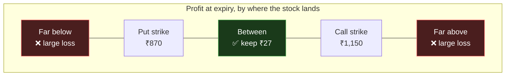

# 17 — Selling Volatility Instead of Predicting Direction

[← Running it](16-running-it.md) · [Index](README.md) · Next: [What a trade costs →](18-what-a-trade-costs.md)

**This document starts Part III.** Everything up to here was *research*: can we
detect what large investors are doing? Part III is a different project with a
different question, built on a separate branch (`feat/vol-selling-strategy`),
and the honest reason it exists is that **the research answer turned out not to
be usable.**

This document explains why the question changed, and what "selling volatility"
means to someone who has never sold anything in a market.

---

## 1. The chain that broke

[Document 12](12-the-models.md) ended on the project's one surviving positive
result: a feature called `basis_excess` detects mutual-fund accumulation with a
partial information coefficient of **+0.1374**, positive in 18 of 19 quarters.

The obvious next question is: *so can you make money with it?*

That question has a precise shape. For the detector to be tradeable, **two
separate links** both have to hold:


Both were measured:

| Link | IC | Quarters positive |
|---|---|---|
| our score → MF accumulation | **+0.1351** | 18 / 19 |
| MF accumulation → next quarter's return | +0.0502 | 12 / 19 |
| **our score → next quarter's return** | **+0.0200** | 11 / 19 |

**Link 1 holds. Link 2 does not.** And the failure is not the detector's fault —
you can see that by looking at the middle row on its own. Even if you had
*perfect* knowledge of which stocks mutual funds were accumulating, delivered to
you free and instantly, that knowledge would barely predict returns: +0.0502,
positive in 12 of 19 quarters, which is a coin flip with good posture.

### Why knowing what the whales do does not pay

Two measurements from [document 12](12-the-models.md) explain it, and both are
worth internalising because they contradict most retail intuition:

1. **Domestic funds are contrarian.** Their accumulation correlates **−0.064**
   with price momentum. They buy stocks that have been *falling*, because they
   are deploying a steady monthly inflow of retirement savings into whatever
   looks cheap. They are not trying to call a bottom; they simply have money
   arriving every month that must be invested.
2. **Quarterly momentum is itself negative** (−0.047) in this sample. Over a
   three-month horizon in Indian equities, what went up recently was slightly
   *more* likely to come back down.

Put those together and the picture is almost the opposite of the folk theory.
The whale is not a superior forecaster whose coat-tails you can ride. It is a
large, slow, price-insensitive buyer with an obligation to deploy capital — and
being on the same side as it confers no advantage at a three-month horizon.

> **The finding to carry:** a detector can work perfectly and still be worthless
> to trade, because *detecting what someone does* and *profiting from what they
> do* are two different claims. The project spent four modelling stages
> establishing the first and one measurement destroying the second.

---

## 2. So the question changed

Direction is a closed question in this project. Every attempt at it failed:

| Attempt | Question | Result |
|---|---|---|
| XGBoost direction model | Will this stock rise tomorrow? | Abandoned — the edge was largely an artefact of broken rows |
| Stage 1 | Which way will institutions trade tomorrow? | Null — a calendar beats it |
| Stage 4 | Does positioning direction continue? | No — it actively reverses |
| Stage 5 → returns | Does detected accumulation pay? | +0.0200, 11/19 — no |

Meanwhile, **every forward relationship this project ever measured successfully
was about magnitude, not direction:**

| Feature | Partial IC vs next-day **\|return\|** (size of the move, ignoring sign) |
|---|---|
| `ce_iv_30` — implied volatility | **+0.2114** |
| `fut_basis_excess` | −0.0516 |
| gamma z-score | +0.0436 |

+0.2114 is, by a wide margin, the largest forward number in the entire project.
Stage 1's best margin over its baseline was +0.002. So the pivot is not a change
of heart — it is following the only signal that was ever there:

> **Stop asking which way a stock will move. Ask how much it will move, and sell
> that.**

---

## 3. What "selling volatility" actually means

If you have read [document 03](03-futures-and-options.md) this will be familiar;
if not, here is the whole idea from scratch.

### The insurance analogy, which is not an analogy

An option is insurance on a share price. Someone who owns RELIANCE and fears a
crash can buy a **put** — a contract that pays out if the price falls below an
agreed level. They pay a small amount now (the **premium**) to be protected from
a large loss later.

Somebody has to be on the other side of that. The **writer** (seller) of the put
collects the premium and takes on the obligation. They are the insurance
company.

| | The buyer | The writer |
|---|---|---|
| Pays or receives | Pays premium | **Receives premium** |
| Best case | Large gain if the move happens | Keeps the premium, nothing else |
| Worst case | Loses the premium | **Large, open-ended loss** |
| Wins when | The stock moves a lot | **The stock sits still** |
| Frequency | Loses often, wins big | **Wins often, loses big** |

Writing options is being an insurer. You collect many small, certain payments
and occasionally pay one large, uncertain claim. It is a real business, and it
is profitable when the premiums you collect exceed the claims you pay.

### Why this is called "selling volatility"

The premium on an option is mostly a price for *expected movement*. If everyone
expects a stock to swing wildly next month, insurance on it is expensive; if
everyone expects it to be quiet, insurance is cheap. That expected movement,
extracted back out of the premium, is **implied volatility** — the market's own
forecast of how much the stock will move ([document 05](05-pricing-iv-and-greeks.md)).

So when you write an option you are, quite literally, **selling the market's
expectation of movement.** You profit if the stock moves *less* than the premium
implied. You lose if it moves more. Which way it moves is, to a first
approximation, not your concern at all.

That last sentence is the entire pivot in one line. **This is a strategy that
does not need a direction forecast — which is fortunate, because this project
established that it does not have one.**

### The strangle

The strategy implemented here sells *both* sides at once. A **short strangle**:

```
  Stock is trading at ₹1,000.

  SELL a call at ₹1,150   →  collect ₹15/share
  SELL a put  at ₹870     →  collect ₹12/share
                             ─────────────────
                             ₹27/share collected up front

  At expiry one month later:
    stock between 870 and 1150  →  both expire worthless, keep all ₹27   ✅
    stock at 1,250              →  the call costs ₹100 to buy back, lose ₹73  ❌
    stock at 700                →  the put costs ₹170 to buy back, lose ₹143  ❌
```

You have sold insurance against both a large rise and a large fall. You win if
nothing much happens. This is the trade — and note that it is **symmetric**: it
does not care whether the stock drifts up or down, only how far.



Full mechanics — which strikes, when to adjust, when to exit — are in
[document 20 §1](20-does-it-make-money.md).

---

## 4. Who is on the other side, and why that is reassuring

A strategy is more believable if you can say *who pays you and why they are
willing to*. Here the project can, because it ingests the participant data
([document 08](08-the-data.md)).

NSE publishes, every day, the net option positions of four groups: foreign
institutions (FII), domestic institutions (DII), proprietary desks (Pro), and
everyone else (Client — overwhelmingly retail).

**Institutional desks are net writers of calls on 99.9% of days.**

That number was originally measured for a completely different purpose — it
settled an argument about the sign convention in the GEX work
([document 13](13-the-journey.md)) — and it happens to answer this question too.
The professionals sit on the writing side essentially always. Retail sits on the
buying side, paying premium for lottery tickets and protection.

So the trade being proposed here is **the trade the professionals are already
doing**, and the counterparty is a structurally motivated buyer:

- Someone hedging a real portfolio, who values protection above its fair price
  because a crash would be ruinous for them specifically.
- Someone buying a cheap out-of-the-money call as a bet, who is happy to pay a
  little over the odds for a large payoff.

Both are willing to overpay slightly, for reasons that have nothing to do with
forecasting. That willingness is the source of the premium, and it is called the
**volatility risk premium**. It is one of the most consistently documented
effects in finance.

> **This matters methodologically.** The rest of this project is deeply
> suspicious of numbers without a mechanism. Here there is a mechanism, it is
> visible in the data, and it does not depend on anyone being wrong — only on
> insurance being worth slightly more to the buyer than its expected cost.

---

## 5. What this trade is not

Three things, stated up front because the rest of Part III keeps returning to
them.

**It is not free money.** You are collecting small, reliable payments in
exchange for occasionally paying a very large one. Gate 0 measured exactly this
shape: **67.1% of trades win, and the average loss is larger than the average
win.** A strategy can win two trades in three and still be ruinous if the third
one is big enough.

**Its risk is theoretically unlimited.** A bought option can at worst expire
worthless — you lose what you paid. A written call has no ceiling: the stock can
in principle triple. The backtest's worst single trade lost **245.8% of the
capital posted for it** — nearly two and a half times the margin, in one month,
on one position.

**Its entire risk lives in a tail that this data does not contain.** 2021–2026
was, by historical standards, calm. There is no 2008, no March 2020. A short
strangle is the trade that gets destroyed in exactly those months, and no amount
of care with a five-year sample can tell you how badly. This caveat is repeated
in every Part III document and in the tool's own output, because it is the one
that matters most and the one most easily forgotten when the numbers look good.

---

## 6. How Part III is structured

| Doc | Question |
|---|---|
| **17** (this) | Why sell volatility rather than predict direction? |
| [18](18-what-a-trade-costs.md) | What does a real trade cost, and what does "return" even mean here? |
| [19](19-the-four-gates.md) | How do you test a trading strategy without fooling yourself? |
| [20](20-does-it-make-money.md) | Does it make money, and do our research features help? |
| [21](21-the-daily-screen.md) | The actual tool a person runs |
| [22](22-forward-validation.md) | The test that has not happened yet, and why a git commit is the evidence |

[← Running it](16-running-it.md) · [Index](README.md) · Next: [What a trade costs →](18-what-a-trade-costs.md)
