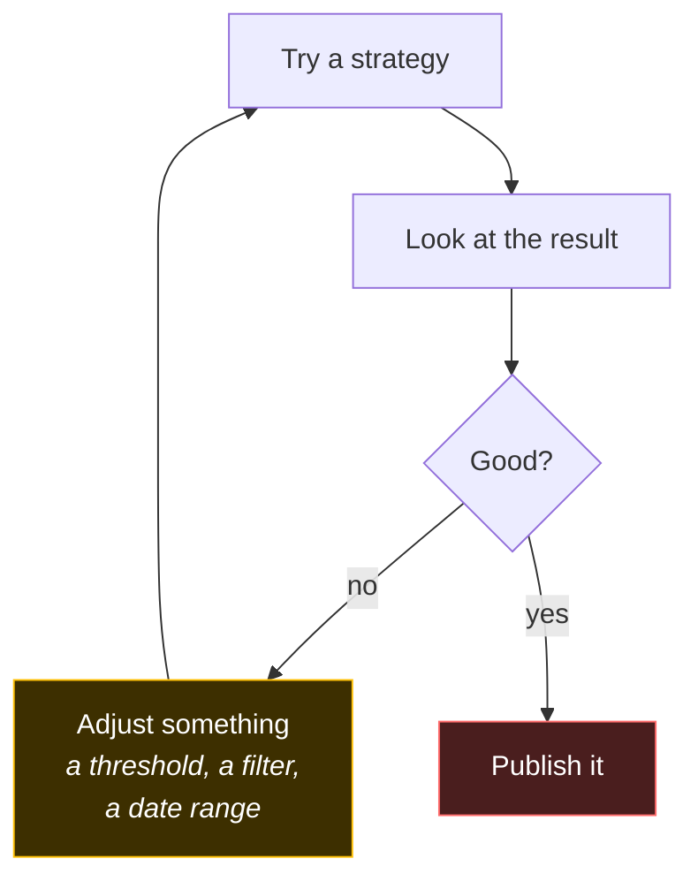
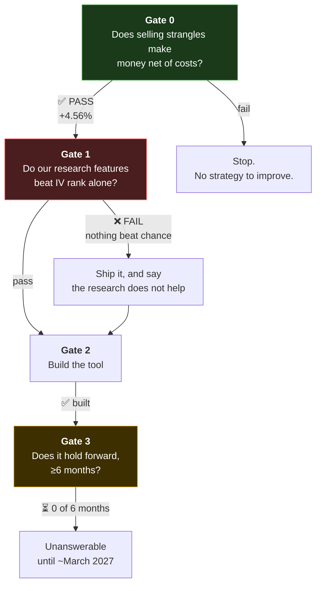

# 19 — The Four Gates

[← What a trade costs](18-what-a-trade-costs.md) · [Index](README.md) · Next: [Does it make money? →](20-does-it-make-money.md)

Backtesting a trading strategy is the easiest way to lie to yourself in all of
quantitative finance. This document explains why, and what this project does
about it.

If you read only one thing in Part III, read §2.

---

## 1. Why backtests lie

A backtest simulates a strategy on historical data and reports what it would
have earned. The trouble is that you already know what happened.

You do not have to cheat deliberately. The process corrupts itself through
ordinary, well-intentioned iteration:



Run that loop twenty times and you will find something that looks excellent. Not
because you found an edge, but because you searched a large space of
possibilities against one fixed history until something fit it. The strategy has
not learned how markets work; it has memorised 2021–2026. This is
**overfitting**, and [document 11](11-machine-learning-basics.md) covers the
statistics of it.

Three specific traps make financial backtests worse than most:

| Trap | What it is | Example from this project |
|---|---|---|
| **Look-ahead** | Using information that did not exist yet at the moment of the decision | Bhavcopy publishes *after* the close, so any filter computed from day `t` can only be traded on day `t+1` |
| **Survivorship** | Testing only on things that still exist | A universe of today's F&O stocks quietly omits every company that was delisted |
| **Multiple comparisons** | Testing many ideas and reporting the winner | Six features × three selectivities × three baselines is 54 comparisons; some will look good by chance |

And the failure mode is almost never an error message. It is **a plausible
number.** That is the recurring theme of this entire repository.

---

## 2. The answer: write the criteria down first

The defence is simple to state and hard to practise:

> **Decide what would count as success — with exact numbers — before you look at
> the result. Then report what you find, whichever way it goes.**

This is *pre-registration*, borrowed from clinical trials, where it exists for
precisely the same reason: an experimenter who can choose the success criterion
after seeing the data can make almost anything look like a success.

A **gate** here is one such pre-registered test. Four properties:

1. It asks **one** question.
2. It has a **numeric pass mark, fixed in advance.**
3. It can **stop the work**. A gate you cannot fail is decoration.
4. Its result is published at **the same level of detail whether it passes or
   fails.**

Property 4 is where most projects quietly cheat — a failure gets one line in an
appendix while a success gets a chart. This project's research half already
established the opposite habit: it published three null results at the same
resolution as its one positive one, and reported that four of eighteen Stage 1
combinations were significantly *negative*.

### Recording the prior, too

Each gate also carries a written expectation — what the project thought would
happen, recorded before the number existed.

This sounds like an odd thing to bother with. It does two useful jobs:

- **A pass means more.** If you predicted failure and got a pass, you have
  learned something that survived your own scepticism.
- **A failure is not a crisis.** It was expected, so there is no incentive to go
  looking for an alternative specification that rescues it.

That second one is the real function. **The moment a failure is embarrassing,
you start negotiating with it** — and the negotiation looks exactly like the
loop in §1.

---

## 3. The four gates



| Gate | Question | Prior, written in advance | Verdict |
|---|---|---|---|
| **0** | Does strangle-selling make money after costs? | *Likely passes* | ✅ **PASS** |
| **1** | Do this project's features beat implied-volatility rank alone? | ❌ ***Expected to fail*** | ❌ **FAIL** |
| **2** | — build only — | — | ✅ Built |
| **3** | Does it hold up forward, over ≥6 months, losses included? | *Unknown by design* | ⏳ **0 of 6** |

### Gate 0 — is there a strategy at all?

Pass marks fixed in advance: **mean net return > 0**, and **positive in at least
4 of 5 years**. Plus four mandatory disclosures that had to be published
regardless of outcome — margin sensitivity, breakeven slippage, strike
liquidity, and the skip taxonomy.

Requiring the disclosures *in advance* is what stops them from becoming
footnotes if the headline is good.

### Gate 1 — the one that actually matters

This is the gate that decides whether the research half earned its place in the
tool. The comparison is deliberately brutal:

| | Partial IC vs next-day \|return\| |
|---|---|
| `ce_iv_30` — plain implied volatility | **+0.2114** |
| **Every feature this project built** | **≤ 0.05** |

"Sell options when implied volatility is high" is a heuristic requiring no
research whatsoever, available in any free screener. **If the project's features
do not beat that, they have no business being in a trading tool** — and the
recorded prior was that they would not.

Note what this gate refuses to do: it does not compare the features to *nothing*.
Compared to nothing, almost any feature looks like it helps. The bar is the
dumbest competent alternative — the same discipline that made the expiry
calendar the baseline in Stage 1, and price momentum the baseline in Stage 5.

> **The rule, stated generally:** always compare against the dumbest explanation
> that would also produce your result. It is the single most useful habit in
> this repository.

### Gate 2 — build

Not really a gate. Its criteria are about honesty of presentation rather than
performance: the tool must state its own limits in its output, type every
refusal, and never display a refuted feature as if it were a recommendation.

### Gate 3 — the only real test

Everything in Gates 0 and 1 is **in-sample**. The strategy, its cost model, its
margin assumption and its parameters were all measured on the same 2021–2026
window that produced the verdict.

Gate 3 requires six monthly selections made *before their outcomes existed*, and
scored without omission. [Document 22](22-forward-validation.md) covers it, and
it is the most interesting gate of the four despite having no result yet.

---

## 4. Two techniques worth understanding

Two pieces of statistical machinery appear throughout the Gate 1 results.
Neither is complicated, and both exist to answer *"is this number real?"*

### Walk-forward selection

Suppose you want to know whether a filter helps. The naive test — apply it
across all six years and compare — is contaminated, because you chose the filter
*after* seeing those six years.

Walk-forward simulates the constraint a real trader lives under:

```
   Pick the best filter using data up to 2022  →  trade it in 2023,
                                                  record the result
   Pick the best filter using data up to 2023  →  trade it in 2024, record
   Pick the best filter using data up to 2024  →  trade it in 2025, record
                                                  …
```

Each year is traded with a filter chosen using **only information available
before that year began.** The recorded results are then what a person actually
following the method would have earned.

This is much harsher than the naive test, and it is the honest one. In Gate 1,
walk-forward came out **negative for five of the six features** — including
some that looked fine in the full-sample view.

### The block bootstrap

You have 7,706 trades and a mean return of +4.56%. How sure can you be that this
is not luck?

The textbook answer assumes every observation is independent. **Market data is
not.** Everything moves together in a given month: if October 2023 was calm,
every strangle that month won, and those are not 200 independent pieces of
evidence about the strategy — they are closer to one.

The **moving-block bootstrap** respects this. Instead of resampling individual
trades, it resamples *contiguous blocks of months*, thousands of times, building
a distribution of results the strategy could plausibly have produced. If the
observed result sits comfortably inside what chance produces, it is not
evidence.

Gate 1 used a **monthly block bootstrap**, and it is what produced the gate's
most useful sentence: the only statistically significant result among the six
features tested was a **harmful** one.

---

## 5. What a failed gate is worth

Gate 1 failed. Its prior said it would. That could be read as a wasted phase,
and the project explicitly argues it is not:

> A Gate 1 failure still leaves a working strategy, a reusable
> cost/margin/slippage model, and the **measured statement** that the research
> does not improve it. That is a result, and it goes in `docs/trading/results/`
> at the same resolution as a positive one.

There is also a practical dividend. Because Gate 1 failed, the tool built in
Gate 2 is **simpler and more honest** than the one originally specified: it
cannot rank candidates by a predictive score, because it was measured that no
such score exists. What it does instead is the subject of
[document 21](21-the-daily-screen.md), and it is a better tool for the
constraint.

[← What a trade costs](18-what-a-trade-costs.md) · [Index](README.md) · Next: [Does it make money? →](20-does-it-make-money.md)
