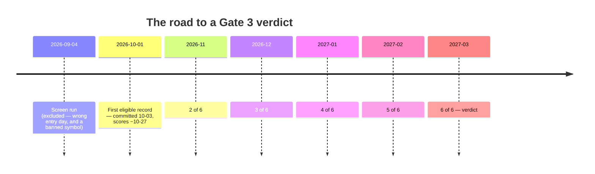

# 22 — Forward Validation, and the +94.55% That Does Not Count

[← The daily screen](21-the-daily-screen.md) · [Index](README.md) · Next: [Glossary →](23-glossary.md)

Gate 3 has no verdict yet. **One eligible record is in place** (2026-10-01,
scoring from ~27 October) and five more are needed, so it will not be answerable
until roughly **March 2027**.

It is also the most interesting document in Part III, because what it *does*
have is a demonstration — on this project's own work — of exactly how a backtest
disguises itself as a forward test.

---

## 1. Why everything so far does not count

Gates 0 and 1 are **in-sample**. That word does a lot of work, so here is what
it means concretely.

The strategy's parameters — which delta to sell, when to adjust, when to exit,
which months to skip, what margin to assume, what costs to charge — were all
chosen while looking at 2021–2026. The verdict was then computed on 2021–2026.

Even with perfect discipline and no deliberate tuning, that arrangement flatters
the result, because every choice was made by someone who had already seen the
data. The project says this about its own research half too:

> Subset stability is weaker evidence than an independent test.

The remedy is not a cleverer statistical correction. It is **time**: make a
prediction, wait, and see.

---

## 2. What makes a record count

Four conditions. Three are bookkeeping. The fourth is the whole gate.

| # | Condition | Why |
|---|---|---|
| 1 | Entered on the month's **first trading day** | The backtest always does. Any other entry is a shorter-dated position at different strikes, drawn from a distribution nobody measured. |
| 2 | **Committed to git before its outcome existed** | ⭐ §3 |
| 3 | Something actually scored | An open month has no outcome to contribute |
| 4 | **Losing months included** | Non-negotiable — §5 |

### Why condition 1 is stricter than it looks

Entering on the 4th instead of the 1st does not just shift the dates. It is a
**26-day position instead of a 30-day one**, at strikes chosen from a different
spot price, with less premium collected and less time for decay to work.

The backtest measured 30-day positions entered on day one. It says nothing about
26-day positions entered on day four. Those might be better; they might be
worse. The point is that **nobody measured them**, so counting one as evidence
for the measured strategy is a category error.

---

## 3. Condition 2 is the entire gate

> Every other criterion can be satisfied by a record written *after* its outcome
> was already known. That is a backtest wearing a forward test's filename, and
> producing one is trivially easy.

Here is why a git commit, of all things, is the evidence.

A file dated "2026-03-02" saying "I would have sold these six strangles" proves
nothing. You could have written it in March, or you could have written it in
September after looking up what happened in March. The file's *contents* cannot
distinguish those two, and neither can its filesystem timestamp, which anyone
can set.

A git commit can. It is a cryptographically chained, externally verifiable
record of when a piece of text came into existence. So the harness does not ask
whether a record *says* it is forward-looking — it reads the commit that
introduced the file and compares that date to the positions' expiry:

```python
committed_at(record)  <  expiry_of_its_positions   # or it does not count
```

**An uncommitted record is excluded however good its numbers look.**

---

## 4. The demonstration: a +94.55% return the tool refuses to count

This is the part worth reading twice.

While building the scoring harness, eight screens were generated for the months
February through September 2026 and scored. The results:

| | |
|---|---|
| Mean monthly portfolio return | **+11.80%** |
| Positive months | 5 of 8 |
| **Cumulative** | **+94.55%** |

A near-doubling of capital in eight months. On any ordinary project this is the
headline — a chart, a bold number, a paragraph about the strategy validating out
of sample.

**None of it counts.** Those records were written on 2026-09-11, for months
whose outcomes were already sitting in the database. The harness excludes all
eight and says why:

```
GATE 3: INCOMPLETE — 0 of 6 months recorded
  0 eligible month(s)  (8 excluded)
    8 — not committed before its outcome
```

### ⚠️ A correction: this was not evidence the check works

An earlier version of this document presented the exclusion above as *"the
strongest evidence available that the check works."* **That was wrong, and the
reason is instructive enough to leave in rather than quietly edit out.**

`committed_at` was broken from the day it was written. It asked git for the file
using a path relative to the project root, while telling git to look from inside
the `screens/` folder — so git searched for
`screens/docs/trading/results/screens/screen-X.md`, found nothing, and answered
"no commit." **It answered "no commit" for every record ever written**, so
`provenance_verified` was false universally and **Gate 3 could never have been
passed**, no matter how many honest months were recorded.

The eight backdated screens were therefore refused because *everything* was
refused. Right answer, broken reason.

It stayed hidden because it failed in the **safe** direction — the output was
correct and no published verdict was ever wrong — and because "I can't verify
this" is a legitimate answer for that function to give. It surfaced in October
2026 only when a record that genuinely *should* have passed was refused.

> **A check that fails closed cannot be tested by anything it rejects.** You have
> to hand it something that ought to pass. The fix, and tests exercising a real
> git repository in both directions, are in
> [document 15 entry 19](15-bugs-and-lessons.md).

### Why the rule is still the right rule

Any project can *claim* it has a strict validation rule. The rule only means
something when it costs you something, and here it cost the most attractive
number the project has ever produced.

Note also how *innocent* the failure mode is. Nobody faked anything. Someone
built a harness, needed test data, generated screens for recent months because
those were the months with data, and scored them. Every step is reasonable. The
output is a +94.55% cumulative return that looks exactly like a forward test and
is entirely a backtest.

> **That is how this happens in practice.** Not through fraud, but through a
> sequence of individually sensible steps whose combination is invalid. The
> defence has to be mechanical, because judgement will not catch it — the
> numbers look fine, and you want them to be true.

### The second exclusion, which was a real mistake

One genuinely forward record exists:
[`screen-2026-09-04.md`](../../trading/results/screens/screen-2026-09-04.md) —
six positions, ₹493,581 of margin, ₹100,642 of net credit, expiring 2026-09-29.
It was committed on 2026-09-11, when the outcome could not be known.

**It is excluded anyway**, on two counts. It entered on 2026-09-04 when the
month's first trading day was 2026-09-01 (condition 1) — and it contained
**INOXWIND, which was in an F&O ban on its entry date** and so could not legally
have been opened at all ([document 15 entry 18](15-bugs-and-lessons.md)).

Its outcome is now known: **+0.30% portfolio return, worst trade −61.69%**,
against a backtested +4.93% mean monthly. It contributes nothing to the verdict,
and at one month — containing a position that could not have been taken — it is
not evidence of much either way.

That was an unforced error — the screen was run on the latest available data
rather than on the correct date — and the fix is a discipline, not code: **run
the screen on the first trading day of the month.** The tool now warns when it
is not, and the record carries the warning on its face.

What was *not* done is more instructive:

> No 2026-09-01 record was manufactured to replace it. Generating one on
> 2026-09-11 would claim fills at prices ten days stale — forward with respect
> to the outcome, backward with respect to the entry.

The first eligible record **is** October 2026's first trading day:
`screen-2026-10-01.md` — 7 positions, ₹492,066 of margin, ₹117,269 of net
credit, committed 2026-10-03 at 14:15 IST, 24 days before its 2026-10-27
expiry. It scores from roughly 27 October.

It was written two days after its entry date and **says so on its face**, which
is the honest form of the thing this section is about. The gap is safe here for
a reason the record states and the data verifies: **no trading session closed in
between** (2026-10-02 was Gandhi Jayanti, 10-03 a Saturday), so the selection
used no information a trader lacked at the 10-01 close.

That distinction — *sessions closed*, not *days elapsed* — is the one that
matters, and it is now computed rather than argued. Every screen is necessarily
generated after its own entry date, because the backtest enters at the first
trading day's **settlement** and bhavcopy publishes only after the close. A
record claiming to have been written *on* its entry date was always the thing to
fix, so `sessions_after_entry` now appears in every record, and a non-zero count
prints as hindsight-contaminated.

---

## 5. The standard this page is held to

**Every scored month appears, including the losses.** No "since inception
excluding the outlier", no quiet omission of a bad month.

`running_record()` performs no filtering at all. The only exclusions are the
four eligibility conditions in §2, and each one is reported with its reason and
its count.

This is the same standard the research branch applied when it reported that four
of eighteen Stage 1 combinations were significantly *negative*, and when it
published three null results at the same resolution as its one positive.

---

## 6. The criteria, and the timeline

| # | Criterion | Status |
|---|---|---|
| 1 | ≥ 6 eligible months, none omitted | ❌ **0 scored, 1 pending** |
| 2 | Realised return consistent with Gate 0 | pending |
| 3 | No month beyond twice Gate 0's worst (−16.12%) | pending |
| 4 | Every record committed before its outcome | pending |

**Verdict: INCOMPLETE.** Answerable around **March 2027** — six monthly cycles
from October 2026.



---

## 7. What six good months would — and would not — establish

This section exists because the obvious reading of a Gate 3 pass is wrong, and
the project pre-emptively says so.

Gate 0 measured a **67.1% win rate with a fat left tail**. Premium selling wins
most months *by construction* — that is the shape of the trade, not evidence of
skill. So six profitable months is roughly what you would expect from:

- a strategy with a real edge, **and**
- a strategy with no edge at all.

The difference between those two lives entirely in the tail. And six months is
not enough time to sample a tail that, by the strategy's own history, shows up
perhaps once a decade.

> **A run of profitable months does not establish that the tail risk has been
> survived. It establishes that the tail has not yet arrived.**

That sentence is returned by `gate_3_report()` **on every call**, so it cannot
be accidentally omitted from a write-up. This is the same engineering habit as
the screen printing its own caveats: if a limitation matters, it belongs in the
output, not only in a document somebody may not read.

The 2021–2026 sample contained no severe crash. If the forward period contains
none either, then Gate 3 passing confirms the strategy behaves as measured **in
ordinary conditions**, and says nothing whatever about the −37.27% drawdown,
which remains unmitigated and is still the binding constraint on the whole
enterprise.

---

## 8. The wider principle

This project now has **four** dated, committed, falsifiable predictions:

| Record | Predicts | Scorable |
|---|---|---|
| `nowcast-2026-08-28.md` | MF accumulation ranking, IC ≈ +0.1145 | ~2026-11-14 |
| `nowcast-2026-09-06.md` | MF accumulation ranking, IC ≈ +0.1266 | ~2026-11-14 |
| `screen-2026-09-04.md` | Six strangle positions | scored: **+0.30%** (Gate-3-excluded) |
| `screen-2026-10-01.md` | Seven strangle positions | ~2026-10-27 — **Gate 3's first** |

All four can fail. That is what makes them worth having, and it is the habit
this project would most like a reader to take away:

> **Write the prediction down before the outcome exists, in a place whose date
> someone else can verify, and then report what happened.**

Everything else in these twenty-four documents — the placebo tests, the calendar
baselines, the partial correlations, the block bootstraps, the leakage tripwires
— is an approximation of that one idea, applied to data where the outcome has
already happened and you have to work hard to pretend otherwise.

Here you do not have to pretend. You just have to wait.

[← The daily screen](21-the-daily-screen.md) · [Index](README.md) · Next: [Glossary →](23-glossary.md)
