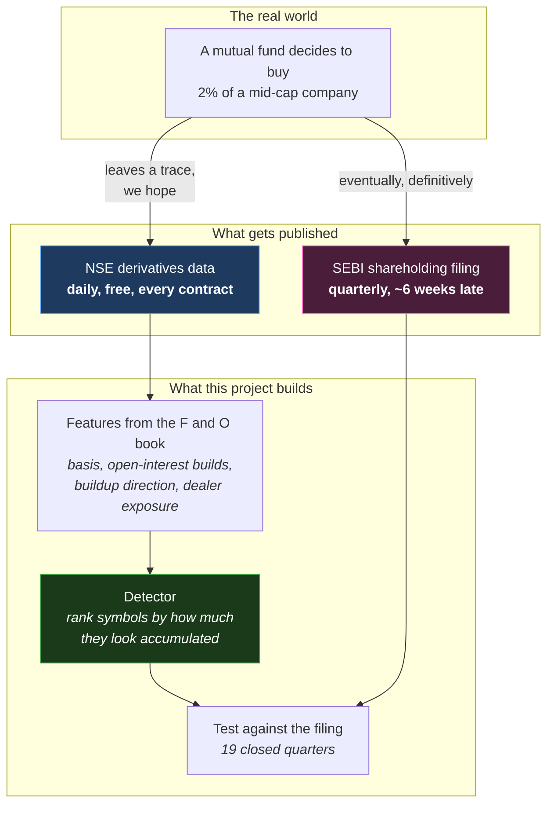

# Understanding MktMtm — v1

**A complete, ground-up explanation of this project, written for someone who has
never bought a share in their life.**

There are two kinds of documentation in this repository. The rest of `docs/` is
written *for the builder* — it assumes you know what an option is, what a rank
IC measures, and why a placebo test matters. This folder is written *for the
reader*: it starts at "what is a share?" and does not skip a step between there
and "we detect mutual-fund accumulation at a partial information coefficient of
+0.1374 across 18 of 19 quarters."

Nothing here is a summary. Every number in this folder is the same number the
technical documents report, and where the project measured something
disappointing, this folder says so in the same detail it uses for the successes.
That is deliberate: **most of what this project has established is negative**,
and a version of the story that hides that would be a worse piece of research
writing, not a friendlier one.

---

## What this project is, in four sentences

Large investors — mutual funds, foreign funds, insurance companies — move
enormous amounts of money in and out of Indian stocks. Nobody tells you when
they do it; you find out months later, in a regulatory filing. This project asks
whether their activity leaves a **detectable trace in the derivatives market**,
which publishes far more detail, far sooner, for free. The answer, after five
modelling stages, is: *mostly no, but in one specific and carefully-tested case,
yes.*

**And then it asks a second question.** Having built a detector that works, the
project measured whether an ordinary trader could profit from it — and found
that they could not, for reasons that are not the detector's fault. So the work
pivoted a second time, to a strategy that needs no direction forecast at all:
**selling volatility**. That is Part III, and it has its own strategy, its own
economics, and its own four-gate testing discipline.

---

## Read these in order

The folder is in three parts plus two reference documents.

- **Part I (01–06)** is pure background — no code, no project. If you already
  know what a call option and open interest are, start at #07.
- **Part II (07–16)** is the research project: detecting institutional flow.
- **Part III (17–22)** is the trading tool: selling volatility. It follows from
  Part II but can be read on its own if you know what an option is.
- **23 and 24** are reference — a glossary and a file-by-file map.

| # | Document | What it covers |
|---|---|---|
| 01 | [What a market actually is](01-what-is-a-market.md) | Shares, companies, exchanges, prices, why a price moves at all. Absolute zero assumed. |
| 02 | [Who trades, and what a "whale" is](02-who-trades-and-whales.md) | Retail, mutual funds, FII, DII, insurers, proprietary desks. Why big players cannot move quietly. |
| 03 | [Futures and options](03-futures-and-options.md) | Derivatives from first principles: futures, calls, puts, strikes, expiry, lot size, and the crucial buyer/writer asymmetry. |
| 04 | [Open interest — the footprint](04-open-interest-the-footprint.md) | The single most important idea in the project. Volume vs open interest, the option chain, the futures basis. |
| 05 | [Pricing, volatility and the Greeks](05-pricing-iv-and-greeks.md) | Black-Scholes, implied volatility, delta and gamma, and why a dealer's hedging is *forced*. |
| 06 | [How derivatives feed back into the stock market](06-how-derivatives-move-markets.md) | The mechanism the whole project bets on: why option positions cause real buying and selling in the actual stock. |

### Part II — the research project

| # | Document | What it covers |
|---|---|---|
| 07 | [The project idea](07-the-project-idea.md) | The research question, why it is *detection* and not *prediction*, and the missing-label problem that shapes everything. |
| 08 | [The data](08-the-data.md) | Every source we download, field by field, what it means in the market, and what it cannot tell us. |
| 09 | [The pipeline](09-the-pipeline.md) | How 60 million rows of raw exchange files become a table a model can read. |
| 10 | [The features](10-the-features.md) | Every number we compute from the raw data, what it is supposed to mean, and whether it worked. |
| 11 | [Machine learning, only the parts we use](11-machine-learning-basics.md) | Rank correlation, AUC, train/test splits, partial correlation, bootstraps, placebos. Enough to read the results honestly. |
| 12 | [The models, stage by stage](12-the-models.md) | All six modelling stages: what each asked, how it was built, and what it answered. |
| 13 | [The journey](13-the-journey.md) | The chronological story — including the two approaches that were abandoned and why. Covers both `main` and this branch. |
| 14 | [Results, in plain terms](14-results.md) | What we can and cannot claim, with the numbers translated out of statistics into English. |
| 15 | [Bugs we found, and what they taught](15-bugs-and-lessons.md) | Sixteen defects, nearly all silent — eleven from the research, six from the trading branch. Arguably the most useful document in the folder. |
| 16 | [Running it yourself](16-running-it.md) | The commands, in order, with timings and what to expect. |

### Part III — the trading tool

| # | Document | What it covers |
|---|---|---|
| 17 | [Selling volatility instead of predicting direction](17-selling-volatility.md) | Why the detector cannot be traded, what "selling volatility" means, and who pays the premium. |
| 18 | [What a trade actually costs](18-what-a-trade-costs.md) | Lot size, the six statutory charges, margin, slippage — with a worked example from points to a return. |
| 19 | [The four gates](19-the-four-gates.md) | How to test a strategy without fooling yourself. Pre-registration, walk-forward, the block bootstrap. |
| 20 | [Does it make money?](20-does-it-make-money.md) | Gate 0 (pass), Gate 1 (fail), and the stop loss that made everything worse. |
| 21 | [The daily screen](21-the-daily-screen.md) | The actual tool: refusals, risk caps, sizing, and a real run read line by line. |
| 22 | [Forward validation](22-forward-validation.md) | Gate 3, why a git commit is the evidence, and the +94.55% the tool refuses to count. |

### Reference

| # | Document | What it covers |
|---|---|---|
| 23 | [Glossary](23-glossary.md) | Every term, alphabetically. |
| 24 | [The rest of the repository](24-the-rest-of-the-repo.md) | Everything off both narrative paths — the UI, the API stub, the legacy pipeline, testing — plus a file-to-document map. |

---

## The whole system, in one picture

The left-hand path is fast and anonymous. The right-hand path is slow and
named. The project's entire job is to learn the mapping from one to the other.

---

## The honest scoreboard

| Question asked | Answer |
|---|---|
| Can we predict tomorrow's market-wide institutional flow? | **No.** A calendar-only baseline wins. |
| Do trading days fall into persistent "positioning regimes"? | **No.** Nothing lasts more than ~1.6 days. |
| Can we split a market-wide flow number across individual stocks? | **Unproven.** It decomposes, but the validation test fails. |
| Does directional positioning continue day to day? | **No** — but futures do lead options by 2–3 days, for microstructure reasons, not whale reasons. |
| Does dealer gamma exposure predict volatility? | **No**, in the direction theory predicts. A weaker magnitude effect survives. |
| **Can we detect mutual-fund accumulation in a named stock?** | **Yes** — modestly, consistently, and it is the one result that survives every control applied. |

Document 14 makes each of those precise.

And for the trading tool:

| Question asked | Answer |
|---|---|
| Can the detector be traded? | **No.** Score → next quarter's return is +0.0200, 11 of 19 quarters. |
| Does selling strangles make money net of costs? | **Yes** — +4.56% per trade, positive in 6 of 6 years. |
| Do our research features improve it? | **No.** Nothing beat a random filter — including implied-volatility rank. |
| Does a stop loss reduce the risk? | **No.** It made return, worst trade, drawdown and Sharpe all worse. |
| Has it been validated forward? | **Not yet.** 0 of 6 months; answerable around March 2027. |

Document 20 makes each of those precise.

---

## A note on how to read the numbers

Financial research is unusually easy to fool yourself in, because there is a
great deal of data and almost all of it is noise. Three habits run through this
whole project, and if you take nothing else from this folder, take these:

1. **Always compare against the dumbest possible explanation.** Before believing
   a feature detects institutions, check that it is not just detecting "the
   stock went up" or "it is expiry week."
2. **Report the control, never the raw number.** A feature that correlates
   +0.36 with the answer and +0.36 with the dumb explanation has found nothing.
3. **Write the prediction down before the outcome exists.** This project has
   three such records — two nowcasts
   ([`nowcast-2026-08-28.md`](../../results/nowcast-2026-08-28.md)) and one
   trading screen — each committed to git before the data to score it existed.
   They can fail. That is the point, and
   [document 22](22-forward-validation.md) shows what happens to a +94.55%
   return that does not meet the standard.
